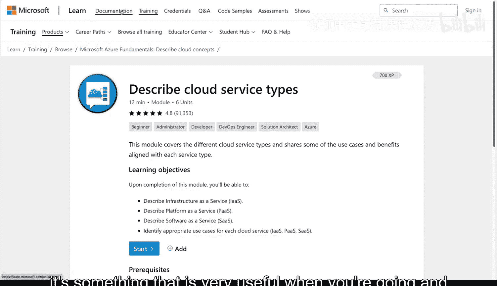
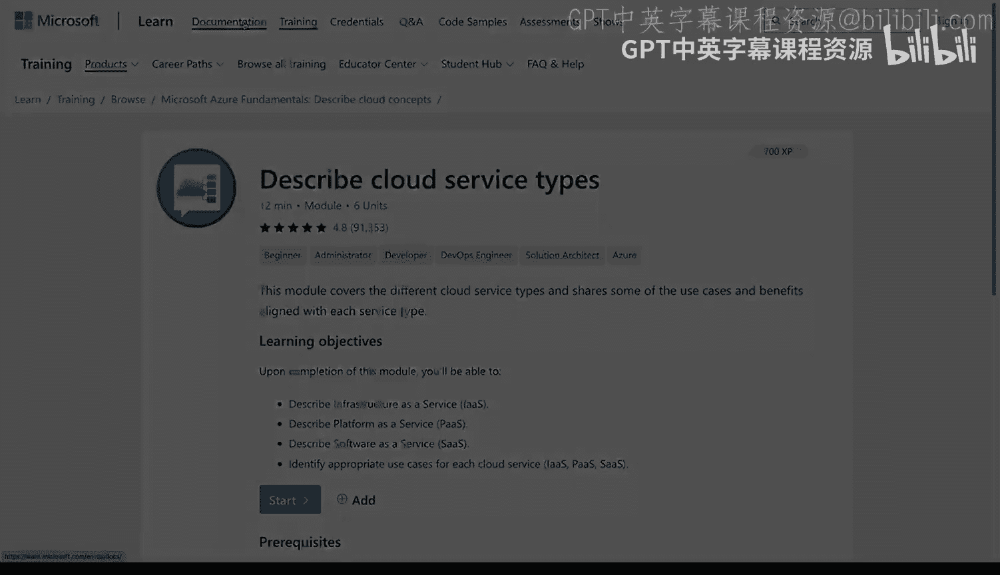

# 杜克大学《大型语言模型实践（生成式AI简介、Azure的LLMs（1、2课，共6课）｜Large Language Model Operations》 - P82：05_01_04_使用Microsoft Learn.zh_en - GPT中英字幕课程资源 - BV1Ef421m7zD

Learn that Microsoftsoft。com is the URL that you should feel also familiarized with when you're working with Azure and anything related to the things that we're going to cover here for LLM ops and large language models but in general anything Azure you will want to come here and in this case what we have here is the landing page for Microsoft learn and you have all kinds of different things here learn by doing technical documentation。

 but I would categorize these with certain distinct distinct sections here that are very important one。

 of course is the documentation you have documentation and pretty much everything regarding Azure you also have the training which we'll cover in a second but you have also some code examples So let's start by the end going into the code samples I'm going go click there。

And what we have here， likes say， for example， if I go and search Open AI。And I hit return。

 you can see here that I looked already a vector similarity search with Azure SQL and Azure Openai。

 So let's very quickly click on that one and it's just examples that I can use to expand my knowledge on something specific in this case。

 Azure SQL and Azure Open AI how to perhaps integrate them integrate these services together。

 create a vector table so it sounds very similar to something that I might perhaps be interested。

 Okay， so you know you have some good samples that is very good you can definitely do that Now what is the difference between that and documentation。

 Well， if you go to documentation and you say， well， I want something about Azure Open AI service。

And I heat return on that。You will get。You will get a documentation that is very closely related to the exact specific service that you want。

 so you can get like say， for example， a quick start and generate images or Azure Openai service documentation So this seems like the landing page and you see the URL well this is kind of like small right here so actually let's make it bigger and the Azure Open AI service this is like the landing page right here slash Azure AI services openaiI So this seems like the root。

 the very root for everything regarding the service documentation So you get all kinds of different things like the quickstar。

And in detail things that are specific to the Azure Open A， let's take a look at open AI models。

And you will get very top down type of documentation for everything related to in this case。

 Azure Open AI here at the left you'll have this。Contents table of contents that you will get from the quick starts。

 concepts and tutorials。 take a quick look at tutorials let's say I want to do fine tuning on G 3。

5 turbo and it will guide you through everything you need to know in order to accomplish everything that in this case this article describing how to do a fine tuning job for G35 turbo so it will give you all of the prerequisites and some of the warnings on some of the constraints that you may have so that is good and this is very specific to that and sometimes in some cases you will get certain differences between Python and and other things and the last thing is the training and when you go to training you are going to learning paths and learning paths of course you have many different things so say for example if you go here you will be able to learn as you go on specific concepts and you'll have to sign。

To keep track of where you're going and that is effectively something that you may want to use。

 but I would first go into the code samples and the documentation as a first stop and it's something that is very useful when you're going and making progress with Azure and doing LLMs with Azure。

