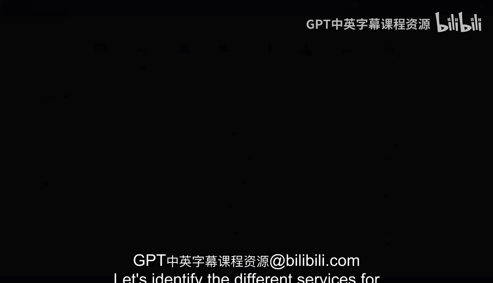
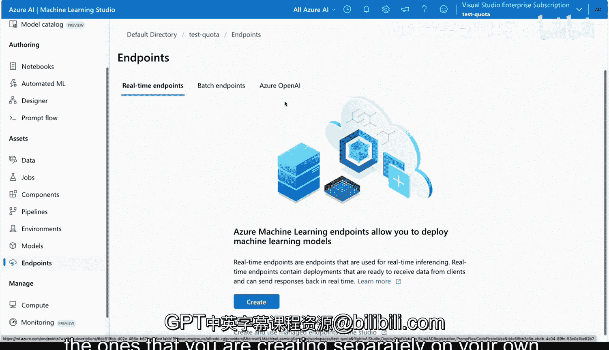

# 杜克大学《大型语言模型实践（生成式AI简介、Azure的LLMs（1、2课，共6课）｜Large Language Model Operations》 - P83：06_01_05_识别Azure AI解决方案.zh_en - GPT中英字幕课程资源 - BV1Ef421m7zD

Let's identify the different services for running machine learning model in Azure or with Azure rather So here I'm back at the portal and in the portal there's two things that I want to show you one is Azure Open AI service and the R one is Azure Ma learning so these two are distinct they're different and having a quick overview even though we haven't gone into details as to how to create or manage or do anything with Azure Open AI or Azure machine learning。

 it is useful to have like like a quick overview on how these things are actually different。

 So if I go to Azure Open AI and here you'll see that I have already an instance created let's not worry too much write the second as to how I can get one created but let's quickly open one go to Azure Open AI Studio there and once you are。

In there once these loads， you will see that you have the capabilities of interacting with open AI models in Azure in Azure itself。

 so this is not so anything in Azure open AI service is not running on openaiI so this is distinct。

 this is different because these models will come actually in in Azure so you can select the deployments you can see here you have a whole selection of models that you can try and these models can be used for specific deployment so all of these ones can get deployed and you can see that several of them have been updated recently and this will get refreshed all of the time and you can do all kinds of different things now you don't see any other models these models come from open AI but。

these reside within Azure within your own subscription and these are only part of your service。

 your account that you can in isolation set whatever constraints you want to do with them so that is Azure Open AI and Azure Open AI studio in this case what about Azure Ma learning so I'm back in my Azure portal and I'll go into Azure Ma learning here and if I click there you will see that I have this one already here already a service of Azure Ma learning this means that you can have many different instances and this case I only have one and I'm going to click that one and I'm going to go to Azure Ma learning Studio so I'm going to launch the studio and that is different from Azure Open AI service in the sense that I can do all kinds of different things with other different models if I。

Here I do have access to some of the language models from here。

 but I can also get access to some other models like including vision models so instead of just having close selection for natural language processing models I do get that access as well however you do have access to kind of other tools that will allow you to create your models from scratch auto automated ML or automl is one of these ones where you can actually set your own data and aure behind the scenes to actually produce some of these models automatically trying to figure out what is needed so you'll get useful resources like the tutorial on how to create your first classification model or creating accurate forecasts。

 so that is actually very good there's some other some other tools like the signer and Prom4 which we will not。

to details right now， but it's useful to know that these tools are around so that they can allow you to create your own models and author your own models and deploy them later when you want some real time inferencing and you can have these endpoints that you can actually deploy and as you can see I don't have anything deploy here and that is why I've been asked to create one so those are the differences between between the services and it is useful to know that they're distinct Azure Open AI for models that are coming from open AI that will allow you to deploy open AI models and Azure Maine learning studio to deploy other models as well as the ones that you are creating separately on your own。

