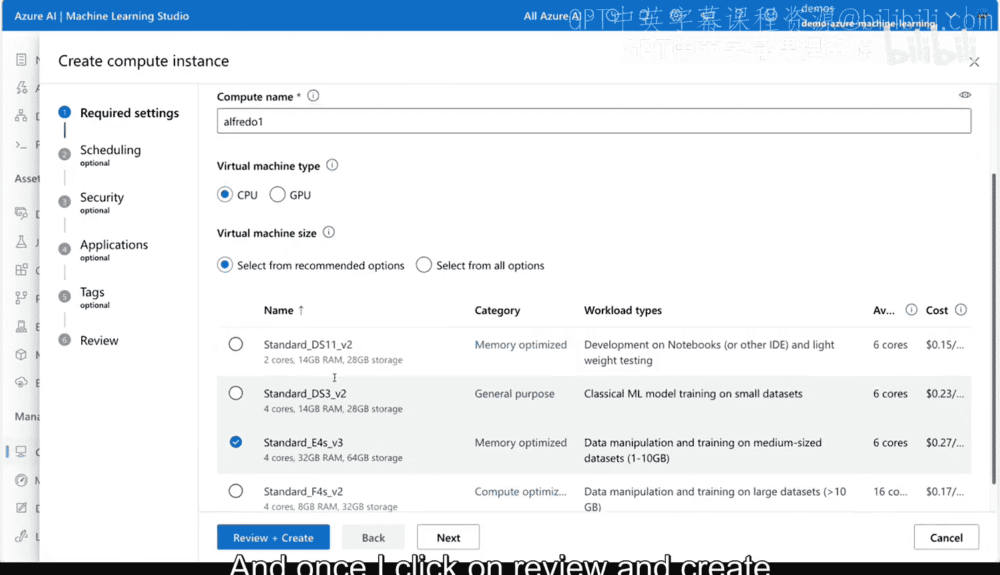
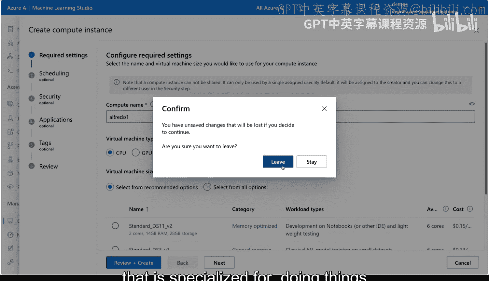
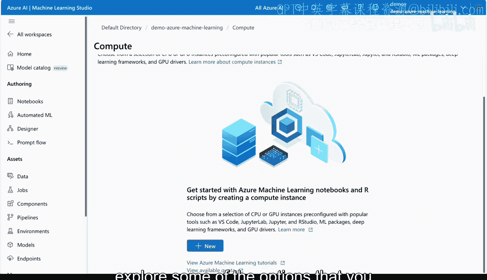

# 杜克大学《大型语言模型实践（生成式AI简介、Azure的LLMs（1、2课，共6课）｜Large Language Model Operations》 - P84：07_01_06_Azure机器学习简介.zh_en - GPT中英字幕课程资源 - BV1Ef421m7zD

Let's see how we can get started with Azure Ma Learn studio back here in the Azure portal and Azure Ma learning is here now if you don't see it。

 these are your most recent recently used Azure services so I can rely on that specific actual services that you've deployed maybe showing up here these are actually instances of each of these services now if you don't find it there you can go and click on this one or search for it here so let me see I say Azure Ma learning you will see that you will start populating so it populates and it' right there and so I'm going to click there and I'm going to be brought up to these screen in here you will have anything that you've previously created like I have right there or you can have the option to create one if you desire now I want to create a new one because I want to show you exactly what you will need。

So I will be creating a new workspace so it's a new instance of Azure machine learning which will hold everything that I want so I'm going to create a new workspace and I have several different descriptions so for this one I'll pick that one and one thing that I highly recommend for resource groups is to create something that is meaningful to use so in this case I'm going to say demo Azure machine learning Now what is ideal here with the research groups is that it allows you to group your things together so I'm going to say okay and then I'll help me identify the resource later and I can remove them also later as well so for this one I'm going to call it the same demo Azure machine learning。

And you will see that all of the other things that this is requiring will be created as well。

 It will need a storage account。 It will need a keyboard and application insights。

 These are all required and it will be created for you once you go ahead and create that one thing that is important to note the container registry will not be created in this case it defaults to none。

 but I can actually create a new one If I so the to create containers and use that container registry in this case I am not and I'm gonna click review and create iss going through go through some validation process and make sure that everything' is right。

 note that the region for this is is US2 and in case you want something different you need to make sure that that is selected in this case for me is US2 is fine。

 I'm going gonna click create。And this is going to take a second， iss going to initialize。

 it's going to submit deployment， and then the deployment is going to say in progress。

 This will take a couple of minutes and you'll see some of these resources will start populating。

 so let's just wait it out until these completes。 All right so this is complete and you can see that I get that and you also get notified。

 you might get a popup right on this corner in this case I'm going to go to the resource So the resource has been created and I get here。

 here's where you you'll find some some things like settings for the workspace like network networking properties you might want to set some tags and activity log but what you really want is to launch studio。

 so when I click here and it will launch studio for me and will have our workspace our workspace will allow us to do all kinds of different things I mentioned before the Azure open AI models even though if I click here model catalog even though that you will see them right here。

If I click on view the models and keep scrolling down。

 you will see that I have several of the Azure OpenaiI models。

 but if I click on these ones and I want to deploy them。

 it will guess what you will tell me you need to go and deploy them using the Azure OpenaiI resource。

 So you are not going to be doing them through the Azure machine learning studio。

 So you will be taken over to the other Azure OpenaiI。

 Now let's concentrate a little bit more on Azure machine learning studio you will have here on the left all kinds of different links for settings。

 I really like poking around the notebooks。 in this case， you can see that it has my username there。

 if I really like the samples。 So if you you want to try certain things， you have tutorials。

 all kinds of different tutorials like Azure machine learning getting started。

 we can click on this one and you will be able to go and execute your notebooks right there。

 So pretty interesting way to start。Playing around with Azure Ma learning Studio and definitely something that I highly suggest you should try。

 Now whenever you have models， those will appear right here， I currently don't have anything。

 but if you have a module that a model that you have created in na machine learning that will show up here you can also register a model you can upload a model by uploading from local files or you can import them from a data store that is somewhere that has storage and you want to put it in there。

 endpoints is whenever you have something deployed you you can have realtime once batch or from Azure openaiI in this case I don't have any but this would if you have a model if you've deployed it。

 you can have that facility there。 The last thing that I want to show you is a compute portion where you can have compute instances。

 compute clusters， Kubernetes clusters and attach computes attach computes from somewhere else in Azure Kubernetes clusters well it's a cluster from Kubernetes that you can actually create。

You can create a new one， you can have compute clusters for doing all kinds of different jobs and compute instances。

 so for example， if you want to attach it to one of the Uter notebooks that we saw before so if you create a new one youll grab a full you'll have a selection here depending on the type of virtual machine types so if I say GPU then you'll have certain different selections in this case I don't have the ability to basically run some of those models so or actually in machines or resources but CPUU I do have several different ones and these are recommended options for the types of things that I want to be doing once I click on review and create that instance that bridge machine that is specialized for doing things with machine learning well show up so I'm going to say leave and that is essentially a very quick overview how you can get Azure AI a machine learning studio run。

And set up and explore some of the options that you might be using with a lot of frequency。

