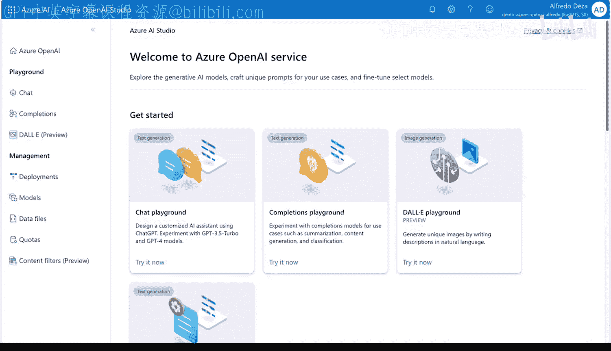

# 杜克大学《大型语言模型实践（生成式AI简介、Azure的LLMs（1、2课，共6课）｜Large Language Model Operations》 - P85：08_01_07_Azure OpenAI服务简介.zh_en - GPT中英字幕课程资源 - BV1Ef421m7zD

For Azure Open AI， I'm going to go again back to the Azure portal and I'm going to look at my service again。

 if it's recently used， you'll find that service there。

 if you have deployed or created an instance of Azure OpenaiI service you will see it right here on the resources if you need to find it because you've not deployed one or have not visited the Azure openaiI service。

 then you will see it or right here on the service I'm going gonna to click on that one and if you've created one resource before you will see it right there in this case let's assume that I don't have anything there and I'll just create a new one So for creating you will see that same options as before youll have to select a subscription and either create a resource group or reuse one in this case I don't want to reuse a resource group I want to create a new one and for this one you'll guess that I will use demo and I'll。

Demo Aure Open AI。And actually open AI is misspell。

 I'm going click OK and that will make sure that I understand what this means and then I can delete and clean up all of the resources actually you can see here that I was deleteleting some other resource group and I got notified over there Allright so region is pretty important quota is selected by region so if you click here you you'll see all of the other regions available So if you have quota for a specific region。

 make sure that you pick the right one so let's create the instance details in this case when I say demo Azure OpenaiI as well just same as the resource group you are not required to name this one as the resource group and you might get into trouble because if that name is already taken in the Azure universe for for open AI service。

 then youll get into this problem where you'll say that the domain the subdomain name is already used this is because it will use DNA。

You will create a domain name entry and that subdomain will have to be unique so one thing that I tend to do here is I say I put my name and that usually tends to fix things and lo and behold out of my name and nobody has a demo Azure openaiI Alfredo All right pricing ti there is only one which is a standard and that's it so I'm going to click well you can see the full pricing details as well and it will open up a new a new tabs I'm going to go back and I'm going to click next and it will say hey how do you want to expose some of these models that you will be able to deploy and you have Tanie a selection here this is unique to the Azure Open AI service and it's what sets set apart from other services you could technically set this behind behind a farable and you can say hey I want to disable this completely except for something that。

That I can configure with a private endpoint and you can do that also you can say select the networks and configure network security for your Azure AI services。

Now， certain options to consider for sure， and I'm going to keep it all opens when I click next。

And you can have tags if you want to， that's optional to help you identify some services in Azure。

 I'm going to leave that empty。 And finally， I'm going to do a review and submit and click on create and this will initialize submit and set the deployment in progress and you'll see that some of the resources well start to get populated here So we'll come back once that is complete All right deployment has succeeded。

 you can see that I get that over there。 so I'm going to click on go to the resource and then I'm going to scroll down one thing that I want to note make you aware is that the keys and endpoint will show up here not when you open the Azure Openai Studio So let's click there。

 this is how you will communicate。 remember we needed to have a unique domain that is right here So this is the endpoint for all of the models and you will use the keys for authentication So again let's go back to overview and explore on Azure Open AI studio So once Azure Open AI Studio load。

You will get the chat playground completions playground。

 I mean you get the playground so let's take a look at the chat playground。

 which is probably what you will be something that youll be interested in to get to these and actually have something working youll have to create a new deployment We'll see this in more detail later but essentially here you will be able to pick something and you will say what what the version that you want to drag with and give it a name so in this case in this case when I say test chat and you have advanced options for the tokens。

 you are going to be built by the usage of tokens， which is something different that you will see later alright so once you've deployed that did you see that I was pretty quick that is a lot faster than just trying to go through regular hoops and steps in other processes used simple clicks and then you're good to go so youll hear you'll be able to select how to act and you'll get the。

And then you'll have the system message and then you will be able to chat so in this case I'm going to that was a helpful mixed message there and it's like hi chatbod and then I can start interacting with that and it's like hey hello。

 can I assist you today so immediately you have something that you can interact with。

So that was interesting and definitely you can do the playground but you will also have the ability to have the configuration for your deployment and your parameters。

 so how many responses and temperature all kinds of details there that you can do there so for the management which is interesting thing you can see that my test chat deployment name is already there with model name the version and the type of deployment and the capacity and succeed it and it is good good to go for us as well if I go to models you will see the variety of models that we have but you have also the ability to create a custom model we won't see that right a second but this is useful to know that you can definitely customize your models and your data files you will be able to upload datas so that you can do actual fine tuning on your models which is something pretty useful although somewhat complex if you're not entirely sure what fine tuning is。

Your quos is somewhere where you which is very useful to understand and you will see that usage limit right here in this case we will deploy the GT35 Trbo and will get that usage limit of that it gets displayed right there so the content filters is also something useful and you will be able to either create a customized content filter or add content filtering that is default but you can when you try to configure the models so that is Azure open AI and it allows you to have all kinds of different things that you can do and you can easily deploy your models as you saw with very easy steps in a few clicks。

