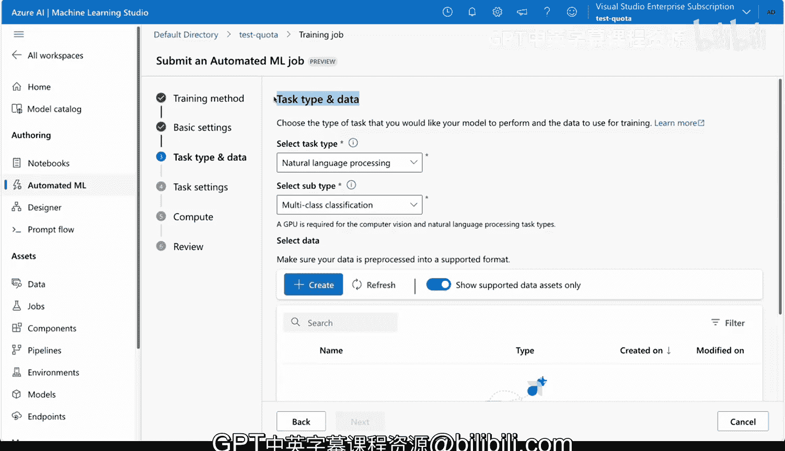

# 杜克大学《大型语言模型实践（生成式AI简介、Azure的LLMs（1、2课，共6课）｜Large Language Model Operations》 - P8：08_01_07_大型语言模型的创建方式.zh_en - GPT中英字幕课程资源 - BV1Ef421m7zD

I want to show you a little bit and this might be confusing if you've never seen anything related to machine learning。

 but I wanted to talk about large language models and how they are created。

 now this is very foundational is a very high overview and I want to start here with Wikipedia now the reason I want to start with Wikipedia is because I want to show you is like you're not going to get a a straight answer so let let's take a look here at what we're dealing here so large language model is language model notable for its ability so great but it's not really telling me how to one will go ahead and create one now usually you don't right like so let me get that very clear。

 you don't go ahead and say hey I'm going to build a large language model that's not very common so that's useful to know and you essentially what you're doing here is。

You have to get data and then use that data in order to train that model and tend to produce an output Now Wikipedia will always be a very wide and broad and might not get into enough details。

 but basically you're dealing with the data set that is the data source and youll have some sort of an initial an initial place where you're going to get started and that data will have to you know perhaps in this case removal passages like depending imagine like grabbing everything。

 every single text available in the internet like you're going to get probably a lot of toxicity there。

And so youll want to have some cleaning and like you will want to have things that are exactly what you want。

 so say for example， if you are in the medical field and you want to just collect data based on related to medical data then good and you want to make sure that say for example anonymous data and not personal identifiable information is present。

 so of a lot of things related to data。And then you on the training and how it exactly works。

 you will have different types of training。And these approaches will allow you to get to an actual large language model。

 so I want to now move on to a little bit on a different description this time based on Microsoft Learn。

A large or a large language model LM is a type of AI that can process and produce natural language text。

 It learns from a massive amount of data gathered from sources like books， articles。

 web pages and images to discover patterns and rules of language So these see is the actual part that I want to mention here on how exactly that is accomplished。

 So based on。Like several different and perhaps。enormous amounts of text， and this is why books。

 articles， and webp pages are listed here。And in some cases images when we're talking about generative AI with images to discover those patterns and rules of language and that training is done for the model now。

I am not going to go exactly and create a large language model。

 but I want to use a cloud service here in this case is going to be Azure AI machine learning Studio。

 which is a cloudown platform cloud service from Azure that allows you to do some training so just I'm not going to go ahead and create anything。

But I'm going to show you exactly what this would look like and when you're actually trying to train to train machine learning model so in this case we're going to start here by using these automated ML job I know I haven't gone into specifics on what are platforms and what are we doing there and how to get here。

 but just let's just focus on a little bit of the concepts So what you have is basically understanding the training method。

 you're going to have some settings， the type of task and the data。

And then you're going to have some sort of compute system。

 and then you're going to start this job this training。 So let's see what we have here。

 we're going to do this training automatically。 we're going to create we're going to create an automated machine learning job。

 That means that we're going let the machine decide when it's good enough and this is good to go。

 So let's go into basic settings。In here we would actually set the name of of our job we're going to do and then in the task type and data。

 this is where I want to focus， we are always going to have to understand what type of training you're going to do so if I click here on this dropdown you'll see that there's different types of training so classification regression time series forecasting。

So for example classification would allow you to predict either yes or no blue， red， green。

10 on or off， imagine if you want to create a machine learning model that allows you to understand if a story is open given certain texts so you will have several different types of data that allows you to define when it's open and when it's closed and you would train based on that data now for machine learning models based on or creating large language models you would be doing natural language processing or NLP。

Predicts based on text only data types using multiclass or multilaval classification now these are big words and big terms。

 essentially what it means is you're going to be using a lot of plain text to train your models so that it understands based on specific language is's going to understand what to do with the language。

So once you decide。Then you're going to have what type of classification you want you're going to have predict the correct class for each sample。

 multilabel classification， predict all the classes for each sample or name entity recognition or extracting domain specific entities from a structure text so there's a lot of things going on here but at the end of the day that is how you would set up something like that would allow you to create something like a large language model。

 this is not exactly it note that I'm just giving you an example how you would create something like a machinery model。

For a large language mono would be very much more involved。 It would definitely start with the data。

 I don't have enormous amounts of text data to train these so this wouldn't be this would actually not be a good use case So a whole team assembled a whole team of data scientists that understands deep machine learning concepts like neural networks and how do they work and how how to manipulate data in a way that they can actually create this and have the ability of several different GPUus and infrastructure to train would be the right way。

 but this should give you like a good a good idea on how that might be and what are those steps might be involved and again you will hear me mention data a lot as we make progress in the course where we need to have an enormous amount of data that is not only a large amount of data but it's actually clean as we saw before in the。

Previous descriptions。