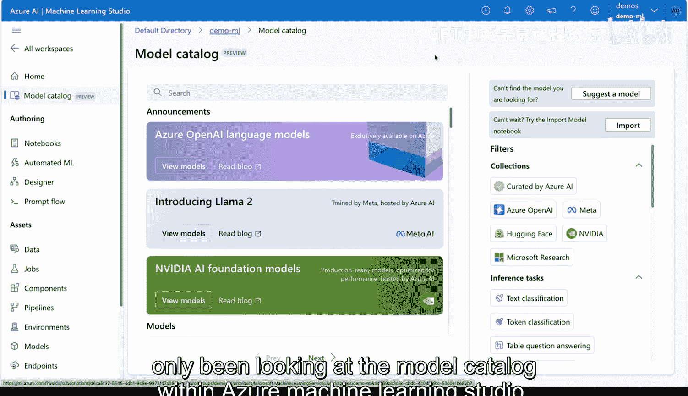

# 杜克大学《大型语言模型实践（生成式AI简介、Azure的LLMs（1、2课，共6课）｜Large Language Model Operations》 - P94：17_01_02_在Azure中发现与评估大语言模型.zh_en - GPT中英字幕课程资源 - BV1Ef421m7zD

Let's go through some of the models that you might be wanting to work with when you're dealing with Azure。

 so here I'm in the Azure portal。And I decided to start here so that you can see how to get to Azure Maine learning which is where we will want to be Now again can you can do this by either going to the Azure services right here or finding your deployed Azure Ma learning instance right there I'm going to choose this one and here we'll have all of your instances depending on the subscription you have you can see here that I have two subscriptions using that in this case I'm going to go to the first one which is called demoMl and then finally launch the studio which is a separate website。

Alright， so in here， and I'm going to make this a little bit bigger。

 What we're going to be doing is exploring all of the models that are available to us。

 Now the website and。Azure Ma learning studio， the actual interface， the dashboard in this case。

 it is very prone to changing， so what you see here might be slightly different from what you will see。

 but essentially we want to concentrate in the model catalog and we're going to be playing around a little bit with the model catalog where it will present all of the options that we want that are available to us from within the Azure interface。

 the Azure cloud。So the first thing is that I want you to take a look at this right here， so first。

 well you have the option to suggest a model， but you can also try to import a model notebook。

 which is also interesting。These are definitely options that you have when things are not quite to exactly what you want。

 but all of these collections are really really good right off the gate you will get greeted with the announcements。

 you will see that NBDA in this case has some models。

 you have the announcements of like how where these models incorporated into Azure and same with some of the other options that you have。

 including the Azure Open AI language models。Right here with the filters。

 what you have is not only the collections， so if you say for example。

 you know what I really like hugging face， I'm going to click on that。

Automatically what happens is that if I scroll here。

 the only thing they will see is hugging phase models。

 you will see that the apply filters mean that we are only getting hugging phase models。

 but you might not want to be such specific to hugging phase。

Actually this is very interesting the Microsoft research also has its own phi15 and Phi2 are also very interesting and those are both for text generation and very good now what I wanted to show you is that you have here the inference tasks so depending on the task you might want to filter down to exactly what you want summarization is one that is pretty common for example so we can actually pick right here So if I click this what we'll see here on the left is that the filter will get applied and we won't only see hugging face models but also other models from other sources now you might be wondering specific specifically in the case of hugging faces why why the dual because HuinF has its own interface as well and it has its own website and it hosts several models well all of these。

And this is actually a really interesting aspect of fasci is that all of these models are vetted to work correctly and to work at a certain standard for the Azure cloud so that's how these get included and you can see there's tons of hugface models and if I keep scrolling down you'll see that there's including like a different page but we will get this one distilled bar for CNN and bar large CNN so definitely lots of different options that you have and you mystral AI as well as pre common and you can explore a little bit more once you go into some of these。

We won't get specifically into all of the options available here but it's good to know that you have definitely several different capabilities when you're dealing with the model catalog once you are in a specific model like in this case you will have several different options as we've seen before but youll also have the breadcrumbs here so you can go back if I want to go back to the model catalog。

 I'll be back here to take a look at the models One last thing that I want to mention is if I want to look at the Azure open AI models and I'll scroll here down the deployment options will force me to go to Azure OpenaiI so let's see if I click on G4。

And I want to， well， the deployment is not there， I am required。

 I am required to have an Azure Open AI instance and you can see here that it says Azure Open AI service is not available in your workspaces region so that means that I've chosen a region for these deployment of Azure machineine learning studio in that I don't have an open AI service that is compatible for that so something to keep in mind when you're dealing with that。

 but it'll definitely there's a duality and this might be confusing。

 but this means that you will have to use the Azure Open AI service and launch that in this case we've only been looking at the model catalog within Azure Maine learning studio。

