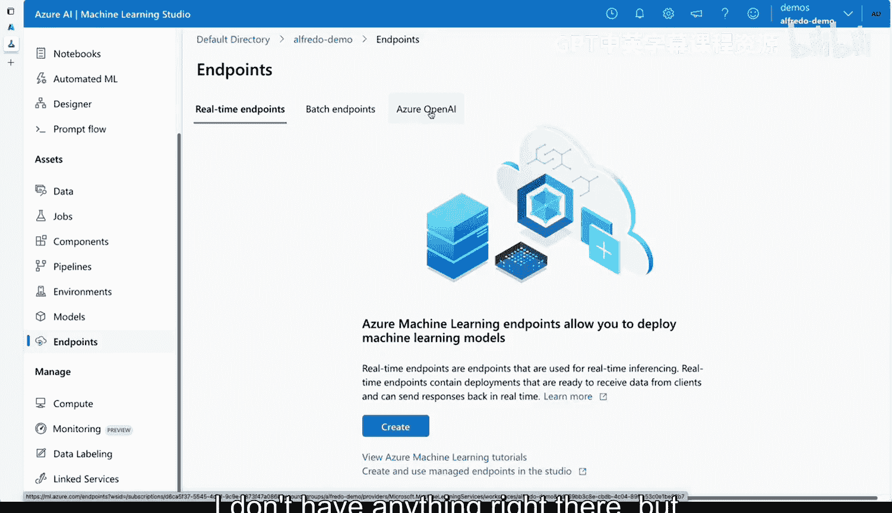
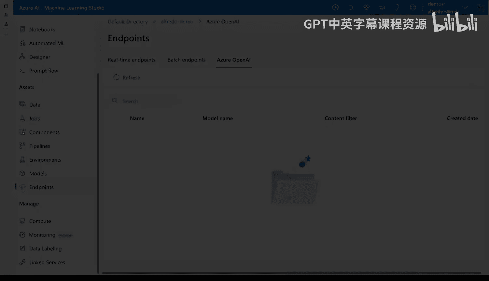

# 杜克大学《大型语言模型实践（生成式AI简介、Azure的LLMs（1、2课，共6课）｜Large Language Model Operations》 - P95：18_01_03_推理部署选项.zh_en - GPT中英字幕课程资源 - BV1Ef421m7zD

Let's see where are some of the options for inferencing in aure machineine learninging Studio so what we have here is Aure Maine learning Studio and in here well when we're at the home where when the landing page will get greeted with all of the models and some of the things that we have available but wherever you are trying to trying to do here。

 so say for example if you want to deploy this one I can very quickly click there and go into the deploy section so in here you'll have either batch endpoint to do batches or real time endpoint most of the time youll try to do something like a real time endpoint。

 if you go here you will be greeted with most probably with something that tells you but you don't have enough quota for creating a virtual machine some of these models will require a specific type of quota and how you will get there。

I by clicking here and finding exactly what is exactly that you need in order to deploy so in this case we need some powerful GPUus and I don't have enough for that if I had one for those you can see here the instance count is pretty interesting because I could basically allow to scale and I could even change this to one word to3 and then you would select certain different options here some of the things that you will have is the data collection and package model so you can find more information about these and then pick and choose exactly what you want one of the things you will get is a specific domain and how to consume that model but we're not going go into those details in here you would get like a whole selection of bridge machines if that's what you wanted to actually do so that is one of the things I wanted to show you the next one is if。

Go to models right here and click and select that one。

 You can see that I've uploaded one that is squeezenet。

 This is an onx model and here the restrictions are less there it's more straightforward and there's more freedom to choose and pick and choose exactly what you want。

 So if I say real time endpoint。I can actually have the option of doing Kubernetes This is really interesting because the only thing that you would require to deploy to Kubernetes is click this button right here and then you would go ahead and need to deploy a Kubernetes cluster which you can do with Azure Kubernetes service I don't have one so I'm going to say manage and that's going to be great and then the authentication type is great you have that by default in Azure well you will be able to create an authentication and preventing anauthorized service so you can do either token based or keybased and you have those differences there and whatever you prefer you can pick and choose what exactly is that you want a key based authentication provides a primary and secondary key that does not expire so that one of the different differences there。

And then the public name access where you will be able to expose these publicly so one of the things is this one and then that's great and then you will select the model and then you will go to the deployment in this case you will set certain timeout so for example if the scoring takes more than 60 seconds this will time out and it won't provide an inen in but you can definitely make changes here and say well you know what I want well in this case is  90 seconds and I can do anything beyond 90 seconds which is a minute and a half you can imagine someone waiting more than 90 seconds might be discouraged。

So these are some of the options that you would have and then you will go ahead and deploy so I'm going to click cancel here because I want to show you one last thing which is the compute and in here you can have your compute where you can actually get your GPUus or your CPUs deployed in this case you will get greetd with an option selecting the type of machine that you want to deploy Now when you're using CPU you will have depending on your quota you have different options like these ones and you will be able to pick and choose what you need if you want something like GPU you will see here that I don't have again a quota for some of these machines but definitely you will be able to pick and choose some of the recommended sizes here for exactly what is it that you need and you will see the pricing displayed right here。

Beyond that， I think you can come here to CPU and select from all the other options so if there's something that is not recommended。

 so'll say for example this one which is only two cores and 14 gigs of Ram you can select from all our options and be done so that is those are some of the interesting options for the different types of deployment。

 once you have something like these deployed。It will become will become available when you're trying to deploy your models and once you deploy them。

 they will appear here in endpoints and you will have these real endpoints right here and even if you want to watch some of the aure Open AI。

 you will be able to find them right here， I don't have anything right there。

 but you will be able to see them if you had anything deployed。

