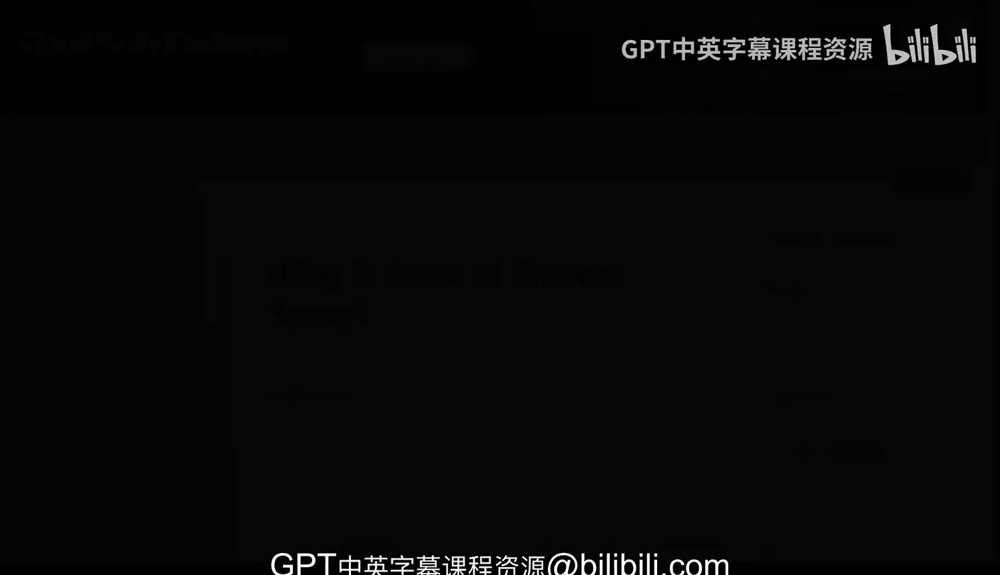
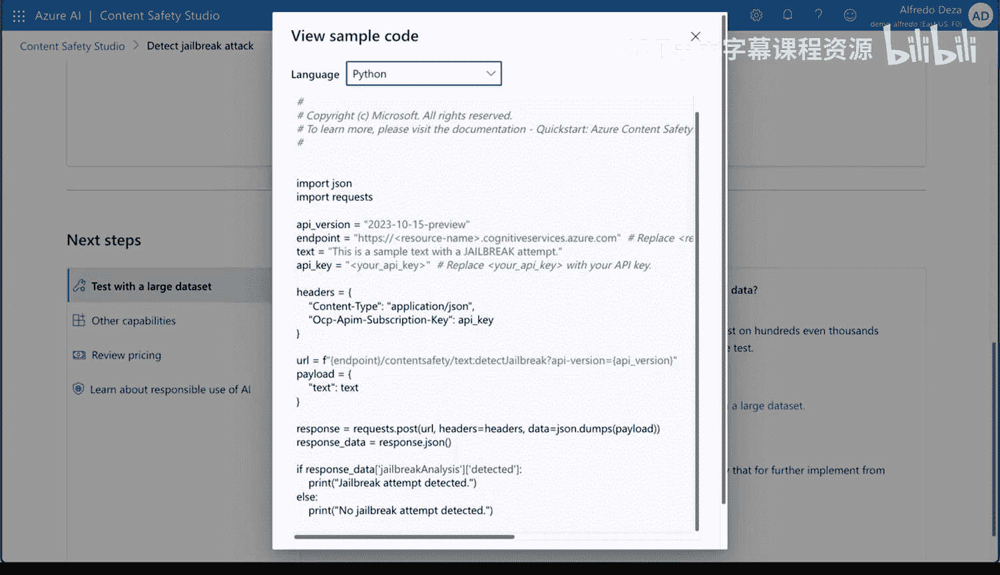

# 杜克大学《大型语言模型实践（生成式AI简介、Azure的LLMs（1、2课，共6课）｜Large Language Model Operations》 - P96：19_01_04_Azure AI内容安全功能是什么.zh_en - GPT中英字幕课程资源 - BV1Ef421m7zD

Before going into some of the details of the Azure AI content safety。

 I w to show you a little bit of the documentation here。

 we are on Microsoft Learn and the reason why and of course I'm not going to go through every single part of the documentation the reason why is there's a couple of things that are very relevant for Azure AI content safety related to generative AI and large language models so in essence what Azure AI content is is an API that you can submit content and get get either content redacted or content that will be blocked and you will be able to control kind of like how your application is behaving So let me show you some of the things and here here's where it's used and you can have like gaming so for example if you want to prevent some chats from going through。

Or education is another good one。 Having a system like this is very powerful。

 but for large language models， I really like a couple of the things that are brand new So one of it is the jail break risk detection so it scans the text the text that is being sent and it determines if there's a possibility of a jailbreak attack。

 What is a jailbreak attack is when a person trying to interact drag with a large language model might want to retrieve information that the large language model shouldn't be giving out or try to make sure that the model will behave in a way that was in not intended to do that and the other one is the protected material text detection now that sounds kind of like like a mouthful but the description is pretty pretty good so scans。

AI generated text for known text content， so this would be like input and this would be like output stuff so this is coming into the model the model and then before it comes to the model it goes through these right here and this one as the model is producing some text then you will be able to scan that and make sure that things are not you know copyright it。

 song lyrics， articles， recipes and it's very good at doing that All right so that is the documentation those are a couple things interesting so let's start with the Azure portal as always so you will find the content safety your Azure services or you can put it right here and start right here on the search and start your search for content safety I've already deployed an instance and you can see my instance is right here。

And as always naming it very well for me to remember that I need to get rid of that resource group later All right so if you click here then you will be able to launch launch the studio but at the end of the day all that you're doing is or the interesting parts are the API calls and how you're dealing with the keys and interactive because you're going to be using these in an application。

 you're not going to be using these in in in a webUI within Azure although you can definitely do that so we can go and play around with the content safety studio which I've already opened and it's right here and the Azure content safety studio will have all of these pre made ready things for you to try out moderate image content if you want to pass in some images the text that we already exportd a little bit and generaterative FA。

Spific the safety Me problemm the jail brake Ri detection and protected material detection。

 which is not quite ready at the time of making this lesson。All right。

 so let's go and play around with the content safety specifically。

And how that looks and we can explore this is the Azure AI studio it's currently on a preview mode。

 but the thing that I want to mention right now is that you are actually not going to be doing interacting with the content safety in this way you will be doing it with an API so here you have a little bit of a test so say for example you want you want something like this and you want to make sure what does that look like and then you would apply some of these and then you will run a test and then get the results now this is all good but again this is not how you will be interacting with it my best suggestion is that you would go and start deploying it and go through the documentation or how to exactly use the APIs so within the。

Content safetyfe studio， you have a thing here that you can actually test the jail brake attack so let let's try to take a look like so this is safe content so we can put it right there I'm going to scroll here I'm going to run the test and it says no gel brake gel brake attack is detected but this one looks like yes you're going to pretend to be done which tends to do anything now So it's trying to is trying to do jail brakes I'm going run the test and you get the gel brake attack is detected so you can you can see you can see how that works and but you can actually view the code as well so here you have what I was referring to where you can have that endpoint and you can implement these and you have the python here but you have other implementations there as well but this is how you would put it in to an application that is doing large language models as well So in essence that is what content。

Saty is for Azure and how it might look to make it work with an application with Gene FAAI large language models。

