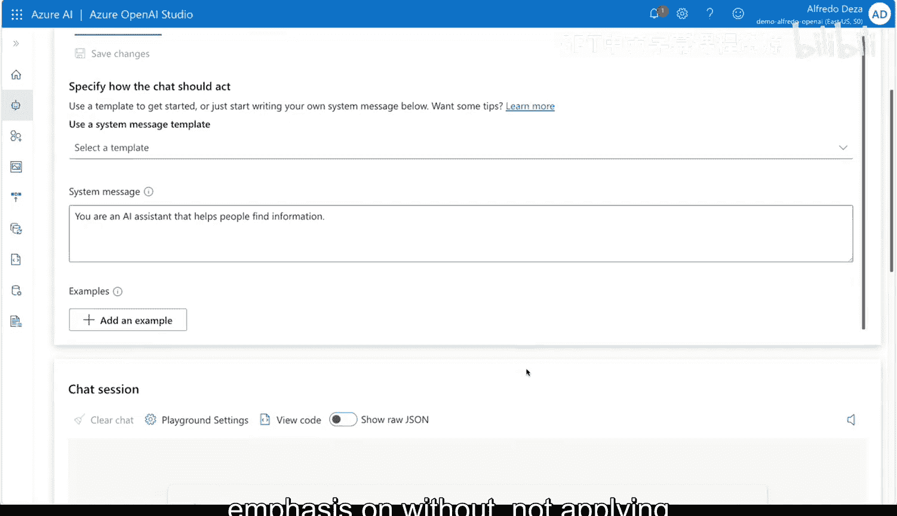
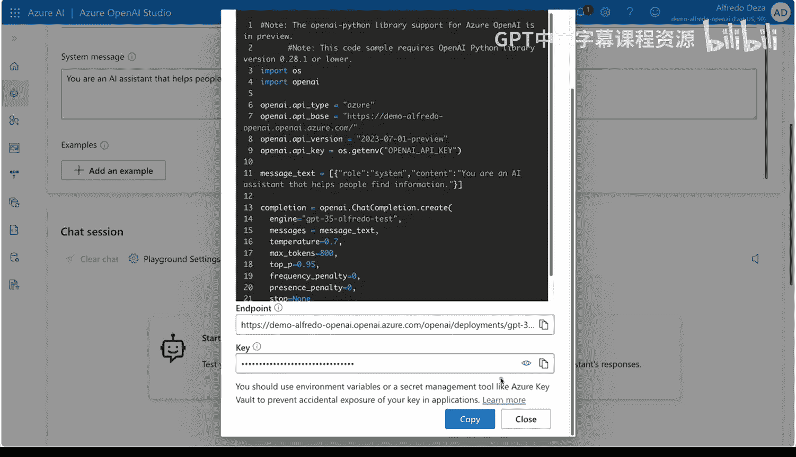
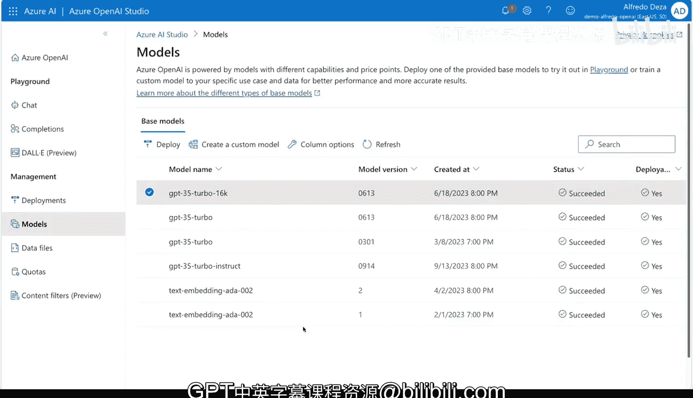

# 杜克大学《大型语言模型实践（生成式AI简介、Azure的LLMs（1、2课，共6课）｜Large Language Model Operations》 - P97：20_01_05_Azure机器学习与Azure OpenAI服务的差异.zh_en - GPT中英字幕课程资源 - BV1Ef421m7zD

The main differences between the Azure Open AI service and Azure Mach learning is that for Open AI service。

 you are going to deal with open AI based models， so we're going to start here。

 we're going to go to Azure Open AI Studio which might sound similar to Azure Ma learning studio but this is only for open AI so let me give you a quick example on Cal how this looks and what is one of the core differences so you're going to go to deployments。

And and you will see here that I have several ones already deployed。

 but let let's go first to models and then also select one of these。 so say for example。

 GP 35 turbo 16 k。 so I'm going I say deploy。And this is one of the key differences here when I click deploy I'm going to say the model that looks fine。

 the model version is auto update to default you can actually select one that is different deployment name let's say GPT35redo test and you can actually have advanced options like tokens and allow dynamic word as well。

 but this looks fine and when I click create and the reason I'm doing this is just to show you the core difference I'm going to click create。

And did you see how fast that was successfully created deployment， that was very， very fast。

 so if I go to deployments， that now will be right here。Deployment succeeded everything's great。

 So that speed as how this was created allow me to interact with it right away like I don't I don't need to do anything extra。

 I don't need to deploy resources。 I don't need to find GPUs。 I don't need to find。

Anything related to compute or any resources， I have this model and is ready ready to go I can actually edit the deployment if I want to。

 I can make those changes on the fly but I can also test it out on the playground so if I go to the playground I can go here which is right here on the chat and I'm going to minimize that so I have more space。

And I can scroll all the way down and you will see that the configuration for this is using my deployment。

 What this means is that I have the actual ability to start playing around with the model right away without again emphasis on without not applying anything related to the model itself so if I go click on the view code look at this I have everything ready to put this in a Python application and be ready to start doing developing developing my my application right away and you can see here that I have everything ready the code is good to go and this is super useful because I can I can actually start doing that and using the API here you can see the open API base and that is living in Azure so that is the core difference is that you。

Youre not deploying anything related to compute services and you have the endpoint ready to be used as soon as that deployment is ready to go and the key is generated for you and you have that ability to interact with the API right away。

 if you want more customization if you want different models if you want your own models if you want to fine tune your own models。

 if you want to do anything that is different from what the open AI models are are here that you can actually go into the model is available to you。

 then you will probably not want the Azure Open AI or Azure Open AI service or go through the Azure Open AI studio。

 but instead you will want to go through Azure Mary studio where you can select other models like huggingF models or other models available or create your own custom models。

