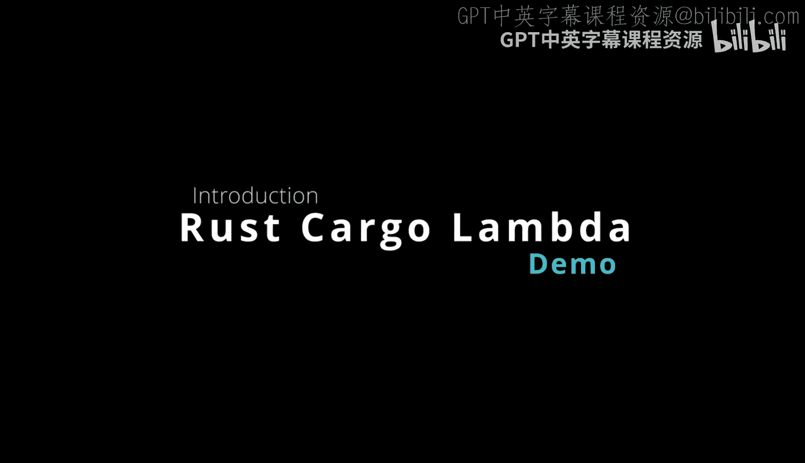
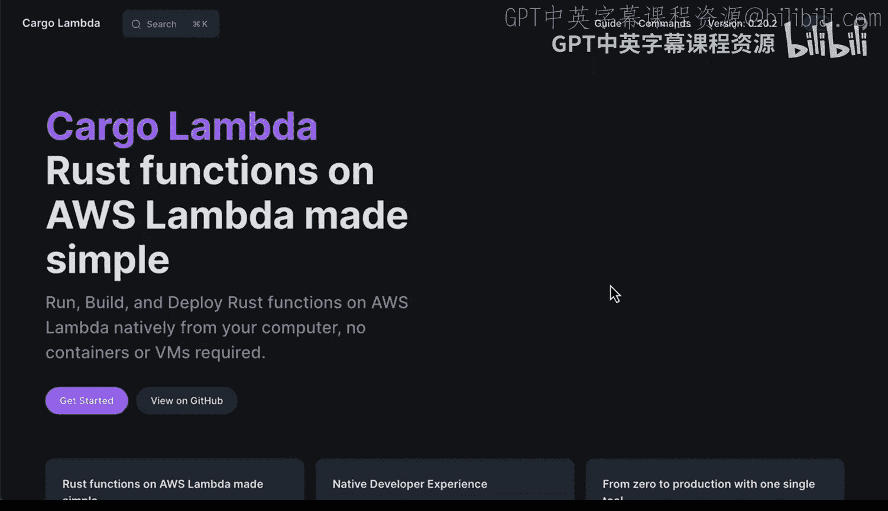

# 杜克大学《大型语言模型实践（高级数据工程、AWS、Databricks和本地LLM）｜Large Language Model Operations 》 - P100：34_04_02_CargoLambda简介.zh_en - GPT中英字幕课程资源 - BV1oi421Q7GT

Here we have cargo Lambda， which is a very big advance on some of the advantages of serverless。

 and part of it is that there is no external requirement for containers or VMs which can really be an issue when you're developing for example。

 your computer may not support containers， your computer may not support virtualization there could be resource constraints on your computer。

 but with cargo Lambda， you can actually build this natively on your computer and actually deploy。

 So if we look through here， the rust functions are made simple and these are powered by Zig。

 which is a emerging systems programming language， there's a native developer experience and it's actually trivial to install。

 So it's one of my favorite ways to work with AWS Lambda。

 So if we go ahead and look at the guide here， you can see here that it's a subcommand for cargo。

 So it taps right into the cargo ecosystem。And if we look at the installation， pretty simple。

 all you have to do is do a brew install here。 So this works on both AWS cloud9 environments or Linux environments or OS 10。

 So you just copy that paste it in and then you've got cargo Lambda installed In fact。

 once it's actually installed， all you have to do is typepe in cargo Lambda。

And you can see there's a help menu that crops up here and it says it's a Ci to work with EWS Lambda functions locally。

 so it can do a build， it can do a deploy， It can do it in knit， Invoke new watch help。

 So really it's got everything you need to do to develop inside of your local environment and it makes development easy。

 So if we go down to getting started here and we say install cargo Lambda。

 the next thing to do would be to actually create a new project。

 So if we want to actually create a new project pretty simple， let's go ahead and do that。

 let's go back here。 So in order to do that all I have to do is paste this in cargo Lambda new Lambda project。

 and then Cd into the directory。And then it's going to ask me some questions。

 So is this HP function If so， it can be triggered by API gateway or the AlLB or the Lambda URL in our case we don't care about this and then it says is this an event driven AWS Lada so is it going to respond to some kind of event and we also can just say basically we don't care about it or by just leaving a blank so now that we look at the structure here。

 you can see here that it creates the cargo2l file for us。

 So this is a nice structure here where we don't have to put in these runtimes。

It also uses the serialization library Tokyo for Async， and it's also got tracecing enabled。

 So pretty much ready to go， everything set up for us。 And then if we look at the source directory。

 you can see that there's a main dot Rs file here。 So everything's really ready to go for us and there's documentation as well about how it would work。

And so at the very bottom here， you can see this is the main body for the function。

 and there's a function handler。 So this is really where the majority of the work is going to happen in your rust Lada function。

 So pretty straightforward， looks a little bit like Python code。

 And then if you scroll down to this Tokyo main here。

 this is going to call the function that does the work。

 So this is really boilerplate code and this is the logic inside of your function。

 So in order to run it though。 all we have to do is look at the instructions here and go back。

 So if we say how to watch this out， we just do cargo lambmbda watch。

 So now it's actually running locally on this instance。

 and then if we want to test it out pretty simple if you're doing a basic function。

 we can actually do cargo Lambda invoke and this is nice is I can actually get all this working locally here and we can say cargo Lambda invoke。

Once it compiles and the binary is created。Pretty simple。 We can just say hi， hi， hi。

 And this is gonna go back here and call this。Particular lambda function。

 So very straightforward here to get things running。 Now。

 if you wanted to invoke a API requests from API gateway， you could do that as well。

 And if you want to build the release， this is also one of the nice things about it。 Very simple， so。

So this is going to build a release that would be deployable to AWS Lada。There we go。And next。

If you want to deploy， all you have to do is do cargo Lambda deploy。

 so pretty straightforward here to do a deploy。And。There we go。

 So what's nice about this is that we can see here that it's called new Lambda project。

 And if I go to my AWs toolkit， which is down here。😊，AWS。And we go to Lambda。

We should see one called New Lambda Project， there we go。And if I want to invoke on AWS。

 I could actually invoke that Lambda， so really a very straightforward way to get started with writing Lambdas and rust is to dive into cargo Lambda and it makes it easy to really build things locally because you don't have to depend on containers or virtual machines。

