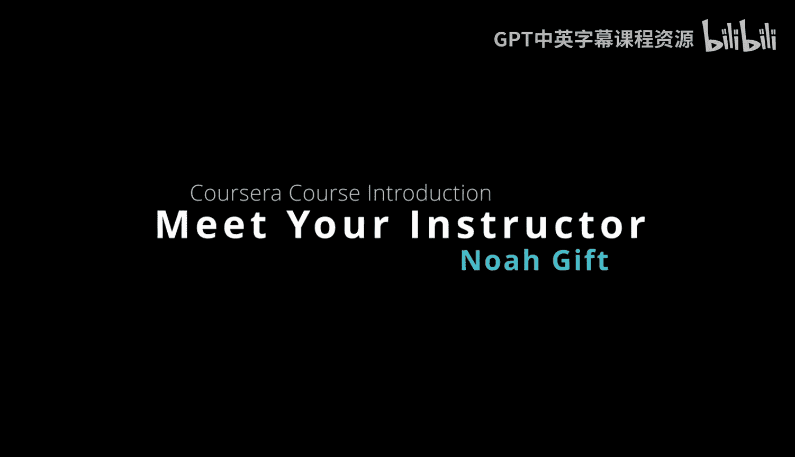

# 杜克大学《大型语言模型实践（高级数据工程、AWS、Databricks和本地LLM）｜Large Language Model Operations 》 - P102：01_01_01_认识你的课程讲师诺亚·吉夫特.zh_en - GPT中英字幕课程资源 - BV1oi421Q7GT

Yeah。Hi my name is Noah Gift and I'm your instructor for this course。

 What we're going to cover in this course is a broad background starting with Databricks all the way to using local large language models。

 First my background。 I'm a prolific courseursera instructor so I've created over master's degree of content on the Courra platform Currently I am an executive and residence at Duke What this means is that I work with the graduate data science program and the AI for product innovation program to develop content around data engineering cloud computing ML Lops as well as teach this in person。

 I have about 30 years of experience from a wide variety of industries from games to film to software as of service to machine learning and production and I'm going to take all those skills and put them into the content that I create on the Coursera platform。

 So we have a lot to cover in this course。 Let's go ahead and get started。 There's no time to waste。

