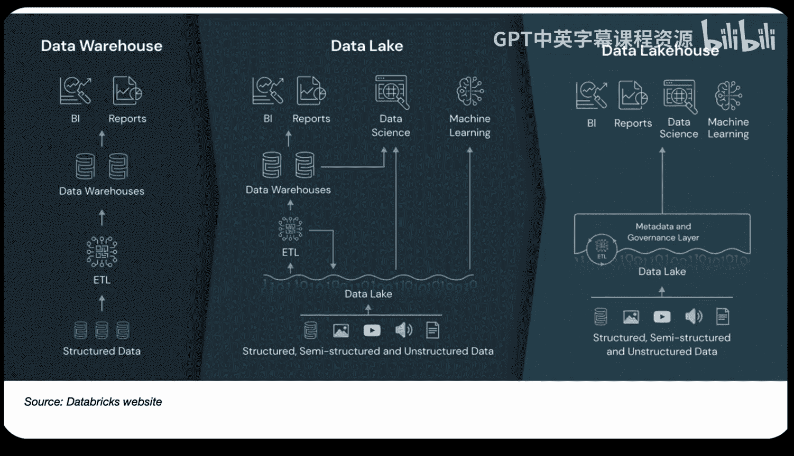

# 杜克大学《大型语言模型实践（高级数据工程、AWS、Databricks和本地LLM）｜Large Language Model Operations 》 - P103：02_01_03_Databricks湖仓平台简介.zh_en - GPT中英字幕课程资源 - BV1oi421Q7GT

Let's take a look at the evolution of data architectures。 First here on the left。

 we see that there's a progression from the data warehouse to the data lake to the lake house。

 One of the reasons for this is that there are limitations of traditional data warehouses for unstructured data at scale and some of the promises of data lakes didn't fully materialize due to lack of governance So first。

 let's define what a lakehouse is。 It's a way to combine the strengths of a data warehouse。

 and you can see some of the things you can do like B reports ETL it's combining those strengths with the data lake in a new architecture。

 And again， if we look at the data lake here， you can see that some of the difference are that you can also do data science。

 machine learning work with structured semistructured and unstructured data。

But it enables the governance， the quality the performance for analytics alongside the flexibility for M and AI。

 and it's also powered by separating the storage in the compute like the traditional cloud data warehouse。

 Some of the key attributes include the support for asset transactions and schema enforcement like you would get with a traditional SQL solution and also open formats built on lowco object storage。

 So in the case of AWs， it would be something like AWs S3 Unified batch streaming SQL and machine learning workloads are also included and also the ability to have enterprise capabilities like security。

 access control， auditing all things that are very important for compliance and for proper data governance。

 So some of the benefits over past systems include radically simplified architecture for multiple specialized systems。

 faster time to insight without copying or moving the data and cost savings。😊。

operationalizing one system's infrastructure and also the flexibility for diverse analytics from BI to AIM so some of the limitations here for the future outlook would include early in the maturity so that they may lag some of the old systems query performance also there could be some issues where you need better support for non-sQL tools and personas and one of the things to be know really keep in mind when you're thinking about these new solutions is that eventually those gaps are going to close over time while retaining the simplicity and cost benefits that you get from a data lake house。

Really， Ade Lake House is an evolution of what is currently happening。

 and this is something you see all throughout the history of innovation with many different technologies。

