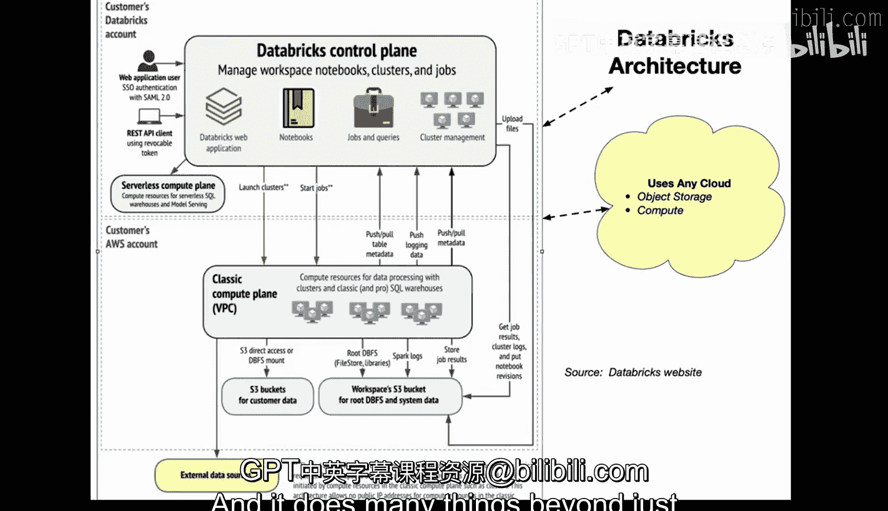

# 杜克大学《大型语言模型实践（高级数据工程、AWS、Databricks和本地LLM）｜Large Language Model Operations 》 - P104：03_01_04_Databricks架构概述.zh_en - GPT中英字幕课程资源 - BV1oi421Q7GT

Here we have the general overview of the Databricks architecture at the top here。

 you can see that it's structured into a control plane and this control plane is managed by databricks and the compute plane lives in the customers cloud In this example it shows AWS。

 but it could be an Azure it could be in GCP could be in some other cloud， the control plane， though。

 is where all of the action takes place and it handles the backend services like the storage of notebooks and jobs and the compute plane processes the customer' data and the workloads。

 The connector integrates the external data for ingestion and then the data lake stores securely in the customer' cloud storage。

 So it works on top of things like object storage and compute in the case of AWS it would be S3 or EC2 and there's a separation of responsibilities where Databricks manages the control plane service to reduce the customer burden and the customer maintains the ownership and control。

Business data。 So this is very similar with the shared responsibility model of AWS where you manage certain parts of the resources and AWS manages others like the physical data center。

 In this case， though you're managing these lower level resources。

 but then Databricks is actually able to orchestrate on top。

 So the common workflow would be the data is ingested from sources via connectors into the cloud storage like S3 the compute would spin up on demand to process and analyze the data and then the interactive workloads and notebooks batch job SQL all would share the same architecture and the results would output back to the cloud storage under the customer control so。

What this means is that some of the benefits are fully managed control plane that reduces the overhead。

 the customer cloud account provides security and isolation。

 and you have flexibility to handle diverse data workloads and pay only for the compute used through serverless offerings。

 So in a nutshell here what you really can do with databricks is manage complex workflows by leveraging that layer on top and that databricks control plane has the web application。

 the notebooks， the jobs and queries and the cluster management and it does many things beyond just data engineering。

 including MLOs。

