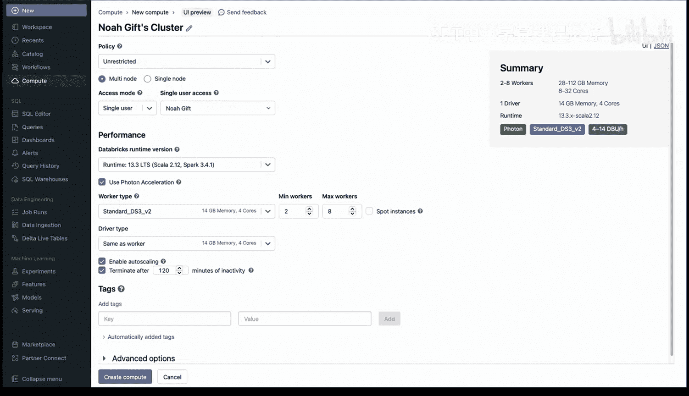
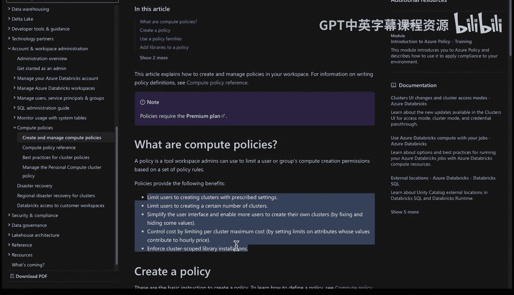
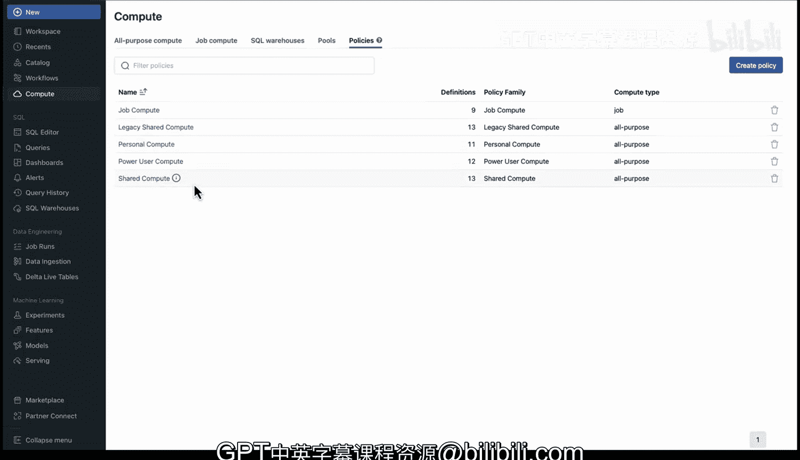

# 杜克大学《大型语言模型实践（高级数据工程、AWS、Databricks和本地LLM）｜Large Language Model Operations 》 - P105：04_01_05_创建和管理集群.zh_en - GPT中英字幕课程资源 - BV1oi421Q7GT

One of the more important jobs with managing Databricks environment is the compute。

 Let's take a look here at this compute tab inside of the Databricks interface。

 You can see there's several different categories of options。 First up。

 we have all purpose compute here。 So this is a place to start if you're going to do things like work with notebooks。

 for example， do a basic data engineering operations。

 And you can see here that I've actually got something running， which is called thrifty right here。

 So how would I run this。 Well， I could go ahead and click this and it would say confirm and it would start this cluster。

Now if we want to create one from scratch here， let's go ahead and say createre compute and let's look at the options。

Here you can see that I'm using an unrestricted policy。

 So this is a new feature of databricks that lets you control what are the things that a user is allowed to do。

 That's really the purpose of a policy here and if we go over to the documentation。

 you can see here what are compute policies they can do things like limit users to creating clusters with prescribed settings。

 So for example， let's say your company has a limited amount of GPus。

 you may want to limit a individual user from using more than the allocated resources your company has。

 you can also simplify the interface control costs etc。 and even enforce certain libraries。

 maybe want the people in your organization to only use the libraries that you've created。

 So it's some nice options for control Now if we go back to the access mode as well。

 You can see there's multi node or single node basically the of purpose of databricks is to do cluster compute。

 So in many scenarios you would want。

Multi node single node is for prototyping So if you toggle to single node you can see it'll just spin up one of machines。

 but the advantage of multi nodeode is to be able to scale out the disko and the compute for the Hadoop file system HFS and you're going to get that by using a multi nodeode setup。

 Now look at the default runtime here as well。 this is important to stay and look at is that the runtime here is already configured for you。

And it has the latest versions of Scala and Spark and you can toggle it up and down if you want based on the kinds of things you're doing。

 So generally for you know regular types of notebook operations。

 running SQL queries you would want this standard runtime and it's going be configured for you if you want to do advanced M operations notice here that they'll be options for GPU。

 there could be different versions of Spar and also the libraries are going to be preconfigured for you so that you don't have to actually select know something that's going to be installed。

 it's already installed for you for many of the standard use cases。

 So really the runtime is great to allow you to toggle between standard know classic data engineering problems or M and the right libraries will basically be automatically configured for you。

 We also can see here that you can scale up the minimum workers or the max workers So the defaults here are probably good to use。

 But if you know you have let's。A lot of capacity that needs to be used because you have large data sets。

 maybe you want to toggle up the minimum workerser， so you always use let's say。

 four minimum workers and you could also potentially toggle up much larger than max workers right and these will all be things that you'll be able to get feedback on。

According to the resources that are available from your cloud provider。

 we also can look at the driver type here as well。In this case。

 we'd want to do the same as the worker。 And then in terms of the auto scaling here。

 this is the button that's going to allow you right to use that min and max。 Now。

 this is another very important setting as well， which is are you going to terminate after a period of time。

 So for doing lots of ad hoc demos and exploration this is really going to be something youd want to have enabled。

 now， on the other hand， if you're running something that's a 247 cluster。

 you should turn this off because you don't want to terminate if it's unactive because it could cause some downtime for other users that are trying to do things。

 So this is really going to be dependent on your environment， you could also add tags here as well。

 let's say you want to say maybe the team would be data science right if you wanted to add some kind of tag that would tell you exactly what's happening。

Now， once this thing is running again， if we go back to compute here。

 you can actually look at it and look at the details of exactly what's happening。

 You can look at the notebooks associated with it， the libraries that are associated with it。

 install new libraries， you can also look at the Sp user interface as well and look at the different things that are happening with the jobs you can look at the metrics This is also very important when you're running jobs is to see do I need to have。

 let's say a larger scale characteristics。 maybe I need some additional max nodes because I'm overloading CPU or I'm overloading disko or memory etc。

 you can view all that from here。 So really the compute interface here is a onestop shop here to manage everything you need to do for basic computation。

 There also is the compute jobs here， which allows you to do ad hoc jobs and manage those jobs We also have SQL warehouse。

 which is another one。 We have pools which can allow you to。

Logically group the tendencies to allocate compute power you can also dedicate a cluster from an autokiing pool to a team or a unit and then finally this is where youd go in and you could actually create customized policies so that maybe you simplify the ability to launch things or limit the ability to do GPUs all this is managed directly from the interface inside of Microsoft Azure Databricks or AWS Azure Databricks or whatever platform you're using Databricks on。

