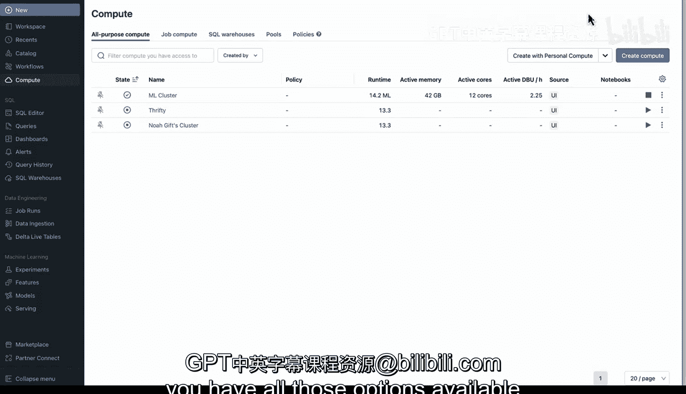

# 杜克大学《大型语言模型实践（高级数据工程、AWS、Databricks和本地LLM）｜Large Language Model Operations 》 - P106：05_01_06_配置集群运行时.zh_en - GPT中英字幕课程资源 - BV1oi421Q7GT

Yeah。Here we have databricks runtimes and they include things like the data engineering and MLl solutions here。

 and we we the reason for this is that you can have different clusters doing different things。

 and you don't have to spend a lot of time maintaining them。 They're managed by databricks itself。

 So this is a huge time saver。 If we take a look at standard here。

 This is just general purpose right It's for the ETL operations， data pipelines， batch processing。

 let's say you want to have a scheduled job that runs at some interval。

 It often could be using the standard runtime。 We also have support for Python。

 We have support for R。 we have support for Scala for SQL。 There also is this photon runtime as well。

 which is optimized for huge data volumes and table scans。

 and it's great for ETL on petabyte size data。 And then in terms of machine learning。

 we have libraries like Tensorflow。 We have pytorch。 we have Caris。

 also regular machine learning tasks。handandled as well like things like pandas， for example。

 that particular API could be available in terms of the other run of times for analytics。

 we also have SQL analytics and this is optimize for SQL and business intelligence use cases and really the difference here is that you can toggle the attributes of languages and libraries。

 memory IO CPU the query engine， the concurrency limits。

 these are all things that you can tweak and you don't have to manage the fine grain details databricks will manage them for you So if we take a look here at the interface you can see a real life example of this where I have an ML cluster running you can see it's running the ML runtime so it's differentiated from the regular runtime and what's nice about this again is that I didn't have to go in and install much of libraries myself they're already pre-installed with many of the things that I would want to use and could if I wanted to create a new compute cluster I could just go through here say a new compute cluster。

And then again just toggle through the runtime and you can see standard ML uncategized Likewise。

 if you go back here， you can toggle to SQL runtimes， pools， you have lots of different options here。

 and it's up to you to figure you know do want two， three， four different kinds of clusters。

 an MLmo cluster， a data cluster， a SQL cluster you have all those options available to you in the Databricks interface。

