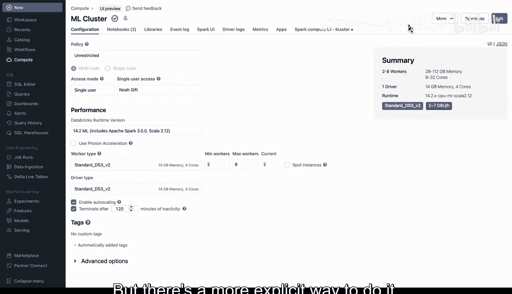
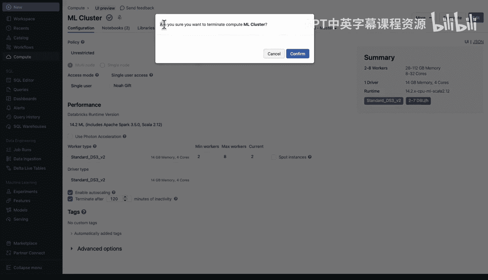
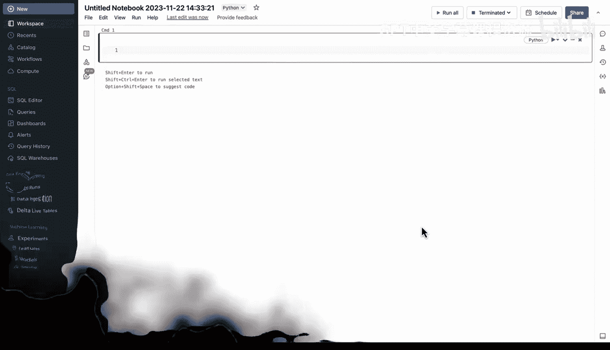

# 杜克大学《大型语言模型实践（高级数据工程、AWS、Databricks和本地LLM）｜Large Language Model Operations 》 - P107：06_01_07_终止集群.zh_en - GPT中英字幕课程资源 - BV1oi421Q7GT

Here we have a Databricks interface where there is one cluster that's already running。

 you can see here that there's a couple of notebooks associated with it。

 we also have a new cluster that's starting here。 If I wanted to control this。

 one of the ways that I could terminate this cluster is by selecting it。

And first you can terminate it by doing nothing right if you have this enabled。

 you can see that terminate after 120 minutes， this is what will happen when when the cluster is actually inactive like you're not doing something to it。

 it'll automatically terminate but there's a more explicit way to do it if you go over to this section here and we click on terminate。

 you can see says are you sure you want to terminate the cluster now this will just basically stop the cluster。

Notice that there are other controls， though， as well。 If we go here， you could also clone this。

 you could restart it Deleting， though， would be permanently getting rid of the cluster。

 including the whole configuration。 So the difference between a delete and terminate is that terminate is just telling it to stop。

 Now， there are other ways to terminate as well。 And one of the ways you can do this is from a notebook。

 So if we go to new here。 we go to notebook。 Notice that the em cluster is selected。

 You see that it's green is running。 Now， how would I actually terminate this。 Well。

 what I can do is I can actually go over to the em cluster。And if we select this and hover over it。

 you can see that I have the ability to actually terminate it。Right from this interface。

 So this is one of the more convenient ways。 let's say you're done with a project and you're inside of a notebook。

 you've saved it。 Maybe you've committed it to version control。

 all you have to do to get rid of it is just select terminate。Go ahead and say confirm。

 and this will actually go through the termination phase and you can see here that this was requested。

