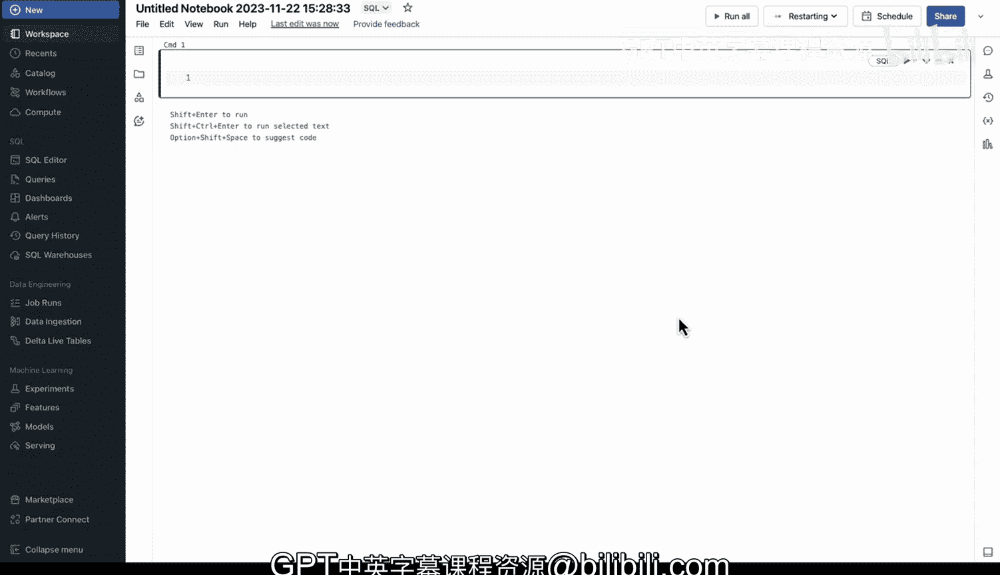

# 杜克大学《大型语言模型实践（高级数据工程、AWS、Databricks和本地LLM）｜Large Language Model Operations 》 - P108：07_01_08_重启集群.zh_en - GPT中英字幕课程资源 - BV1oi421Q7GT

Here we have several compute clusters that I'm going to make some changes to。

 and I'm going to start with doing a restart。 One of the things that happens sometimes is a compute cluster could be acting in a strange way。

 or it's overloaded。 It's out of memory。 And so how do you actually restart it。 Well。

 let's go ahead and take a look at this thrifty cluster right here。 If I take it。

And I go to this menu right here。 I can select restart once I select restart。

We're able to actually get this thing in a new statell reboot and all of the memory and everything else that's happening will really change so that I don't have to actually keep those legacy issues。

 So another way to do the same thing though， as we can also go to the notebook And if I select a notebook from here。

 if I scroll down what I can do as well is actually select this cluster here。

Or some other cluster that's associated with it。Hover over it。Select restart。

And we can see that I can do the exact same thing by restarting from the notebook。

 so there's two ways to restart inside of databricks。

 both of them can be handy if you're experiencing issues。

