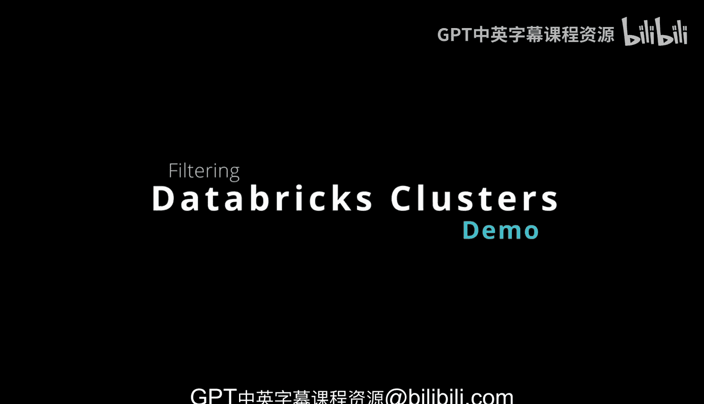
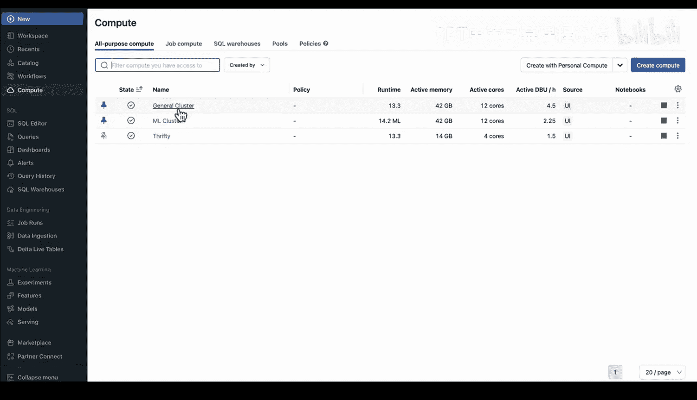

# 杜克大学《大型语言模型实践（高级数据工程、AWS、Databricks和本地LLM）｜Large Language Model Operations 》 - P109：08_01_09_过滤集群列表.zh_en - GPT中英字幕课程资源 - BV1oi421Q7GT

Here we have the compute interface and there are three different clusters and if you're working with。

 let's say hundreds of clusters， you want to be able to filter very quickly on a name or potentially a runtime and one of the ways you can do this is by this menu here where it says filter compute you have access to if we go through here and we type in ML。

 for example， notice that I can actually quickly pull up the name of the cluster。

Another easy thing that you may want to do is look at a particular runtime。

 let's say that you know that that runtime， for example。

 the ML runtime has a particular version you could go through and just type in right here 14。

2 or in the case of another one 13。3。Or 13。2 right， there's nothing，13。3 we see we have two。

 This gives you the ability to quickly toggle if you have hundreds of runtime。

 which is very possible in a larger organization。 Another thing that is also helpful in really when you're combining with this is that you can pin maybe your favorites as well。

 So again， if you have 20，30，40 different clusters， you can filter。

 but then you also could potentially save， let's say the two clusters that you use most frequently up here so that by default。

 you always have access to it。

