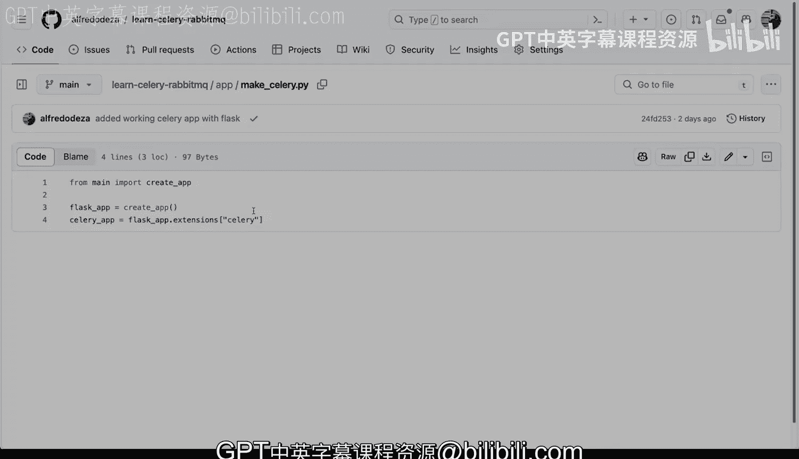

# 杜克大学《大型语言模型实践（高级数据工程、AWS、Databricks和本地LLM）｜Large Language Model Operations 》 - P10：10_01_03_在Flask中配置Celery.zh_en - GPT中英字幕课程资源 - BV1oi421Q7GT

Let's configure salary with flask and this is one option that you have and this tries to follow a little bit the documentation that we have for using salary with flask and I'm going to go and head over to app and then to main up I and I'm going to go step by step on what are some of the things that we're trying to do here so what we're going to do here is first look into the salary underscore inE app the first thing that we're going to receive this is going to require an app argument which is actually a flask application。

So the flask application and this pattern actually looks a little bit odd。

 but essentially what it is is allows Flask to work with tasks， no problem。

And you're going to have the application name and salary is going to to take that it's naming it's naming your salary and your salary application and then its the task class is going to be flask task which was right there so you're defining how this is going to actually work these app context here is a flask thing that allows you to run run what you're going to be passing in these pieces of code。

 these functions that are going to run are going to run with this type of construct right here All right so moving on we're going to configure we're going to configure the salary application from the configuration from flask in this case I'm not doing anything specific but this allows me to configure everything in a single place that means that if I'm configuring everything for。

In the flask app itself， I can poke around that configuration and define a specific portion for celery and just use a single spot instead of having multiple different spots for configuring。

And finally I'm going to say that the extensions， you can see here that I'm supporting the extensions for the flask app whenever you see app right here that means that it comes from flask itself that's that app is flask and the other one is the salary app which is you know salary so the app extension salary is going to be the salary app and finally I'm going to return the salary app right there。

All right， so moving on I'm going to the create app for flask is very straightforward in this case I'm naming this my flask queue it's not really a queue but I just named aad to be consistent with the types of examples that we're going to be doing。

And here you can see how I am configuring my salary application in this case my broker URL remember that's where salary is going to be connecting is going to be using the AMQP protocol which is the Rabbit MQ the protocol that RabbitMQ uses and where Rait andQ running is going to be running in local hostst using the full port of 5672 Now that is going to allow me to again pass these remember we saw a minute ago that we're going to call ce in it app I'm going to pass that app。

 that app is the flask application with a configuration I need and it's going to return the application and in the end right here we're going to have these to these two created there and not created but the here so that they can be available and we'll see how those are going to be。

Later now the other piece I want to show you is this other file which is called make underscore salary and why is this needed well。

 because we're going to run salary separately salary is going to run is going to start and its going to start a separate process and for that I'm going to create call or import that create app and because I'm calling that from or importing that from main I'm going to call right here and then I'm going to assign salary right there so all of these pieces are going to be more clear later when we start these processes and start making use of all of this so that everything just works but it's important to understand how we're connecting how we're configuring all of these services。

