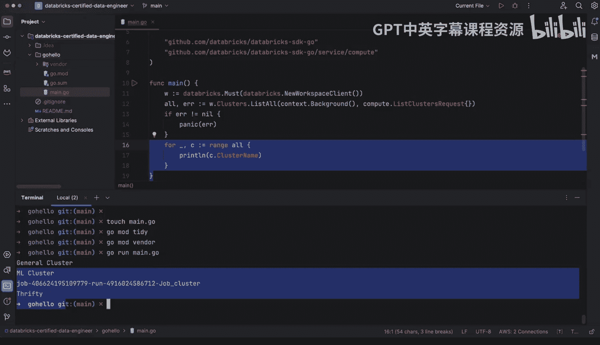

# 杜克大学《大型语言模型实践（高级数据工程、AWS、Databricks和本地LLM）｜Large Language Model Operations 》 - P111：10_01_02_为Databricks配置IntelliJ与Go环境.zh_en - GPT中英字幕课程资源 - BV1oi421Q7GT

One of the emerging standards here for doing SDK work for data engineers is the go language and I'm going to take a look at how to do that inside of this Intelge environment so you can see here I've got a Databricks certified data Engineer project and inside of here I'm going to create my go SDK code for Databricks so the first thing that I will do is I will actually go ahead and make a new directory called goHo。

And I'm going to seed into that directory。 Now， the first thing that we need to do inside of this directory is type in go mod and knit sample。

And this will create this initial go module here， and this go module is going to hold all of the things that we need in terms of dependencies。

 So the first thing that I will run is the Databricks SDK。

 so we'll say goMo Ed require and we'll go ahead and load that in。

And now you can see here that we've got this new SDK loaded。

We also want to go through here and create a new project file as well。

 so I'll need to go ahead and touch that。 So we'll say touch meango。

And this maingo will be empty to start with。 But what I'm gonna to do is just paste in some code and get it running。

 So this is from the official documentation。 you can see we have a function here inside the imports we have a couple of imports。

 And so inside the main function here is where we're doing all the work。

 So first up there is a client that's created。 And then this will unpack what's coming back from the client in this case。

 it'll be a clusters list。 So let's list all of the clusters that are available。

 and then we'll say if there's an error right here。

 go ahead and panic Otherwise let's go ahead and print out do a for loop over all of the clusters that come back from the SDK。

 So pretty straightforward here and all we need to do is install all of the missing dependency。

 So type in go mod tidy。Perfect， and then we'll go ahead and grab copies of all the packages needed to support builds and Tesa packages。

 so we'll type them in the Go modd vendor， so Go modd。Vendor。Great。

And now all we need to do is go ahead and get this thing running by typingGo run maingo。

And this is going to go through here and compile this and run it。

 and we should see a list of all the clusters。 There we go。 So pretty straightforward actually。

 to get go running， there's some great advantages of the go language。

 there's strong support for the Databricks SDK as well。 So if you want to give somebody in your team。

 a binary that just ships to let's say， Kubernetes or ships to some serverless platform that talks to Databricks。

 this is a pretty good solution。

