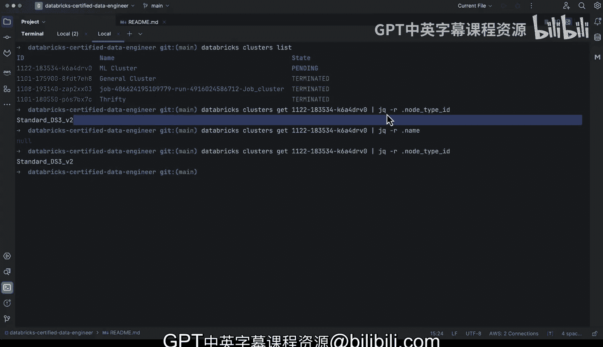

# 杜克大学《大型语言模型实践（高级数据工程、AWS、Databricks和本地LLM）｜Large Language Model Operations 》 - P112：11_01_03_安装和使用Databricks CLI.zh_en - GPT中英字幕课程资源 - BV1oi421Q7GT

One of the cooler things you can do with Databricks is administer it from the CLI in order to do that on a Mac platform。

 all you'd have to do is just do a B install。 so here we go。

 you can see that I run these B commands and in this case it would go through and notice I've already got it installed so I don't have to install it。

So we're ready to go Now， all anything to do is say which dataricks。

And we can see that this is actually better installed。And at the very beginning。

 you'll want to run the Databricks configure command。

 and this will actually configure your environment for the workspace that you're wanting to talk to And this is where you would also configure any kind of authentication as well。

 So you would credit Owa token and put it inside of here。

 So since I've already done that all I need to do is just dash dash help here。

 and we can see there's a bunch of different commands。 We can see we can look at the account。

 we can look at the API authentication bundling。 we can also do file system related commands。

We can synchronize a local directory to a workspace directory。

 So those are really cool things that are available inside of this。

 I would say that one of the more interesting things to start with， though。😊，Again。

 we can see there's a ton of things inside of this would be to work with the cluster。 So first up。

 what I'm going to do is I'm going to type in databricks。Clusterters。And I can actually say list。

 And this will show me all of the existing clusters that are available。

 And if we take a look at these four clusters， you can see that all four are running in a terminated state。

 So that means that at one point， they were running。

 And then now the state has been changed to terminated。

 So this is a great example of if I was gonna do some data science work。

 and I wanted to set up a job before I get frustrated because my job is taking a long time。

 I could notice that look， the cluster is actually in a terminated state。

 we need to actually change that。 So how would we do this pretty straightforward。

 what I could do is I could just say databricks clusters。 and we could say start。

 And then I would put in the I of the cluster that I'd want to run。 In this case。

 we can do the M cluster。😊，There we go and if I do this。

 it'll actually wait for it in foreground mode and give me the ability to see exactly what happens。

 finding the new nodes for example， and then it'll finally show back the start the start state。

 so this is a great way to administer machines here， another thing that I'll point out as well。

Is that we can also query for。Different information。 So let's say I had 100 or 1000 different。

 you know， machines here。 Well， what's a little bit confusing is how do I know which one has the right hardware。

 for example， Let's say I wanted something with a particular hardware capacity。 I don't know GPs。

 etc cetera。Well， what we could do is we could run a separate query while that's running in the background。

 and I could actually again go to databricks。Clus。List， and we look， we can see， in fact。

 it's in pending state。 Let's， let's actually find out a little bit more information about that。

 So what I can do is do you get。We can put the ID right here and it will return back a big J payload。

I don't want that entire payload。 So what I'm going to do is I'm going to pipe it into the JQ。

 which is a Json query tool， and I'm going to actually query for some pattern。 In this case。

 I'll say node type。Id。And what this will do is it'll actually show us great。

 this is a standard DS3 V2 that's the kind of hardware that I was looking for or you know you could obviously do something more silly。

 like do a name， of course where you have the name but you could actually go through here and figure out whatever it is that you wanted to do by querying that J payload so in a nutshell。

 the CLI is really something that is invaluable for people that are using the Databrick system day in day out。

 you can look through the help command， find a bunch of different recipes and create solutions that allow you to easily administer and start jobs and interact with the Databricks cluster even if you don't have access to the web interface。

