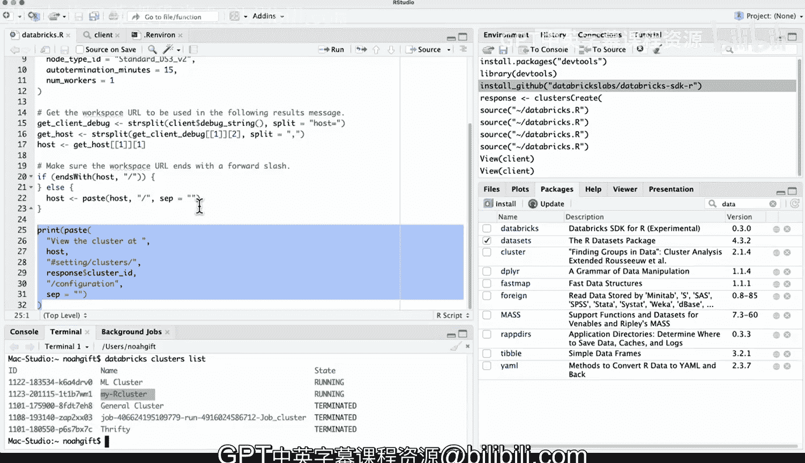

# 杜克大学《大型语言模型实践（高级数据工程、AWS、Databricks和本地LLM）｜Large Language Model Operations 》 - P113：12_01_04_安装和使用RStudio版Databricks.zh_en - GPT中英字幕课程资源 - BV1oi421Q7GT

Databricks also worked with both R and the R studio environment。

 You can see here this is a Databricks SDK for R tutorial and notice that it's an experimental SDK for now。

 but the gist of it is that you need to build out inside of your local R environment Databricks host so this would be your workspace URL and then your token which you can get from the Databricks administrative console once you've done that and you've gone through and you've created that token you can actually put it inside of your dot R environment files。

 obviously this is something that must not go into version control systems because this would have the personal access token and also the workspace URL but once you've done that you'll go through here and install these packages so you'll say install packages。

 dev toolsol， library dev toolsol and then you'll install it directly from Github。Finally。

 all I need to do is go inside of here and require the Databricks library that you just installed。

 make a client and do whatever it is you need to do So let's go ahead and take a look at how this would work in practice so if we go over to this environment here you can see that I have our studio running and I also have a script that I'll walk through here So first up what we can do is we can see that I did in fact go through here in the R console and say install packages devtools I also did library devtools and then I installed directly from GiHub the experimental R SDK Now the next thing that we do is I open up inside of here you say plus and you go to an R script and we require that Databricks SDK。

The client is actually pretty straightforward。 You make an instance of it。

 and then you figure out some kind of response based on that client。 In this case。

 there's actually a cluster's create command。 So this is really useful if you're familiar with the R language。

 You don't have to actually go into the web interface。

 you can actually create your own cluster in this case I'm creating a cluster called my R cluster。

 I then specify the spark version that I want to use and then I also specify the node type。

 So this is critical because there are many different types of nodes and you want to select the one that is going to meet your needs。

 for example， MLl jobs or data engineering jobs。Then finally。

 you can set the auto termination time 15 minutes as a sensible default and then again。

 if you're just getting this thing experimenting， one worker is fine and then finally you get the workspace URL and this will return back in the result and then finally at the very end。

You say make sure the workspace URL ends with a forward slash。

 and then the print paste here goes through and it gives with the response of that command。

 So in fact， I was able to do that。And I have a cluster running in this environment and what's nice about that is you can see that it's actually able to set up the host and the worker node。

 so there's a total of two nodes here and then what I can do is I can verify this by going to the Databricks CLI。

 which I can use inside of our studio so if I type in here Databricks。Cluters。List。

We should see that my R cluster and in fact， we do have that my R cluster running。

 so the R language is also a option for people that are familiar with it。

 If you're a data science practitioner and you're really living inside of our studio。

 you can absolutely administer the Dataricks infrastructure remotely from our studio。

