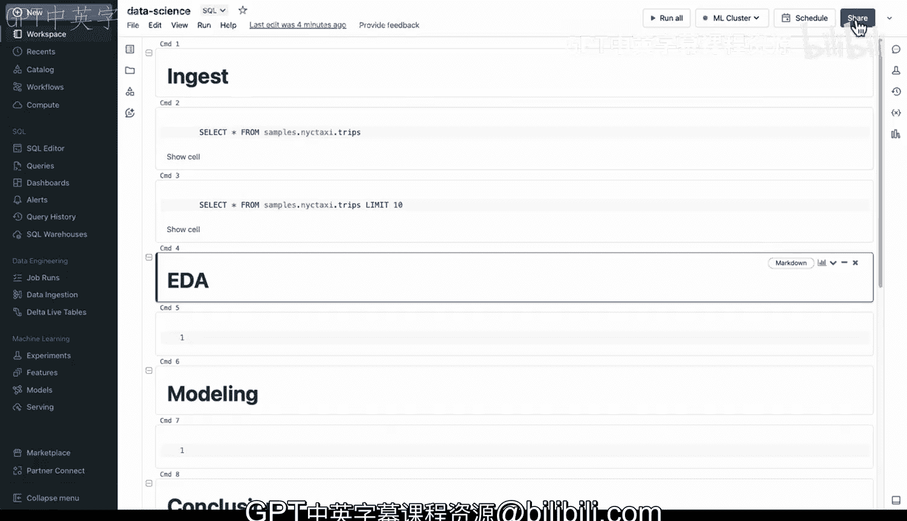

# 杜克大学《大型语言模型实践（高级数据工程、AWS、Databricks和本地LLM）｜Large Language Model Operations 》 - P114：13_01_05_笔记本系统介绍.zh_en - GPT中英字幕课程资源 - BV1oi421Q7GT

Let's take a look here at the Databricks notebook interface。

 You can see that you can create a new notebook by going to the new section and clicking on the notebook tab。

 So I've already done that and I'm going to name this thing data science。

So it's really common to want to build out a exploratory data analysis workflow。

But notice here that by default， you have the ability to use SQL。

 but you could toggle to another language like Python。 You could toggle to Scala to R。

 It's up to you to decide what it is you want to do。 Let's leave the default here for now。

 And'll also want to show you what I would consider a good first step when you're ability it out or notebook。

 So first， we have this markdown cell here。 and you can see it from the table of contents。 Not that。

If you put a markdown cell here and if we double click on it。

 you can see it is this markdown tag that it will create this hierarchy for us。

For a data science workflow， I would recommend the concept of ingestion first。

 and then you could do another markdown cell here by just going through here。Copying it。

Pasteing it and just tweaking it and we can call this。EDA。

And now if we go back to the table contents， you can see we have another one。

 And then if we want to do another cell as well， we can call this。

 let's say modeling if you're going to do some machine learning。

And then finally we could do one more and we could have a conclusion。

 maybe the conclusion is we have a predictive analysis where we show some kind of result。 Now。

 if we go into each of these sections as well， this would be a good spot where you could put in a new cell and do some kind of coding now notice here in the ingestion phase。

 I was able to run a SQL command Well how did I know how to start to look at the data， Well。

 if we go over to this section here， you can see this is a workspace where I could look at other notebooks or I could look at the catalog。

And in the catalog， you can actually start off with the sample dataset sets here and you can see that there are several sample data sets。

 this is the New York City taxi data sets here。And if I want to query it。

 let's go ahead and do it again， I can go to the middle。And select this plus。And from here。

 I can start to query exactly this hierarchy， so we'll say select。

And I can get an autocomp that's pretty nice and we can say from again。

 I'm getting autocompte and now I can just follow the naming structure right I can say samples dot。

 and then it'll go through and tell me what is available actually in the samples and we'll say New York taxi。

And then from here， I want to look at the trips， for example。

And then from here we could actually go ahead and say select star from samples。

And I could maybe even do like a limit。And we could say limit 10。And at this section。

 now all they would need to do to run it would do a shift return。

And it's going to go through quickly and run this query what's nice about it。

Is that it also gives me a table that I can scroll through here and look at the different items。

 even toggle up and down。 For example， And what's great about this is that I don't have to do much。

 I can really interactively play around with the data and move through things very easily。 Now。

 obviously， I can also hide these cells。 And this is a good thing to be aware of is that you can hide these cells。

😊，And if I wanted to create new cells。Here I would do another， let's say。

 explore towards the data analysis cell， maybe another one for modeling， another one for conclusion。

And at the end of this， I can again go back to my hierarchy and I can click on any of these and it'll navigate right to that section。

 So this is what I would call a normal setup for data science project is you create this structure of ingestion。

Expllororatory data analysis， modeling conclusion， you go through you query your data sets。

 potentially by first looking through and making sure you know what data set you're going to use。

 for example， the stuff you've already uploaded or using the sample data。

When you're at the conclusion of your project， you can go through and let's say share that notebook to other people on your team。

