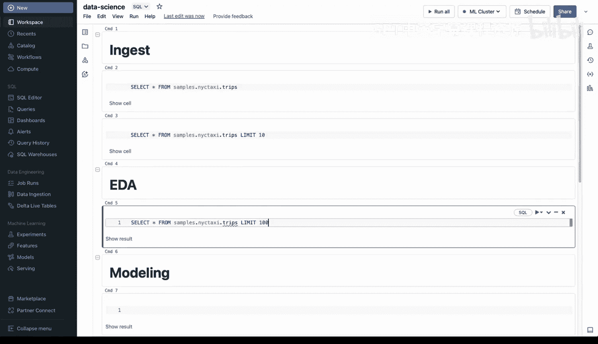

# 杜克大学《大型语言模型实践（高级数据工程、AWS、Databricks和本地LLM）｜Large Language Model Operations 》 - P115：14_01_06_执行笔记本.zh_en - GPT中英字幕课程资源 - BV1oi421Q7GT

Here we have Databricks notebooks and they're very exciting because there are many ways to use them。

 you can see here are some existing queries that I've got。

 but another thing I can do is execute the entire thing from the interface so if I go to run notice that I don't have to do things cell by cell。

 I can select run all When I do run all it'll run every single notebook。

I could also pick a certain cell so if you're working with big data， for example。

 you may want to select a subsection so that you don't rerun everything or you could run everything above or you could run everything below or you could run the selected text or you could even go to the last run cell so there's a lot of options here as well Now another thing that could be very useful to be aware of in terms of execution is you may want to clear all state and run all so for example。

 let's say you've been running this notebook over and over again and maybe you are unclear of actually the order or something changed or you could do is basically redo it。

Clear all the state， run everything again， and you're now in a known good configuration。

 so there's lots of options here in the run menu。Another option is you can also schedule。

 so if you go through here and you schedule， you could schedule a job and say I want this scheduled every single day at some time。

 a great example of why you would want to do this would be。

 let's say web scraping or some kind of data collection job。

Now you also could send alerts to your personal email address and you could toggle on start， success。

 failure， etc。And you can also name this a particular job。

 so you can also schedule into the future or even manually run it if you want to toggle through and take a look at it。

Finally， another advanced feature here that's worth pointing out is if we notice here that we've got this select query here is I can get hints on what to do。

 And so how would I get some hints on what to type Well， if you type in a partial selection here。

 So we'll say select， you're going to get code completion， which is nice。

And we can even get from samples and we can go through here and do this and even do trips。

What we can also do as well is if we do shift option space。

 it'll actually give you some ideas of some other queries that you may want to run。

 so this is also a nice way to get some ideas for execution。

 but they may not be exactly what you want you may have to change it， etc。

 but it is nice that you can actually go through here and do the shift option space and here we go。

 maybe 100 is the way that we want to actually run this particular query so there's lots of options here when you're executing cells。

 not just doing the shift or return which people typically do but you can go through the run menu。

 select certain cells or schedule things into the future。

