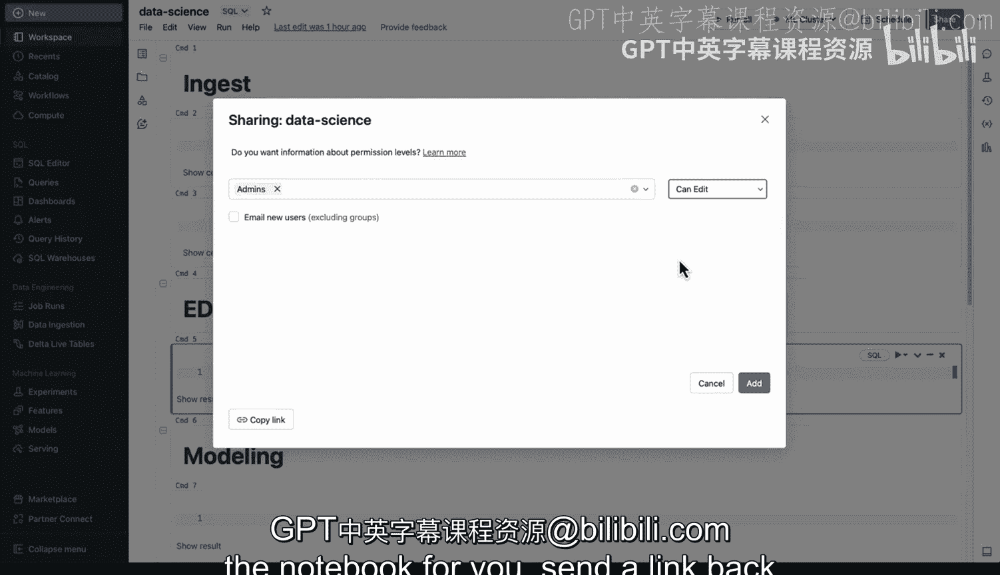

# 杜克大学《大型语言模型实践（高级数据工程、AWS、Databricks和本地LLM）｜Large Language Model Operations 》 - P116：15_01_07_共享笔记本.zh_en - GPT中英字幕课程资源 - BV1oi421Q7GT

Once you've created a notebook that has everything that you need。

 one of the things that we can do is go through the notebook and share it with other people on your team So how would you do this。

 Well， if we go over to the share icon right here， you can see that it gives you the ability to share with other people on your team so you can see here that it will pop down some suggested choices。

 for example， like admins。And you can go through here and give them this sharing link now。

Another thing you can do is control exactly what they can do。

 So this is very useful for maybe a developer that's working on some big data projects is that you want。

 let's say the data scientist to only view the notebook because they are going to execute the run。

 but you don't want them to actually change it likewise， you can actually go through here and run。

And you can actually allow someone to redo the run， for example， because in the case of a view。

 if you go through here and you were able to just view the results in the notebook。

 that's good enough， maybe for some of the data science tasks that you need to do but running requires many resources and it could require a bit of an understanding of what's happening in your organization and the cluster size。

 etc ce， so this could be a more privileged thing to do likewise editing would be reserved for very few amount of people that you share this with because you don't want someone to make a change to the notebook that could cause the notebook to fail in the future especially if it's like a scheduled job and then finally manage this would be for the highest level of privileges and this would be the example where you could allow someone potentially to reschedule the job or change the kind of cluster that runs with there's lots of options here when you're thinking about sharing that you can control inside of databricks and then finally you can just copy。

the link here and paste that link into a chat system like Slack or email it to somebody and say， hey。

 can you take a look at this notebook I'm having some problems and if you had， for example。

 edit privileges， they could even edit the notebook for you， send a link back to you and say hey。

 I think I fixed it。

