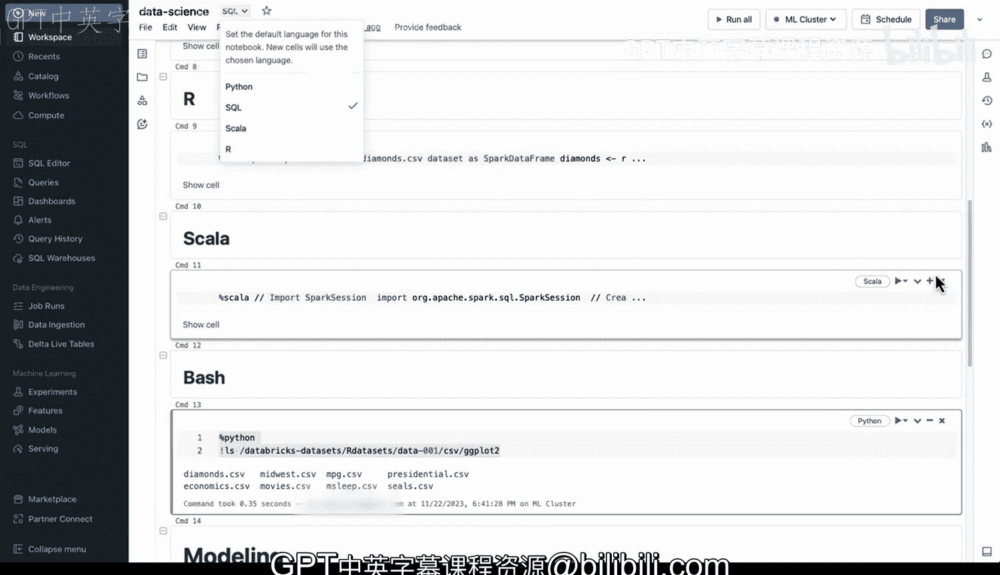

# 杜克大学《大型语言模型实践（高级数据工程、AWS、Databricks和本地LLM）｜Large Language Model Operations 》 - P117：16_01_08_多语言支持.zh_en - GPT中英字幕课程资源 - BV1oi421Q7GT

Yeah。Here we have a notebook that I'm going to demonstrate the ability to use multiple languages now by default。

 you can see here that the default is SQL， but there are other languages we can use。

 We can use Python。We also can use Sca， and we can use R， and even there's a hidden language。

 which is bash， which I'll show you how to do as well。 So first up here。

 if we scroll down and we look at a SQL query， you can see that this is obviously a straightforward way to query。

 of course， doing a limit on a large dataset set as a good idea so that it doesn't take several minutes just to test something out。

 Now， if we want to go down and run this， I could just go through here and just click on runse。

 and this will go through here and give us the result。

 and we can see the result is able to be shown next， though。

What we can do is move to the Python section and what we're going to do in this Python section is also。

Be able to run the cells。 And so in order to do that。

 all we need to do here is go ahead and run this。 we can see run cell and notice the difference。

 We have the python right here with the percent that tells the cell that it's going to be a Python cell we also have the import pandas asP we then go through here and mount the databs file system we then read it in as a CSv and then we display the first 10 rows。

 So this works fine for small datas if you want to use something larger。

 you'll need to use the Sp interface and then if we want to go down here and look at R as well。

 this is another choice that we have that's available and what's nice about the R interface here is that we're able to if we look through the cell here require the spark R library So this binds with Sp and we're able to also put in the percentage R here to。

show that this is going to be a cell that will invoke the R language。

 and then we're going to read the diamonds data set as a spark data frame。

 and you can see here that it's all included it we have diamonds，We're able to source databricks。

 We're then going to split the data into a training set and test set。

 and we're going to exclude the row IDs。 and then finally the pertinent information is actually printed there。

 So let's go ahead and run that。And we go ahead and we say run cell。

We can see it's going through here， running， churning， going through。

 and we see the output right there， which is which is nice。Finally， we have Scala。

 and if we go through here and we take a look at Scala。Again， it's a percentage， we can say import。

 org Apache， Spar SQL Spar session。A spark session is then created。

 and then you can actually pass insQL query if you want， and then that turns into a data frame。

 which you can actually run the show operation on and you can see as well。

 we can run this and it goes through and it runs that and gives us the data。

 Now the final thing that I'll mention is this bash example here and what's nice about this style is that if you use Python cells。

 Python has the ability to execute shell commands and we can actually do this with a percentage so we can say percentage Ls and then notice when we run this。

 we're able to actually run any type of shell command inside of here。

 So this is a great way to you know maybe do some data processing or run some commands to see where you're at。

 So you really have the ability to run not only just these four languages but with the Python syntax。

😊，You can also do the exclamation point here LS to also get access to the shellll ecosystem。

