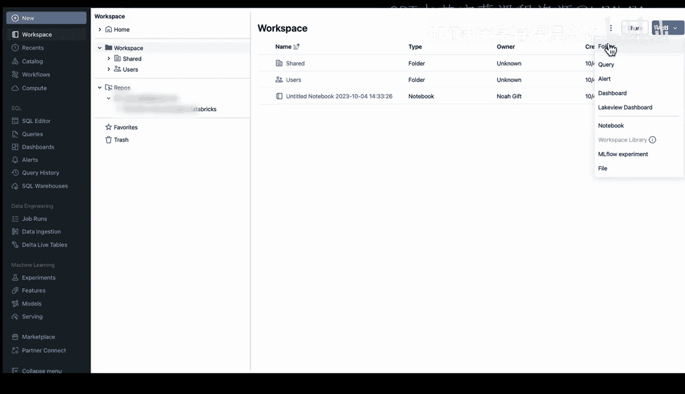
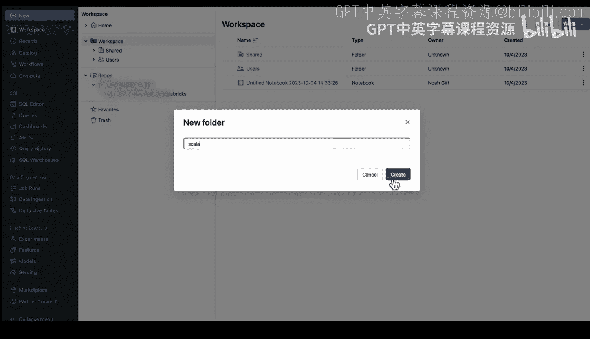
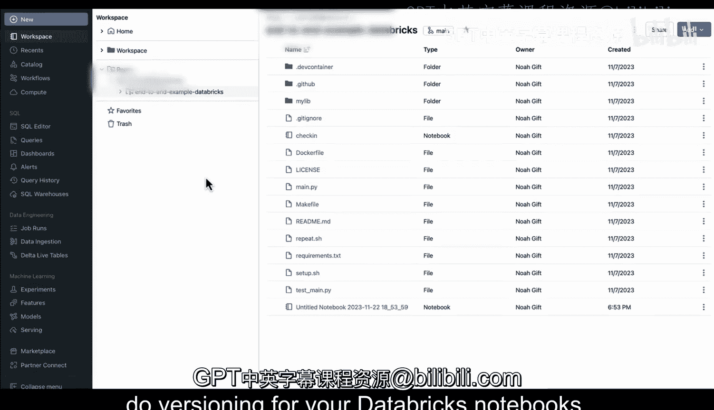

# 杜克大学《大型语言模型实践（高级数据工程、AWS、Databricks和本地LLM）｜Large Language Model Operations 》 - P118：17_01_09_Databricks代码仓库概览.zh_en - GPT中英字幕课程资源 - BV1oi421Q7GT

Once you start using notebooks quite a bit， you're going to want to look into the workspace。

 which is a way to share different things in your environment with other people and also organize things and also repo So first。

 let's take a look at workspace here。 So inside of the workspace one of the things that we can do because we can actually add a folder。

 And so this folder could be， for example， some Sca notebooks。

 you could put them all in a certain directory and then once you've got those notebooks directory created you could actually go through and put a notebook there and we can just say this is called our you know Sca。

Test， and then we could change the default language to Scala and we can just say sure。

And then from here， if we were able to go back to that workspace that you can see that that notebook is there as well。

 And so finally， I could actually share this entire thing with other people by selecting sharere。

 That's one way to do things is you have this local workflow and there's a lot of benefits to that。

 on the flip side a lot of times you will want to get access to version control and actually go through the version control system and version control your notebook。

 So let's go ahead and take a look at a repo here。 So if we go to reppos。

You can see one is already added。And if I go ahead and I say add folder。

 you can actually organize them inside of the folder。

 That's one way to actually change things or likewise， if we go into here。

 we can actually say add and we can add a repo。 Now in terms of the repo here。

 you can see this is the URL。And you could put an HtP URL here。

 We also could select different providers from Github to Bit bucket to Gitlab to Azure Devops to AWs code commands。

 So have lots of options here。 depending on what are the requirements for your organization And then you put your name right here。

 So once you've done that， you can see I have an example here。

 you get access to everything inside of the notebook。

 and we could start the version control the work that you're doing so that it's not lost and you're able to actually share that work via the version control system with other people。

 you also can directly add inside of here as well。 So if you go through here， you can add files。

 you can add notebooks， you can have folders so you do have the ability to interface with them。

 So there are a couple different ways to version control your system with databs。

 you can always download it and add it in or you could have the direct workspace integration and you can actually move things from the reos to the workspace and the workspace to the reos。

 And in general， it's a best practice to do versioning。

For your Databricks notebooks。