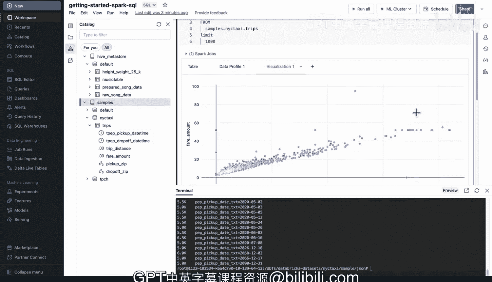

# 杜克大学《大型语言模型实践（高级数据工程、AWS、Databricks和本地LLM）｜Large Language Model Operations 》 - P119：18_01_02_使用Spark SQL进行高效数据转换.zh_en - GPT中英字幕课程资源 - BV1oi421Q7GT

。Let's get started with SparkSQL， which is a way to query all of the Databricks file system in SQL。

 let's go ahead and take a look first at this catalog here。

 so if I look at this you can see here that we've got these catalogs and in fact sample data as well so we see sample default New York Tax TPCH。

We can also look at it from another view。 If I go to open bottom panel here。

 it gives me the ability to also interrogate it from a terminal。 So if I type in L S D B。F S。

That would show us what's inside of that Databricks file system。

 and I also could look at the actual data sets here。 So if we could say data sets。

And if I want to look at， for example， NYC。Sample。We can see， in fact， that's where that data lives。

 and I can even CDd into it if I wanted to。Just take this last navigation here。Put inside。

 and then we can see， for example， there is a directory that has Jason。Inside of that。

A whole bunch of different files。 in fact， I can do this。 I can do a DU。

And what this will show me is the size of the entire set of sample data。

We could also do it individually and we could see that there's a large really variety of different sizes here。

 you know，70 meg 105。 So this is a good way to just kind of play around you know。

 if you want to see what's happening with the local Databrick file system。

 but we also can query it from SQL right so this is our default language here。

 And if I go inside of this。 What I can do is I can actually type in select。Star。

 and we can say from。And we can say we want to do the samples。And we'll do the NYC taxi data。

And if we look at the trips here。Let's go ahead， and。Limit， let's just grab about 1 thousand0。

Of these files。 Now， this is an O SQL query， but I can use the advanced features here of the notebook to clean it up a little bit。

 make it look better。 So if I go over to this over here。That's going run it。

 but I want to select this one right here， which says format SQL。 Let's go ahead and run that。

 There we go。 So we have a little bit better of a SQL format now。 And then if I run this。

 what's going to happen is I'm going to get this giant spark job that runs and I can even inspect if I want to and see what was going on。

 But in general， what's nice about this is I'm able to actually look at this data。

 look at the different views， you know， sort it， for example， and the other thing I can do as well。😊。

Is click on this plus icon， and there's two different modes we can dive into。

 We can dive into visualization， which is often a good place to start， or even data profile。

 Let's go ahead and data profile first， so we can find things like， for example。

 descriptive statistics， which I often first want to do when I'm looking at something And I want to see what's going on in terms of what's happening here。

 so we can see that the standard deviation of this particular column is a certain value。

 I can look at the median really in these are doesn't really make sense。

 but in terms of trip distance here， we can see that the median is 1。63。

 So that is something that's an interesting。 and we can look at the skew really skewed towards extremely short trips simultaneously we can look at the fair amount。

 a little bit more spread out， still skewed， but we can see the median fair is 9。

And then if we look at the pickup zip code or drop off zip code， right so we can。

 we can get a feel for the data by doing a data profile， which， which is really handy。 We also。

 though， can click on this plus and do a visualization。

 So let's go ahead and do this visualization as well。

 And let's start off with something beyond just a bar chart that's a little bit boring what we could do instead。

As we could look at a scatter plot or a bubble plot， let's do a bubble plot。

And then we can select what we want to actually do a scatter plot on。 So if we go through here。

 we can say， let's say the trip distance and also the fair amount， those are kind of exciting。 Oh。

 there we go。 So we got we got a nice little logarithmic relationship right it's linear up until you get to here and it seems like things start to go into a logarithmic curve here。

 So it may be the fact that know once you go to a certain part of the city。

 potentially it's like a fixed rate or something like that。 But in general。

 we're able to get a good visualization here by taking a look at this And if I want to as well。

 I can just say save。And then I'm also able to have this visualization inside of my notebook。

 So this is a great way to really immediately start adding value in an organization。

 You can see it's not too hard to use SQL do some descriptive statistics。

 get some great visualizations， and obviously if I go to here， share。

 I could share that with other people in my organization。😊。

