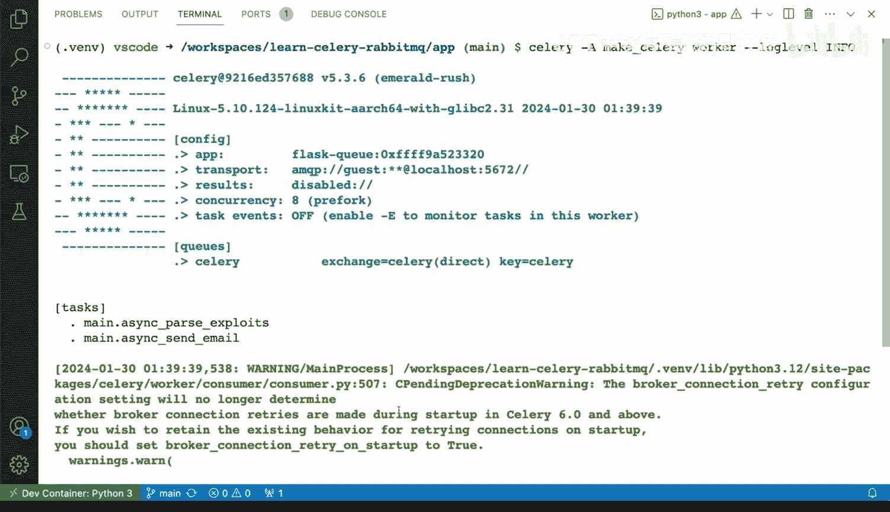

# 杜克大学《大型语言模型实践（高级数据工程、AWS、Databricks和本地LLM）｜Large Language Model Operations 》 - P11：11_01_06_将Celery与RabbitMQ连接.zh_en - GPT中英字幕课程资源 - BV1oi421Q7GT

Let's connect ce with raitm Q here。 I have an environment where I have raitm Q running。 It's。

 let's actually take a look at。The type of system that I have I think its Dian and yes。

 in fact it's Dian 11 perfect that's fine。 And in this Deven 11 system there's a couple things we already have raitm Q running so let's let's actually triple check。

I'm going to check all of the processes here and we're going to look for rather than the Q This is a good way to check if ratherq is running。

 you can see there's tons of different things that are already running and executing in the system and it's what is going to allow us or it's like the requirement that we have in order to connect salary。

 Al right， so the next thing that we want to look here I'm going to span here as always with Python we want to an actually less quadruple check the version。

 we have Python 312。So I'm going to use Python3 here and I'm going to use the VM module to create a dot Vm folder。

 So yes， I'm going to say yes to these is going to tell Vis code to use that virtual environment behind the scenes what's happening is the Python 3 is creating that folder for me so let's activate now this is this has created a virtual environment。

 a sub which is a subdirecty where all of the Python dependencies will go you'll see that this has changed pretty standard practice with Python and now the next thing we want to do is install the requirements。

 we've already seen the requirements before， so I'm to do Pip install R requirements。

Rerements that text and this is going to go through and let's just wait it out until that completes Great that completed。

 And now what we have where we need to take a look at is if we have salary subcom and yes。

 in fact we do have salary So now what we need to do is we need to go here where app is and I'm going to click on app and'm going to let's take a look at make salary remember remember we had that before it is this right here and we're going to use that with salary to start the salary application。

 this is a requirement， by the way， so I'm going to expand here I'm going to clear to make some some room for what the type of things that we're going see and what we're going to do is salary dash a。

Make salary， salary worker salary。啊。Make salary actually is the Python file I'm going say it's going to be a worker and the log level that we want is going to be in So this type of error is what you're going to be facing if you're not in the right directory so if we say we go to app and then we find make salary right here that should work no problems So we'm going to run these and we're going to find some problems So what is going on here well we have issues with with our application where one of the dependencies was not installed in this case where requiring requests so this is another problem that you may find when you're trying to connect salary because salary is trying to run that application is going to load that python application you just need to make sure that whenever you have your requirements right here this is going to。

Be installed。 So that's just Python packaging can be tricky。 And this is not a problem。

 So what we're going do is make sure that requests is installed。 And there we go。 This was。

 this seems to be good to go。All right， now that we've seen a couple of things that can go wrong。

 let's actually try this again and I'm going to start salary with make salary worker log level info Minands。

And this is going to get started。 All right， so let's go through some of the things that are happening here at the very top we'll get some information。

 this is our name remember the name of our app flask queue this is pretty important because it is making sure that we have the right queue here we're connecting to the right queue we're connecting to the rabbitM Q instance that that is running on local host。

And we get some concurrency information。 So what are some of the cues Well。

 the queuees are right here and these cues are async parse exploits and async send email So we'll see those later but that basically these are basically coming from my flask application。

 I define them there。 So this is useful because I have I can make sure that this is actually good to go and this is correctly loading my flask application and it understands exactly where things are coming from so。

You can see here that salary is ready and whenever we start interacting with these tasks。

 we'll see some activity here。

