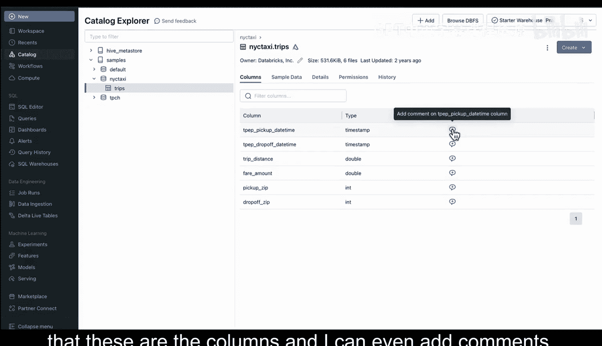
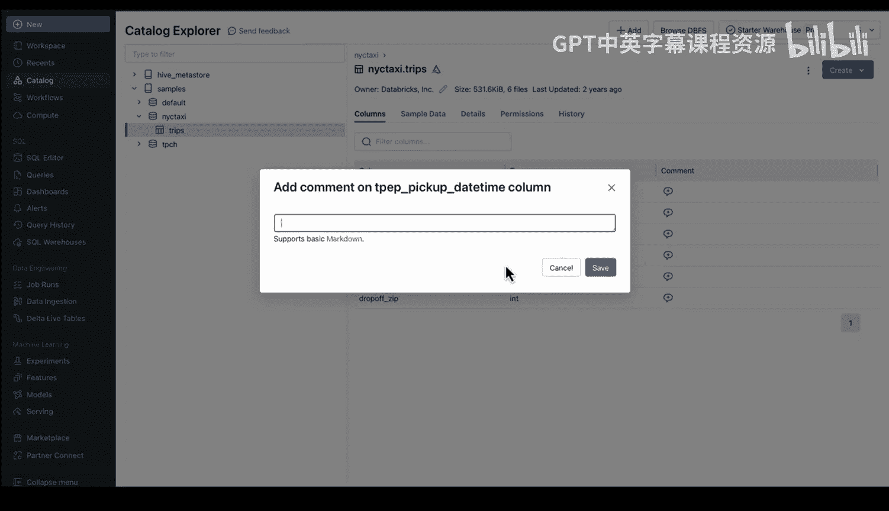
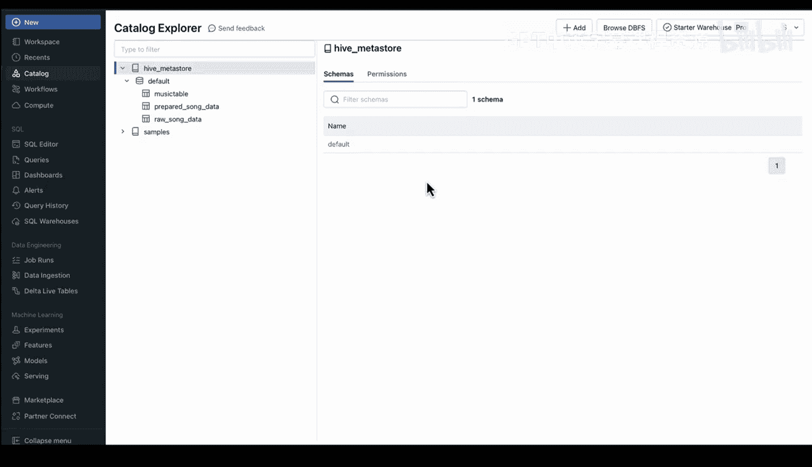

# 杜克大学《大型语言模型实践（高级数据工程、AWS、Databricks和本地LLM）｜Large Language Model Operations 》 - P120：19_01_03_使用目录浏览器.zh_en - GPT中英字幕课程资源 - BV1oi421Q7GT

Yeah。The catalog Explorer in Databricks is a user interface that allows you to browse， search。

 manage and organize different data objects like tables， views。

 dashboards in the Databricks workspace。 Some of the things you can do include providing a centralized portal to search。

 filter and browse tables， dashboards and models and you can also tag objects and you can manage access permissions and you can also view the underlying data within table。

 So really， it's a great way to play around with your data。 I would say is the easy example。

 So let's take a look at this catalog Exper here。 We have samples。

 and we see that the new taxi data would be a good one to play with。 So if we click on this。

 notice what happens is that automatically I can tell that these are the columns and I can even add comments。

 let's say I'm working with a team and you know， for example。

 we would want to have some very rich commenting like hey。

 we need to clean up this data or whatever it is we want to do。😊。

Also， I can look at a descriptive sample as well， which is really nice to just get a view of the data without having to write any code。

 and we can also look at things like the details。You know， where actually is this on disk。

 which is a great thing to know， because I may want to do some other things with it。

 And then finally， if I wanted to， I can actually do things with this。 So this is kind of neat here。

 this create widget。 So if I say create。😊，Probably the first place you'd want to start would be to do a query。

 So if we do a query here， we can say select star from trips。 and in fact， I mean。

 it already does a limit 1000， so maybe I'll just make it easier and I'll say a limit。100。

And what's nice about this is that I can do a shift return。

And then it's going to go ahead and run this query。

 It's got a built in limiter here that protects us from， you know。

 basically taking down the system by always limiting to 1000。 But if we look at this。

 you can see that return back 100 rows in 385 milliseconds。 So this is a very cool feature here。 Now。

 remember， we also can do other things。 So if I click on this plus。😊。

I could immediately go into a visualization as well。 And again， I could look at a scatter plot。

 for example， pick the X。Pick up zip code or potentially the trip distance。

 whatever it is I want to play around with。 And then I've got this nice little dashboard here as well。

 So what's really useful about this is that I can keep on building things so I can。

Potentially build some kind of a filter。 And in general。

 this gives me the ability to have these stored systems attached to the data so that other people that are looking at it might go。

 oh， okay， great。 This is one of the things that we want to take a look at with this particular data set。

 Now， the other thing that's also kind of a stealth feature here is if we go to。

One of these things here， like the hive meta store， for example。

 it also gives us the ability to do more things。 So， for example， if I type in catalog Exper。

We can also open this up in a separate window as well。Now。

 the other thing that is important to be aware of is that we're able to toggle back and forth between the SQL editor and the catalog Explorer。

 which is what we saw。 So if I go here and I go to the SQL Explorer right that gives me this view but I could always toggle back and go to the catalog Exper and there's really an interaction between the two things a lot of times you may want to just look at the data but then when you want to actually change something you would go back to the catalog Exper finally the other thing you can do that's actually very powerful is dive right into the Databricks file system。

 So for example， if I look at the file store here， one of the things that we can see is that there is some data here that doesn't have a table。

 So this would be something that later if I wanted to create the metadata for this I could go back to this databricks file system and look at that particular path。

Create the table inside of the catalog Explorer so then I could do queries with it or do visualizations。

 etc ce， so catalog Explorer is really the place to start when you're dealing with metadata on the Data bricks file system and it saves you a lot of time if you set up some automations around the visualizations and also the descriptive statistics so other people on your team can immediately start to add value。

