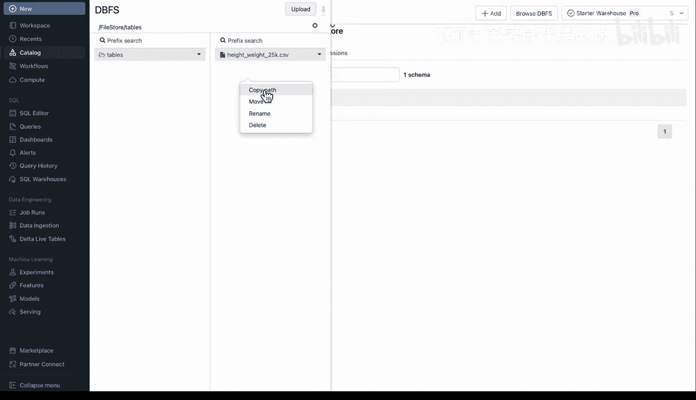
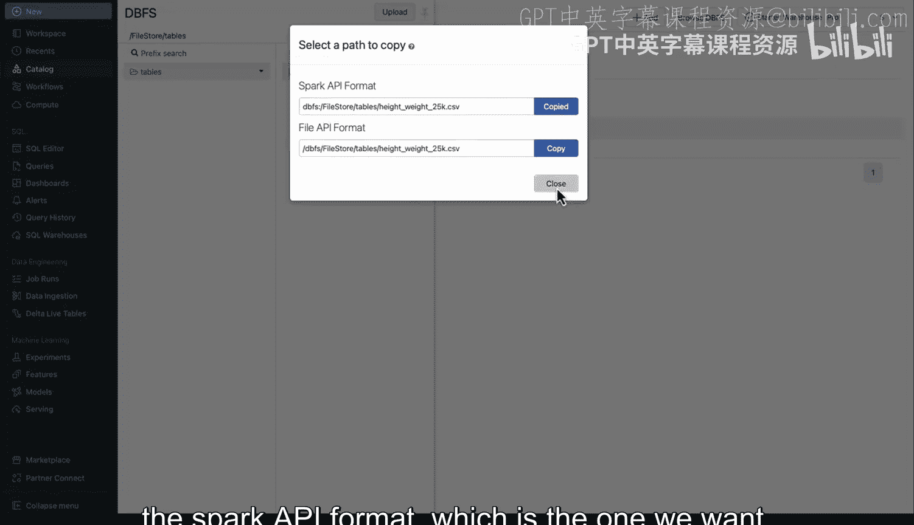
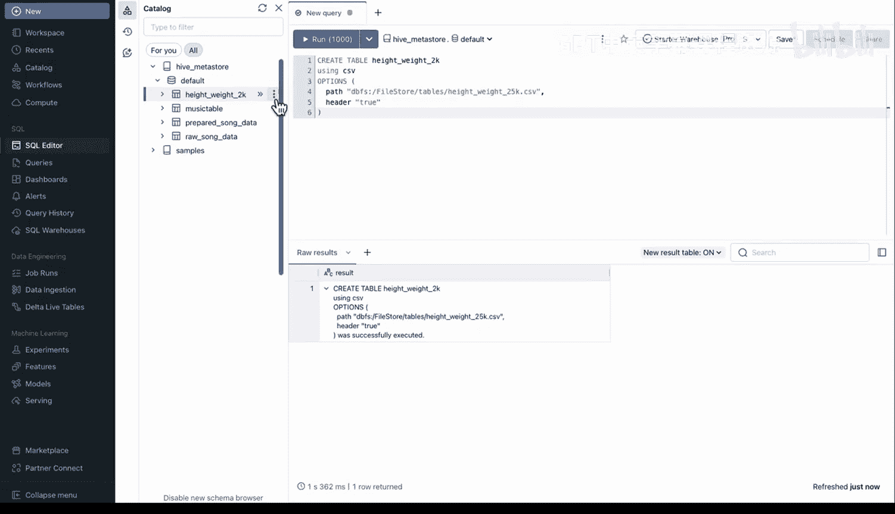
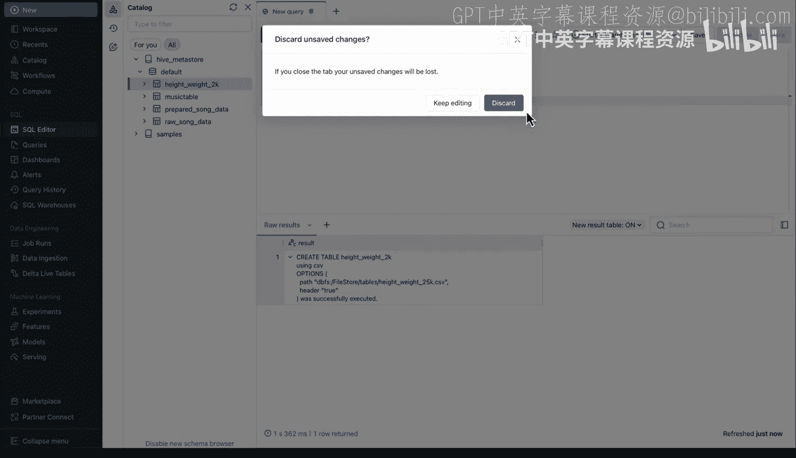
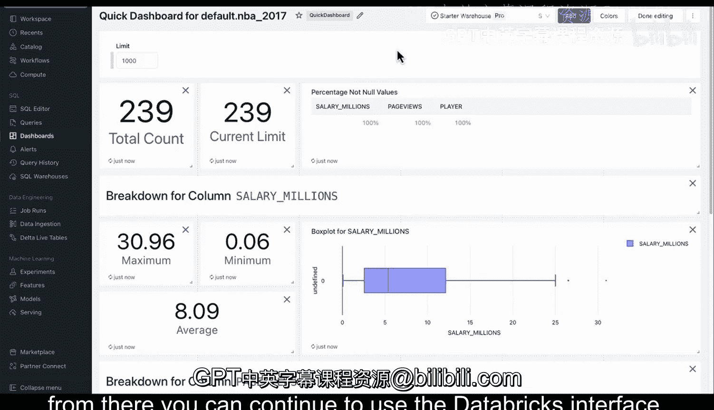

# 杜克大学《大型语言模型实践（高级数据工程、AWS、Databricks和本地LLM）｜Large Language Model Operations 》 - P121：20_01_04_从文件创建表.zh_en - GPT中英字幕课程资源 - BV1oi421Q7GT

A very common task that is a little bit confusing with Databricks is how do I add data？

Into the Databricks file system manually and then create a table based on it。 So， for example。

 if it doesn't show up in the catalog Explorr here， how do I actually get it to be created。

 So first up， what we want to do is look at the DBFS。 If we take a look at this DBFS here。 Look。

 I have some data that actually isn't inside of the catalog Exper。

 So one of the things that we can do is we can actually pop over to the SQL editor right here。

 and what I can do is I can actually create a new query here， that will create the table for us。

 So what I can do is I can say create table。😊，And if we want to go back to this real quick。

 let's double check where this path actually lives。 So if I go to this， if I click on copy path。

Notice how it actually tells us DBFS file store tables， height weight or the Sp API format。

 which is the one we want。 So I'm going actually use that when I do this query。

 So I'm going to say create table and we'll call this one。

Hight。Wait。And we'll call this 25。K， and we'll say using CSV because of CSV data。

And then we'll say options here。And we can put in essentially the path。And so this will be。

The first path， and then if I do a quote。I can paste that in。Looks good。

And then I can do a header equals true so that it will respect。The column headers。

And that should do it if we go through here and we take a look at that， looks pretty good。

And I could even save that query， for example， if I wanted to。And that looks pretty good。 All right。

 let's go ahead and run that。And so what this is going to do is's going to read in that data。

 And then there we go， we can see that it is able to actually create that table。

 So what it means is if we go back to the hive minister store。We go to default。Aha， there we go。

 We've got this thing actually created for us。 And if I want to。

I can actually close this to get it out of the way。

And if we just go over here， we collapse this， we can see all of the different names here as well。

 which is pretty nice， and I could also open this up in the catalog Explorer independently。

 so it's basically all ready to go。 We have the columns。 we have the sample data。

And we have the details as well。 So this is a pretty straightforward process to get this into the catalog Exper。

 What we haven't covered， though， is how do you actually upload the data from scratch。

 So let's do that as well。 I'll add another file。 So we'll say add。Add the data。

 create a modify table。 We'll click on browse。 I have some NBA data here that I'm going to upload。

There we go， we see it gives us a nice preview mode。And we can take all of this stuff。

 and we can say， in fact， automatically create a new table as well。

And we'll call the table name MBA 2017。 Let's just make it a little bit easier to work with。

And we'll say create table。 So if you used the proper interface as well。 Like， for example。

 the other one potentially was used from an API upload and it hadn't the table hadn't been created。

 it could be a little bit more difficult。 But if you use the catalog Explorer interface here。

 look immediately， we've got all this working， we can look at the sample data。 And in fact。

 I can immediately as well。 make a nice little dashboard here。

 And if we go through and we say the number columns， maybe we can look at the。Let's look at some。

Salary in the millions that looks pretty good and maybe be the page views on Wikipedia and then the player name。

 and we can actually create a nice dashboard from that。And here we see， I'm able to pop all that in。

 We can see a box plot for the salaries。 We also see the total records or 239。

 We can look at the page views as well。 We can see there's a very。😊。

Exponential relationship between the the data here。 We see some outliers are just you know。

 amazingly big。 And then we also can look at other things inside of this dashboard。 So in a nutshell。

 this is a great way to get started with your data。😊，Is to use the catalog Expr， upload things。

 add it to a table。 And from there you can continue to use the Databrick interface。

