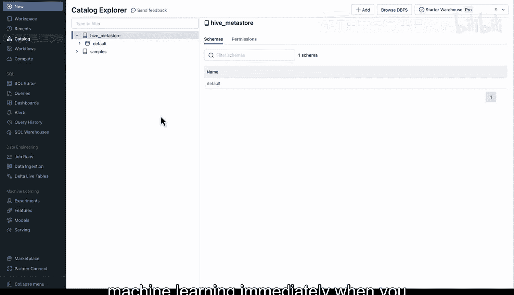

# 杜克大学《大型语言模型实践（高级数据工程、AWS、Databricks和本地LLM）｜Large Language Model Operations 》 - P122：21_01_05_查询外部数据源.zh_en - GPT中英字幕课程资源 - BV1oi421Q7GT

How do you query against external data sources， Well。

 if we take a look at this catalog Expr here and we go to add。

There's a section here where we can obviously add external data。That's one option。

 We can also integrate with native integrations as well。

 So this is probably one of the easier ways to get started with querying external resources is you could put some items inside of blob storage and you could then integrate that directly into your upload。

 Now another thing you could do as well is you could have things in different databases like Cassandra。

 Snowflake system， JDBC， Kafka， El search， Mongodb， Postgrass， MysqL， even the DBFS itself。

And now you also can talk to other sources as well， including。Google Drive。

 you could look at Salesforce。 So there's a lot of different ways that we can actually add things inside from external sources。

 One thing I'll also mention is that we can also look at ingest via partner。

 And so this is slightly different in that。What you can do is you can actually take data sets from these other resources here。

 There's a nice integration。 Let's take this5t here。 We could go through here， advanced options。

 This is going to put it directly into your DBFS and you'll be good to go。

 There's also BI and visualization。As well， there's sources for data preparation， transformation。

 machine learning， so data IU， label box， we got security， we have data governance。

 So there's a bunch of different ways that you can connect these external data sources as well。

 So there's more than just being able to add the data directly from this interface。

 you can also talk to providers by this in just via partner So really there's a rich set of resources to pull all this into your Databrick system and of course。

 you can use all of the existing interfaces like creating a new notebook or querying that directly inside of your SQL editor or even going right into machine learning immediately when you have that data and running an Auto experiment。

