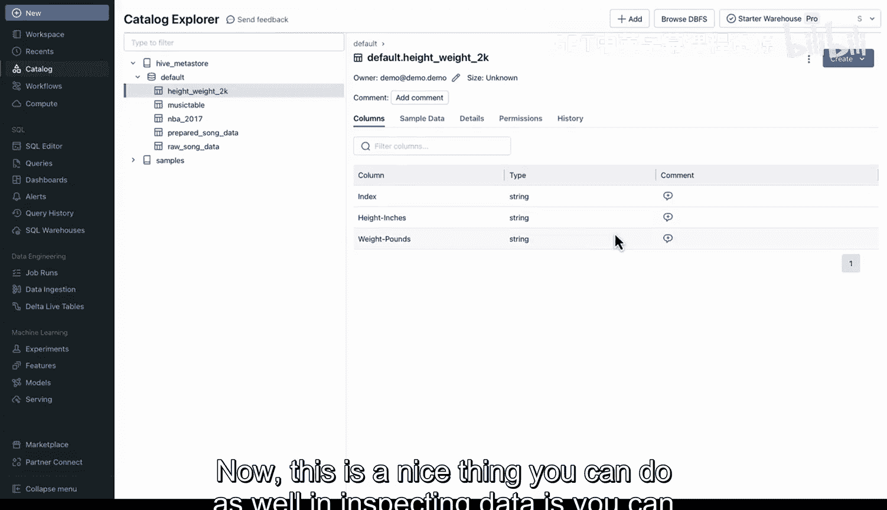
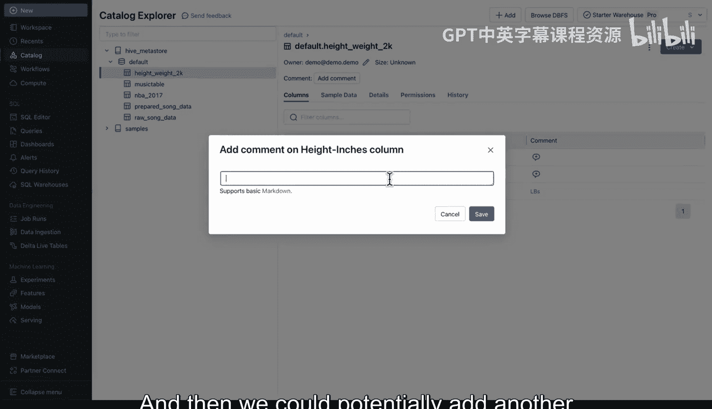
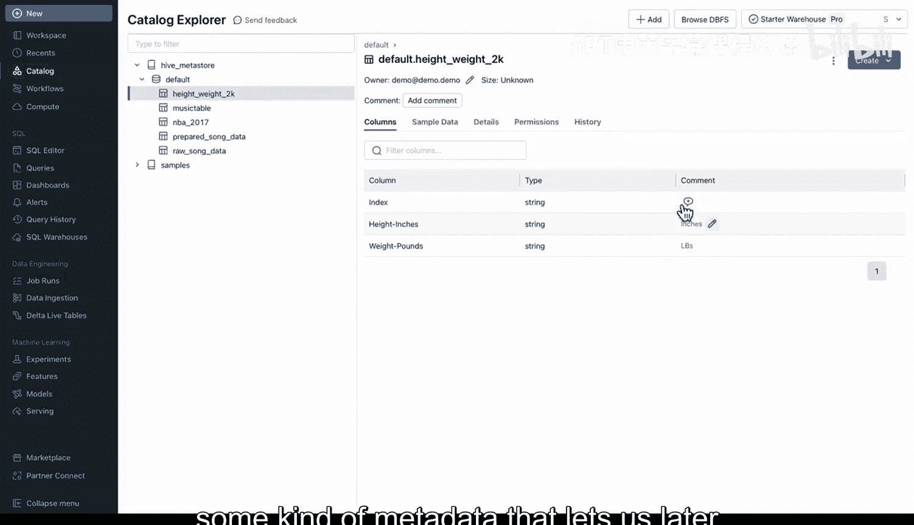
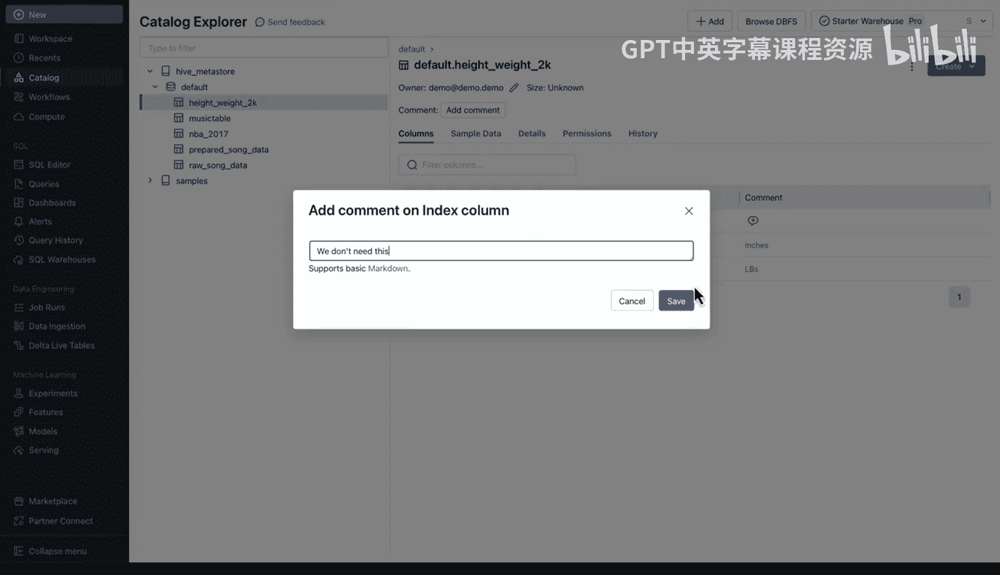
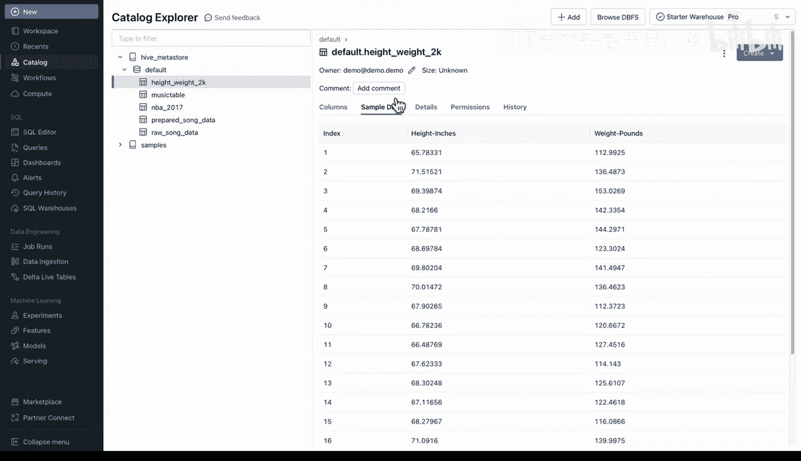
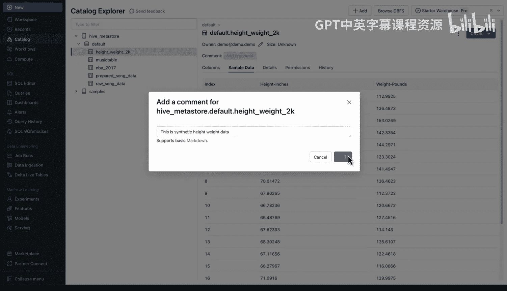
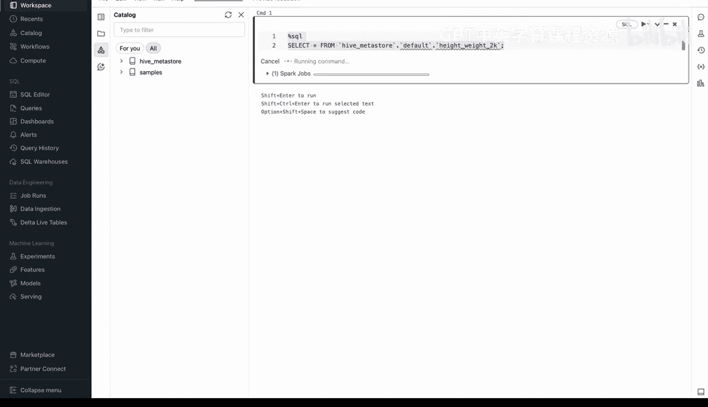

# 杜克大学《大型语言模型实践（高级数据工程、AWS、Databricks和本地LLM）｜Large Language Model Operations 》 - P123：22_01_06_检查表结构.zh_en - GPT中英字幕课程资源 - BV1oi421Q7GT

Yeah。Let's take a look at how you would inspect a table inside of databricks。 First。

 proceed to the catalog。 The catalog Exper is going to require a warehouse to be running so that you can actually inspect the tables。

 Now see here we have the hiivemin store which is where the user uploads are kept and we also have the samples so these are the default。

 So if I wanted to take a look at， for example， a table here。

 trips notice that the owner is databricks so we can see what actually occurred when this was first created。

 So Databricks created it two years ago and we see the sizes 531 kilobys we can also take a look here at the columns。

 we can grab some sample data as well and this will give us a good overview of what's happening。

 we can also look at the details here and this shows us the location on disk so this could be handy if you're doing some。

Of operation like you want to copy something into location。

 and then we can also look at what are the permissions and also what's the history Now。

 this is going to be less helpful in terms of the default data。

 But if we go to some data that I've uploaded here and we take a look at this height weight 2000 here。

 you can see this is owned by demo thiss a fake email address。

We also have the columns that are available。 So we have index， height， weight。 Now。

 this is a nice thing you can do as well in inspecting data is you can actually add comments。

 for example， we could say this is in。

LBs， for example。And then we could potentially add another statement that says this is in inches。

Some kind of metadata that lets us later figure out more information about this。

 and we could even add some things like， for example， we don't need this。

And this would allow us to annotate and inspect what's happening。

 We also can again go to the sample data， take a look at it， look at the details。

 look at the history， etc。

And you can even add a comment directly onto the table itself and say， this is synthetic。

heightight weight data。So really this is your go to spot if you want to inspect what's happening inside of the Databricks catalog is go to the catalog Explorer。

 you can manipulate the table， inspect it， look at some metadata around it。

 add your own metadata to it and finally if you want to as well you can directly go into a query a notebook or even create a dashboard Now if we take a look at this notebook real quick one of the handy features here is that it automatically gives us the query that we would want to run so this is actually pretty useful。

If we connect to a cluster here。What's nice about this is that it can be the one stop shop if you want to grab into a table and get as much information as quickly as possible。

 you can branch off from there and go to different solutions like， for example。

 starting to query it inside of the actual notebooks themselves and starting spark jobs around that。

