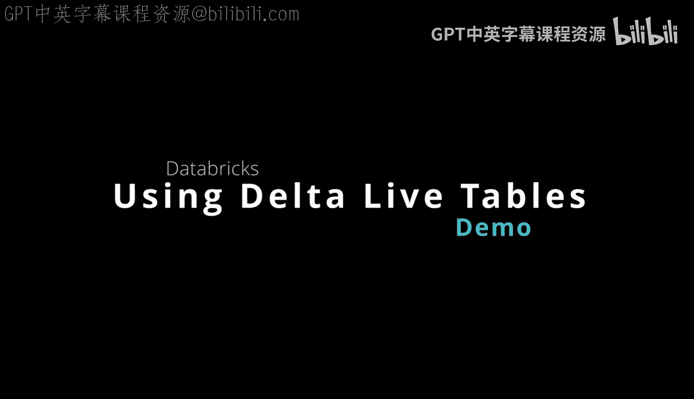
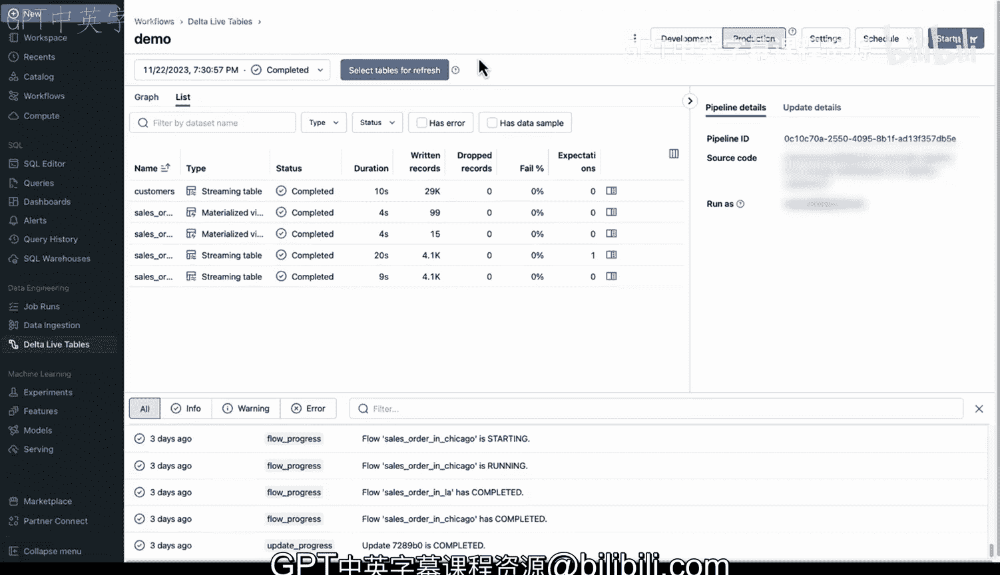

# 杜克大学《大型语言模型实践（高级数据工程、AWS、Databricks和本地LLM）｜Large Language Model Operations 》 - P124：23_01_07_使用Delta Lake构建可靠数据管道.zh_en - GPT中英字幕课程资源 - BV1oi421Q7GT

Delta Live tables are a new way of scheduling workflows because you're able to use all of the advanced features of Delta Live and you can obviously create a new pipeline by just selecting Cate。

 notice you'll have to select pipeline name。You can choose what product。For advanced core Pro， etc。

 you can even see some documentation about which ones to choose and then you have the option of doing continuous or triggered so the difference between a continuous with streaming data。

 you could always be ingesting the new data as it arrives versus a triggered would be on an event and then you would pass in the source code path as well。

 for example your repo that's connected to your workstation that could be a good place to store your source code and then in terms of the destination。

Potentially the unity catalog and then in terms of compute。

 you would select what kind of compute cluster you would want to run。 So I already have one running。

 so let's go ahead and take a look at this demo here and you can see here in this deelta lives spreadsheet we have streaming table here which is customers we also have the streaming table here and these are able to move into a combined sales order clean So there's some ETL operations and then we have a materialized view here and a materialized view here。

 What's useful about this is that we also can toggle and look at a list and get more information For example。

 did it fully complete what are the different types of jobs that are actually running is it a streaming job for example。

 how many records were written did any of the records drop so if you're dealing with anything from the internet like an API there could be some drop so there could be some failures。

It's really nice to be able to just see that in one view。 Likewise。

 we can find directly where the source code lives as well by just selecting where that lives。

 And if I go to that source code link you can see here here's the notebook that gives us all of the streaming code here and we could make changes to it as well So there's a nice interface between the live code back to the automated pipeline so to kind of wrap this up here the last thing that might be important to be aware of is that you also can toggle between different mode so in your development mode。

 you get things working， you could then toggle to production mode。And then finally。

 you could schedule this pipeline on some kind of an interval as well。

 so there are a lot of features that make doing complex data pipelines fairly straightforward with the Delta Live tables and you can see here a pretty over good overview of the basic features of Delta Live tables。

