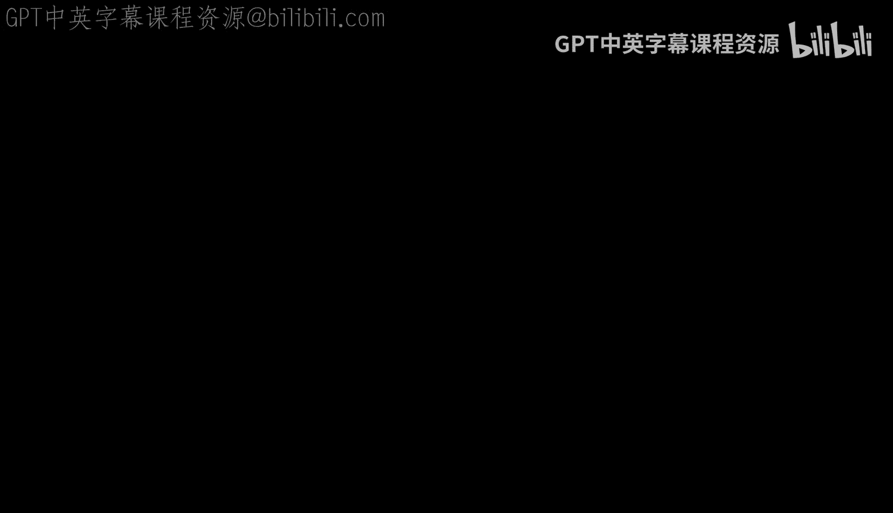
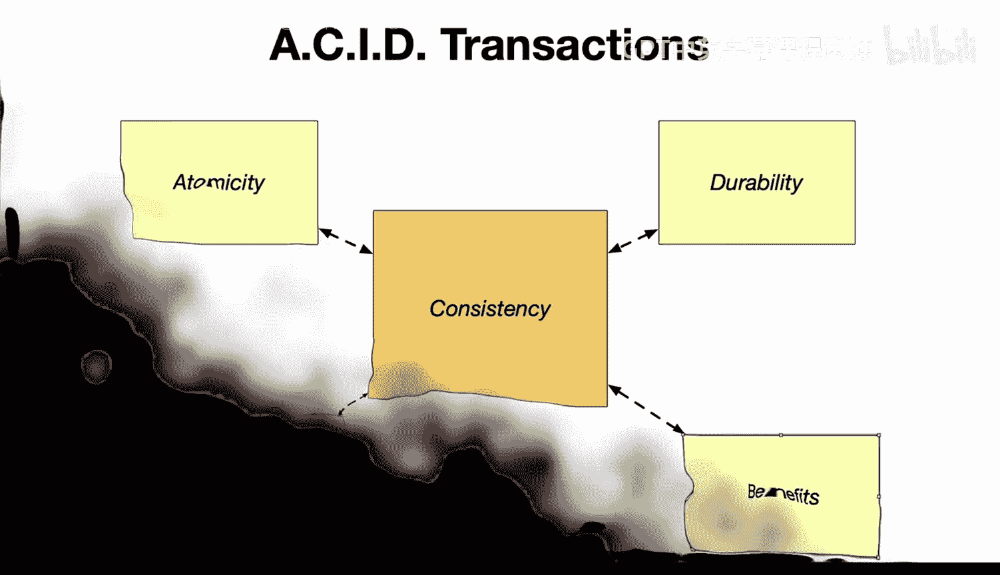

# 杜克大学《大型语言模型实践（高级数据工程、AWS、Databricks和本地LLM）｜Large Language Model Operations 》 - P125：24_01_08_ACID事务.zh_en - GPT中英字幕课程资源 - BV1oi421Q7GT

Here is an explanation of acid transactions。 It stands for four key components of a transaction that make it a unique type of transaction。

 First off， we have atomicity， this is ensuring all the operations in a transaction succeed or fail as a single unit so you don't have an unstable state。

 everything is either successful or failure， there is no partial state that's saved it's an all or nothing operation with consistency any Delta lake transaction。

 we take the database from one valid state to another valid state， for example。

 we also see this with traditional SQL systems。In terms of related data， so for example， the tables。

 they're going to be kept consistent after the transaction。

 this is very different than No SQL databases which have eventual consistency。

There is isolation as well with acid transactions， this means that concurrent transactions and queries are not going to interfere with each other。

For example， if there is an uncommitted change or there's an intermediate state。

 and the changes will remain isolated until they're committed。Durability is another one。

 so once a transaction commits， the changes are persisted durably， and they survive failures。Also。

 the committed data will never be lost so some of the benefits include data integrity across batch and streaming。

 you also have the ability to query consistency with snapshots。

And there's fault tolerance because you can have durable logs。 Finally。

 you have reliable data delivery。 So it's really the highest standard in terms of data quality is to have the ability to do asset transactions。

 There's some things you lose by it。 For example， the scalability aspects are limited because of that consistency。

But in terms of data quality， asset is really the gold standard。

