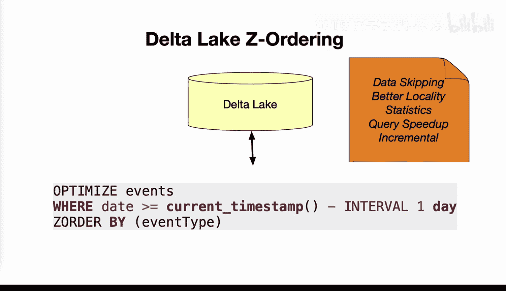
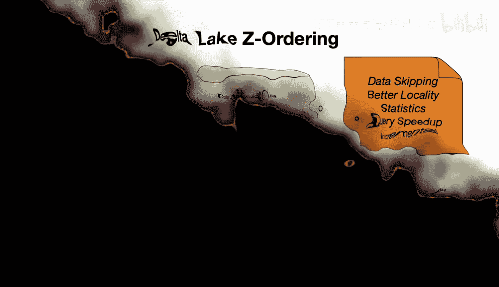

# 杜克大学《大型语言模型实践（高级数据工程、AWS、Databricks和本地LLM）｜Large Language Model Operations 》 - P126：25_01_09_Z-Order排序优化.zh_en - GPT中英字幕课程资源 - BV1oi421Q7GT

。What is Z ordering， This is an important technique for Delta Lake。

 and it collates related information in the same set of files。

 So this collocality is automatically used by Delta lake on Databricks data skipping algorithms and this means that it can dramatically reduce the amount of data that deta lake on databricks needs to read。

 So if we take a look at this SQL query here， you can specify the columns to order in the Z order by clause。

 So we see optimize events where date greater than or equal to current timestamp interval one day。

 And here we get into the magic。 let's go ahead and use Z order by event type。

 So some of the things that you can expect is that。

When you're using a query prediction and the column has high cardinality。

 so a large number of distinct values then the Z order really comes into play and it helps you out in terms of being able to skip certain parts of the data so really if we look at the key characteristics here it is automatic data skipping this means that the deelta lake collects Minmac stats on rights to enable predictive pushdown also happens transparently without extra configuration and it skip scans irrelevant to the data at the query time。

Next up， we have better locality as well。 so this means it colocs the related column values within the same data files。

 It also provides a major boost to skipping effectiveness and you can specify the columns that you want to use the Z order by Also the statistics are great as well because it gives you a configurable statistics collection and it defaults to the first 32 columns in the table schema。

 but you can customize it via the columns property and you can avoid high cardinality。

Tex textexual column so the last two things here to mention are there are significant query speedups so there's much less data needed to be scanned it's particularly effective with specific queries and especially the selective specific queries。

And it translates to lower cost， total cost of ownership。 And finally， it's incremental。

 So there's an incremental reoptimization。 You can apply the Zordering after major backfills。

 You can rerun it when the data distribution changes significantly and you can even test the queries to quantify the performance gain。

 So it's a nice trick to have in your toolkit when you're using Delta Lake on the Databricks platform。

😊。

