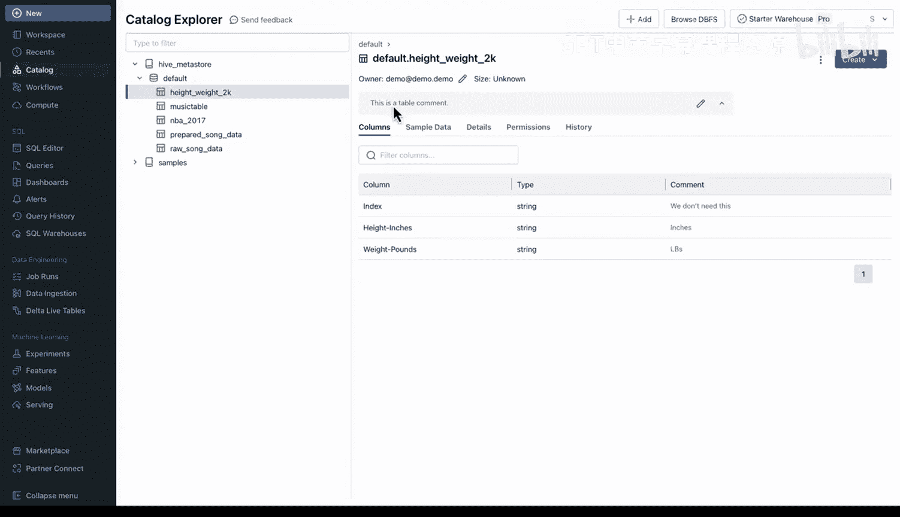
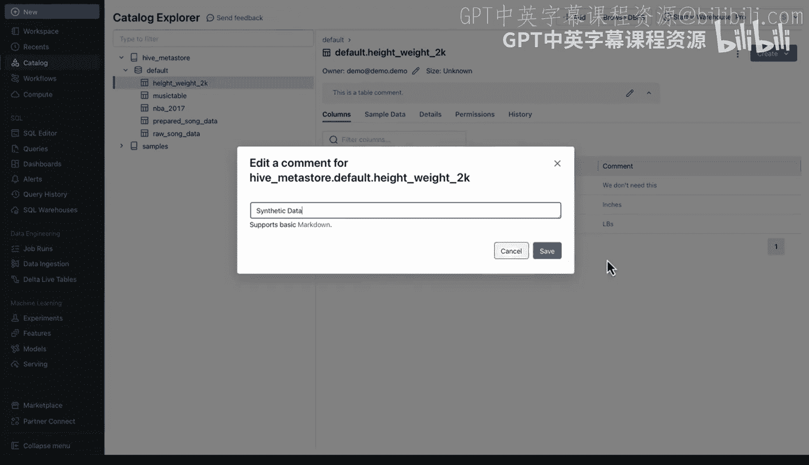
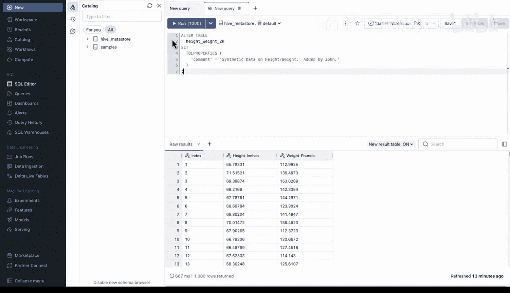
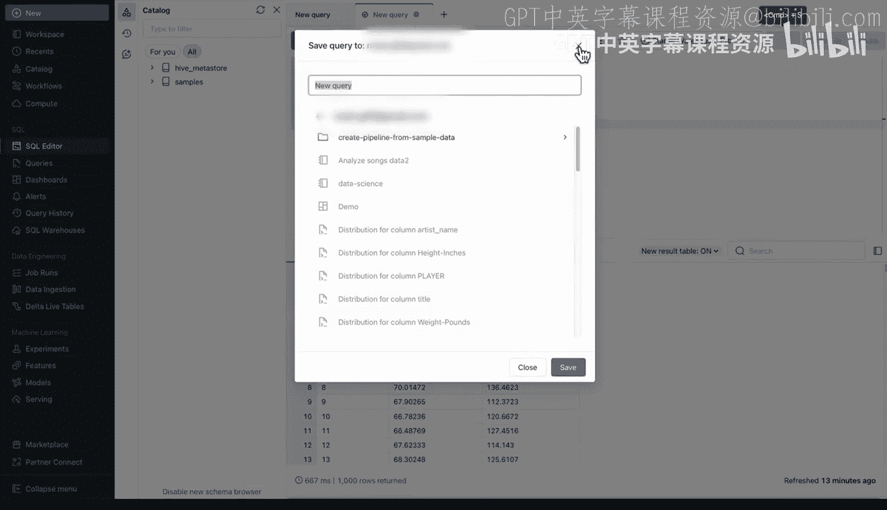
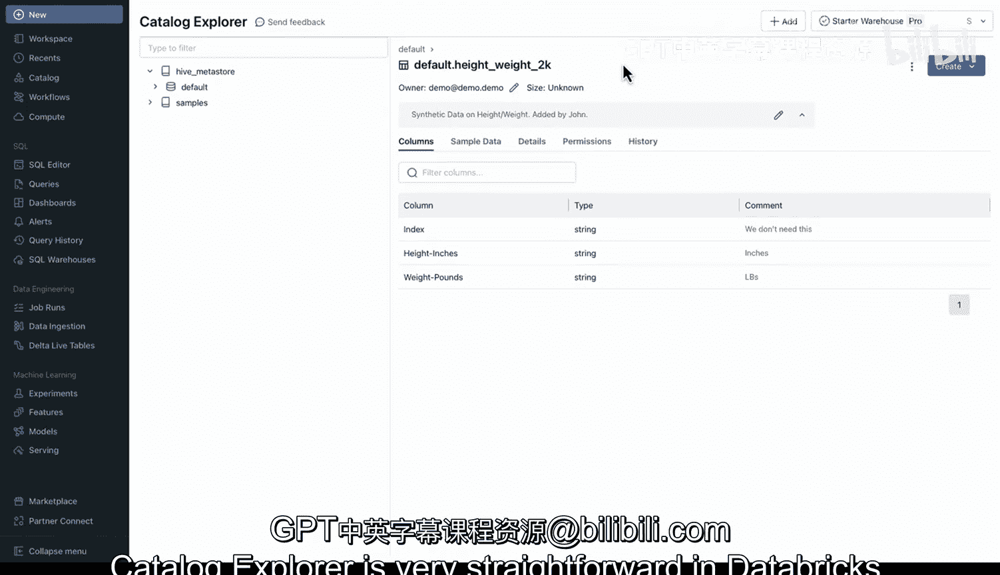

# 杜克大学《大型语言模型实践（高级数据工程、AWS、Databricks和本地LLM）｜Large Language Model Operations 》 - P127：26_02_02_表文档化.zh_en - GPT中英字幕课程资源 - BV1oi421Q7GT

。Here we have catalog Explorer。 and what I'm going to do is add documentation to a table。

 There's a couple ways to do this。 First， we can go look at a table and I'm going to take this height weight table here and notice that it says this is a table comment。

 So let's go ahead and change that and just say that it is synthetic data。

Right， so I've been able to enhance the table comment here， which is great。

 but a lot of times you don't always want to point and click and change things。

 you want to be able to programmatically。

Interact with a table。 So what we can do is go to create and go to SQL query here。

 and we can actually manipulate this by doing a SQL query。 So what I can do is I can say， let's。

 let's go ahead and take this default SQL statement out and do an alter table here。

 So what I can do is I can say。😊，Alter。Table。And we're going to go ahead and select this one。

Which is the height here。And next， I'm going to change the property。 So I'm going to say set。And。

I'm going to do a table properties。There we go and notice that I can actually put inside of here。

What it is I need to do in this case， I'm going to say comments， so I'll add a comment to this。

And it will say maybe something different， say synthetic。Data。On。Height， weight， right？Added。By John。

So we've got some comments here， let's close out with a semicolon and now if I wanted to as well。

 I could save this and we could just call this a default query as well。

 so let's go ahead and alter the table。

We'll see the result here。 Great。 I was able to alter it now。

 how do I programmatically also see what happened？ Well， fortunately。

 it's pretty straightforward as well。 What we can do is just do a change here where we describe the table。

 So let's go ahead and go back to this。😊，Go to。Describe。And we'll say， describe extended。

And this will give me the ability to see the extended attributes of the table。

And we see that it is index， height， weight， right catalog。 But notice here that we also have。

A comment on each of these。 And then in terms of。The actual comment on the table。

 we can see my new comment is actually kept there as well。 So this is a great interface。

 If you have some SQL experience to document your tables， I mean。

 why not have really good documentation。 And， of course， if we need to go back here。

 All I need to do is actually go back to that table name here。😊，And if we select this。

 we can say open in catalog Explorer。And then once I'm in catalog Explorer。

 I can use those same techniques as well， right， I can visually see that that comment has been made。

 So documenting tables either in SQL or catalog Explorer is very straightforward in Databricks。

