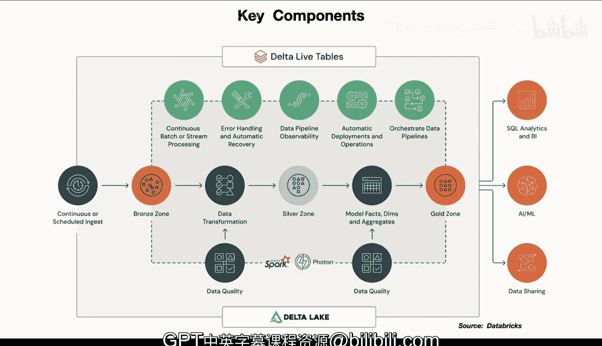

# 杜克大学《大型语言模型实践（高级数据工程、AWS、Databricks和本地LLM）｜Large Language Model Operations 》 - P129：28_02_04_Delta Live Tables组件解析.zh_en - GPT中英字幕课程资源 - BV1oi421Q7GT

Here we have the key components of Delta live tables， and you can see。

 as you incorporate the best practices， you can move from the bronze zone。To the silver zone。

 to the gold zone， if you see the differences here are that， let's say， for example。

 in the silver zone， you're able to get the whole data pipeline observability functioning at the end of the gold zone。

 you're able to have automated deployments and operations。 So ML ops or data ops。

 and you're also able to orchestrate your data pipelines。

 This leads to better results in SQL analytics in B， AI and Ml， and also data sharing。😊。

So if we walk through this diagram here， you can see that efficient data ingestion is a big component of Delta Live tables。

 the autoloader has incremental landing， and this is in the bronze layer and the instion from diverse sources like clouds storage or CDC or message buses。

 and you can load the data in a very simple way for the entire data team from SQL users to engineers。

Next up we have intelligent data transformation and this means streamlining architectures using streaming tables and views and this would have the ability to have quality enforcement。

 also flexible， continuous or triggered pipeline execution and you could leverage the performance optimizations of Sp structured streaming Next step you have a simplified pipeline management。

 and this means handling orchestration， monitoring， failure， CICD， version control。

 autoscale your infrastructure， for example， with infrastructure as code。

 and also allowing the focus on business logic rather than just operations。

And then with the Lake House Pla integration， the Unity catalog is useful for data discovery governance。

 and then the Delta Lake is the reliable storage layer and it works across multiple cloud environments and in terms of the business impact you would be able to have faster development velocity。

 easy scaling to manage increasing data volumes and also you would accelerate timed insight across an organization。

 really what this means is that you're able to reduce the pipeline total cost of ownership through automation。

 really that's the final gold zone。

