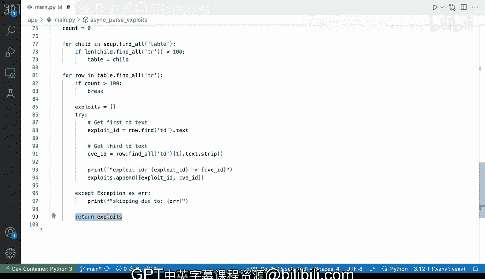

# 杜克大学《大型语言模型实践（高级数据工程、AWS、Databricks和本地LLM）｜Large Language Model Operations 》 - P12：12_01_07_在Flask中定义Celery任务.zh_en - GPT中英字幕课程资源 - BV1oi421Q7GT

There are different ways where we can define a task with salary and flask and in here I'm going to show you more in detail kind of like what we've already seen for in this application so let's start with the send email when' I send a quote unquote email we're going to fake send an email I fake that process and let's see how it works so first this is going to be synchronous and like I said that is going to call our async send email and that delay is the key here that is going to ensure that that's going to go into the background iss going to go into salary is' going to use the queue and it's going to get process later。

And the way we're going to do this we're going to use this shared task now why are we using shared task。

 it is a convenience thing if you want to get into more production details on how to configure salary。

 it will probably not be using shared task which is essentially just saying whatever it is。

 the local rabbit MQ existing， let's just pick the first one。

 let's connect with that one we're good to go。And in here what we're going to do is we're going to take the arguments that are going to come in from the previous function and then that's it we're going to just say return success true like it's zero processing is's going to make it super super easy。

 super straightforward and and then that's it so in here it's essentially you can do whatever extra processing you may want so there are other types of more complex operations that you can do and here is one that the real world one that I want to show you where we're parsing some exploits the exploits are coming from the exploit D from a vulnerability report which is a very rough piece of HTML that we're gonna to parse and then at the very end we're going to return a task ID so let's take a look at the shared task right here so we're going。

To go to this URL。And that's the exploit DVHt of a website that when I look at。

 we're going to use a beautiful soup for doing some parsing。

 we're going to scrape that content out and we're going to take a look at the tables， the table rows。

 and we're going to capture the information。And that information is going to take some effort because the HTML is very rough and we'll see how that works later。

 but all these things that are defined inside these share tasks well these are examples of things that you can do either fire and forget or things where you might want to capture the information later here I'm actually returning the exploits。

 you could actually connect salary and to a backend so that you can store that process information later but you can also trying to make make things here make things happen in this case I'm just returning the exploits and making it super simple and we're going to take a look at how that is going to work next。

