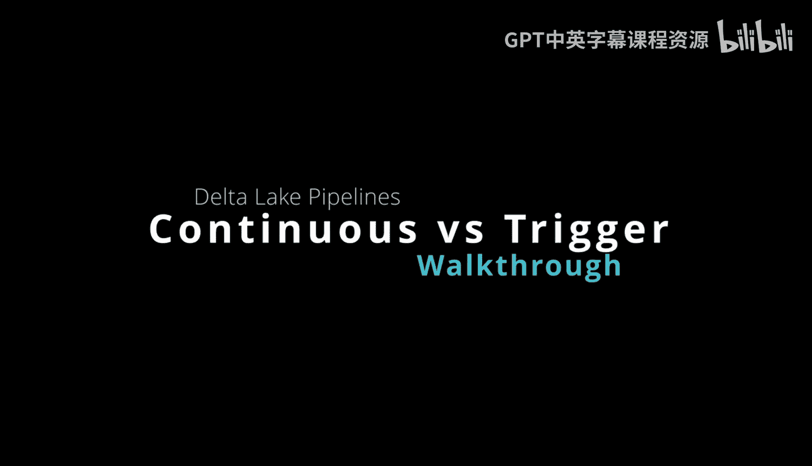
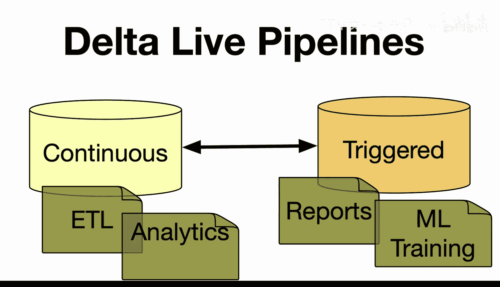

# 杜克大学《大型语言模型实践（高级数据工程、AWS、Databricks和本地LLM）｜Large Language Model Operations 》 - P130：29_02_05_持续管道与触发式管道对比.zh_en - GPT中英字幕课程资源 - BV1oi421Q7GT

Let's take a look at two different Delta live pipelines first up here we have continuous。

 the idea with a continuous pipeline is that data is processed from sources continuously as it arrives so streaming data。

New inserts and updates are incrementally synced to target tables。It also enables realtime ETL。

Extract transform load and also realtime analytics。

 So the use cases for this would be a metrics dashboard。

 Let's say you wanted to know what revenue is being generated on an hourly basis or even realtime。

 This would be a great use case or fraud detection in real time you want to see what fake credit card numbers are being entered。

 You could have a fraud detection system via this continuous pipeline。

 Now triggered pipelines are a little bit different in that the data is processed during scheduled windows instead of continuous。

 So this means that let's say once per day。 You would do some operation and the windows can be scheduled via cr schedules。

And this allows for batch or periodic processing in a logical manner like hourly， daily， weekly， etc。

And these use cases would include aggregated reports or even ML model training。 for example。

 maybe once per day as you get an update， you have a small machine learning model that you rerun and that's done via this triggered window。

 Now you could also consider that continuous is going to have lower latency but would require more resources。

 So this could cost much more money and triggered is more cost efficient for batchbased workloads。

 So you can also combine the approaches based on。The consumption that you're seeing。

 and you could also change maybe make a pipeline configuration update。

 and you could actually try one version versus another version。 So they're both great technologies。

 and it's up to you to figure out how to put the best use case in for both。

While also monitoring the cost and the benefit to your organization。

