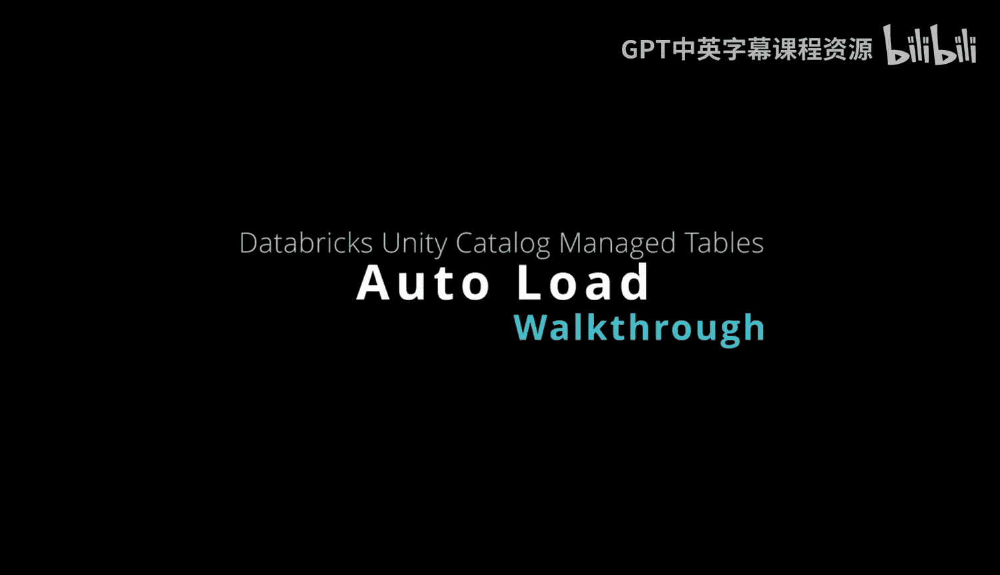
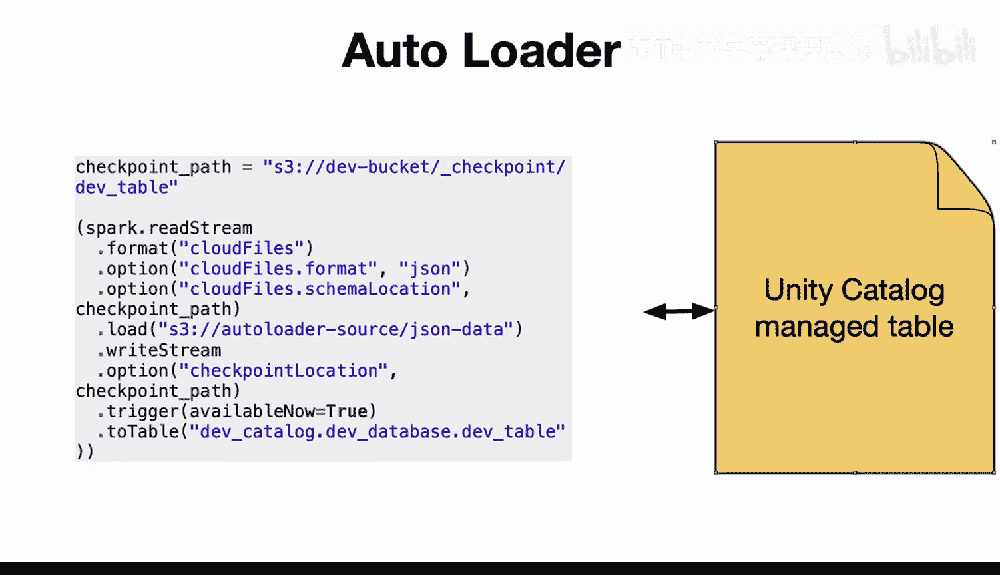

# 杜克大学《大型语言模型实践（高级数据工程、AWS、Databricks和本地LLM）｜Large Language Model Operations 》 - P131：30_02_06_配置自动加载器.zh_en - GPT中英字幕课程资源 - BV1oi421Q7GT

The auto loader allows you to securely ingest data from external locations。

As long as you have the unity catalog here's some key talking points to be aware of First up。

 there is the source configuration。 This means support for cloud storage。 the database。

 the messaging system you can handle various data formats like JN， parquet， CSv。

 and also there is credential management for secure connectivity。

 The incremental data loading is another important aspect because it persists the cursor state for each source。

 and you're only going to get the latest inserts and updates pulled in and it's going to be a lot faster and efficient for full loads for transformations。

 you could execute a query on a source system。 you can apply filter and aggregation a conversion。

 you could also change into delta for reliability as well。

 in terms of monitoring there are dashboards that can track the pipeline health， you can get alerts。

 there's also detailed debug logs as well。 And then in terms of scheduling。

You can set schedules with crons or trigger or continuous execution and then have built in dependency management across jobs。

 So really straightforward here to build this kind of code you can see in Python just a few lines。

 and then you're able to take advantage of the advanced capabilities of the unity catalog to manage that table。

