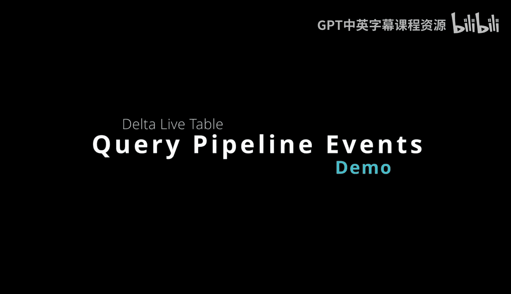
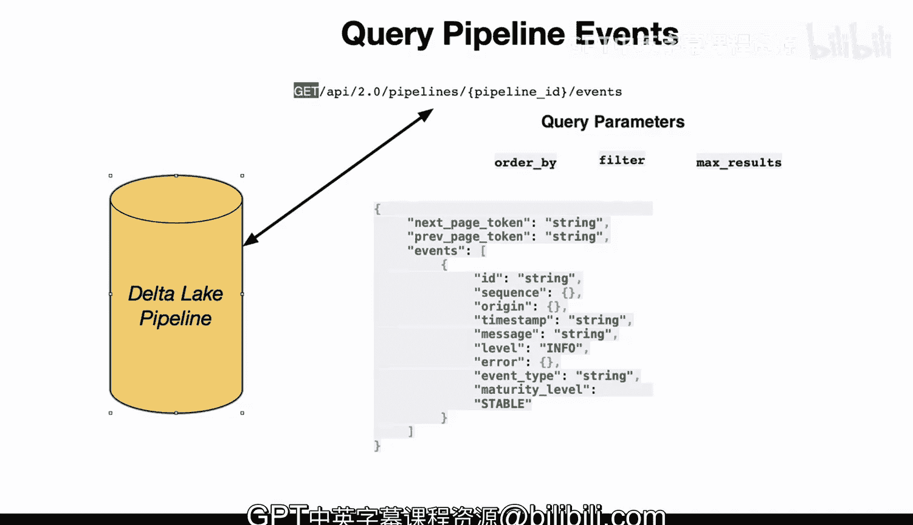

# 杜克大学《大型语言模型实践（高级数据工程、AWS、Databricks和本地LLM）｜Large Language Model Operations 》 - P132：31_02_07_查询管道事件.zh_en - GPT中英字幕课程资源 - BV1oi421Q7GT

Yeah。Here we have a query around the API for pipeline events and a Delta Lake pipeline notice here how you can do a gi request go to API。

 the second version or whatever version of the future。

 look at the pipeline passing the pipeline ID and then get these events there are three different query parameters as well including order by filter and max results and you can see this sample JO payload that gives you some of those items so in a nutshell there are CrD APIs for Delta Live table pipelines you can manage permissions to control access。

 you can remove the pipeline execution events and metrics you can monitor pipeline status and health and you can handle the lifecycle via start stop and reset commands in terms of the DBFS the API also is similar there are basic file system operations。

 the Crd operations to DBFS downloading and uploading also listing files and contents setting ACL。

Permissions and then programmatically accessing the DBFS from jobs so the common capabilities are there's granular validation and air handling。

 structured request response， standard HP code so it can work with many different languages and there's pagination support via tokens so this is easy to integrate into a customized CICD workflow and also build custom tooling and automation。

