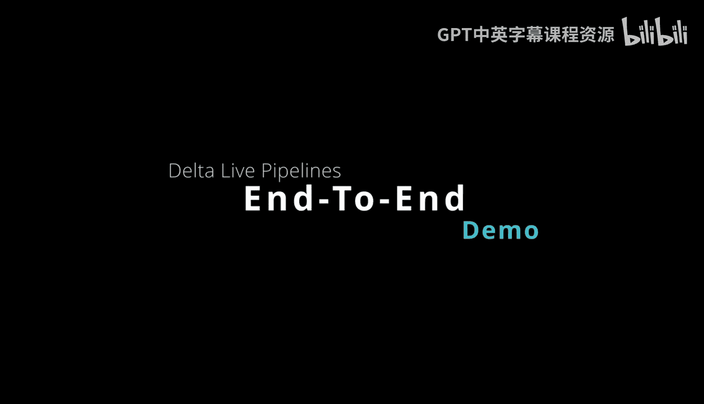

# 杜克大学《大型语言模型实践（高级数据工程、AWS、Databricks和本地LLM）｜Large Language Model Operations 》 - P133：32_02_08_Delta Live端到端示例.zh_en - GPT中英字幕课程资源 - BV1oi421Q7GT

Here we have a in the end example with a Delta Live table inside of the workflows interface。

And notice that there are these initial components that show us what's happening。

 So in terms of data quality， we can see that 100% of the code was written。

we toggle down to the next section， Also 100% 4000 items。

 We can go to the quality here as well and we can see that the expectations。 we have some drops here。

 there's no failures so what's nice about an Indian pipeline is we can inspect each part of the pipeline and get granular ability to look at the data quality look at the details。

 the schema， the flows and even toggle between the development and production and we also can see this from this menu as well so it's going to show when the pipeline is starting when it's running。

 when it's completed and we can also see the updates as well so an Indian solution has a lot of monitoring and observability of the pipeline。

 this can be invaluable when there's very complex things happening potentially there could be a problem in the middle here。

 how do you know if it even failed this is a improvement over a bunch of scripts that are cobbled together because you don't know what's happening。

In the scripts。So the observability of the data pipeline is one of the strengths of these Delta live tables。

 and you're able to do this inside of the interface and also schedule it in the future。

 also started on demand。