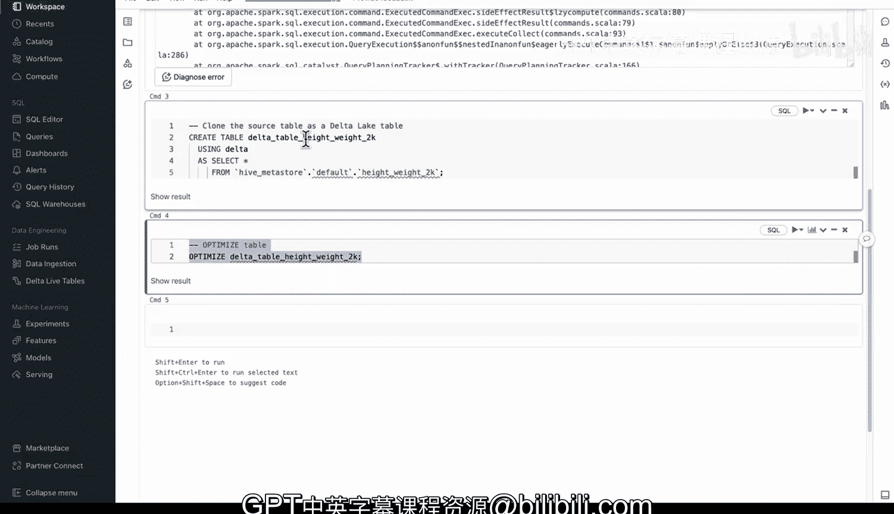

# 杜克大学《大型语言模型实践（高级数据工程、AWS、Databricks和本地LLM）｜Large Language Model Operations 》 - P134：33_02_09_Vacuum与垃圾回收.zh_en - GPT中英字幕课程资源 - BV1oi421Q7GT

Yeah。If we take a look at vacuuming and garbage collection in Delta Lake。

 vacuuming will remove older versions of data from Delta Lake tables that are no longer needed based on retention policy so it could save storage costs and it can be done automatically and then in terms of garbage collection。

 this would remove the underlying data files that are no longer referenced by any snapshots。

 some of the benefits include storage costs are going to be reduced because the unused table versions of data files improving performance and so the used database vacuum。

 these are some of the commands that we need to know about now first though let's look at a table that's not at Delta Lake table if we click on this thing。

Take a look at， in fact， the details here。And we can see， look， it's a very simple amount of details。

 and it says type external。Let's take a look at a table that I copied and converted to a Delta Lake table。

If we look at the details。You see that， in fact， it says tight manage。 So by default。

 a managed table is a Delta lake table。 And so what this means it has all these fancy capabilities like time travel。

 But we're also going to need to manage it in the case of vacuum in a garbage collection。

 So how do we do this。 Well， let's move over to some code here。 And let's pretend that。

We do a select right。 We look at this default table here that isn't a Delta lake table。 Well。

 what could we do， Well， we could try to optimize it， but notice that this won't work。

 we see this giant trace back here because it's not a Delta table。

 So the optimized command would go through and garbage collected。

 but it's not going to work because it's not yet a delta table So how do I change this， Well。

 if I go to Delta Lake table here， right， I can say create table and I could create a copy of the existing table。

And we can do this by creating a new table。 So we say create table Delta table height weight2 K using Delta as select star from。

 and then this is the path of my original table。 Once I've done that now we have a Delta like table。

 which again， we can go through and we can see here， this is a Delta like table。And then likewise。

 I could actually go through and do the optimize setting。 I also could vacuum it as well。

 These are all the things that you can do once you have the ability to do Delta lake table operation。

 So if you do have an existing table that you want to change， right。

 you can just make a copy of it and convert it into a Delta Lake table。

