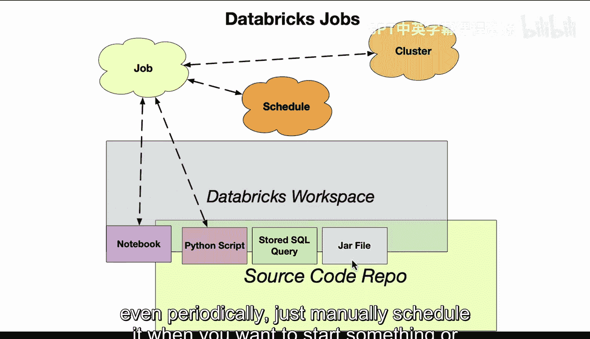
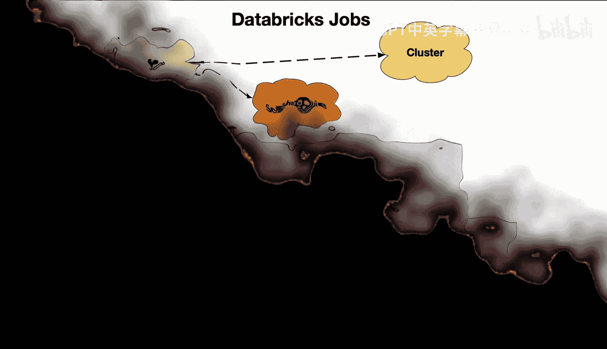

# 杜克大学《大型语言模型实践（高级数据工程、AWS、Databricks和本地LLM）｜Large Language Model Operations 》 - P135：34_02_03_使用作业编排工作负载.zh_en - GPT中英字幕课程资源 - BV1oi421Q7GT

Here we have a databricks jobs overview。 Let's take a look at what a typical job would look like。

 So let's say that I wanted to interact with a notebook。 this notebook could， for example。

 do ETl operations or maybe create some new tables or just some data。

 It could even create a dashboard automatically， that is a great thing to do manually。

 but it's even better if you're able to automate it。

 So that's where the jobs comes in is that what I can do is I can set up a new job here and then hook it up to the notebook that I've already created in。

 for example， source code repo。 So notice here that we have the ability to look at the databricks workspace。

 So that's a kind of a default place。 But I also could point the jobs to the source code repo。

 So this is gonna be a best practice here。 I would check in that notebook。 again。

 it could potentially create some new tables and just some data， maybe create a dashboard。

 and then finally I'll go ahead and I'll schedule that job to run。😊。

SaEvery day and this could be a great way to give a report to maybe somebody on the business team。

The other thing that will need to do is actually decide what is the cluster that needs to be involved in order to do all of the diskcoo。

 the computation。 And so that'll be an ephemeral job that will launch a cluster once the job is finished。

 the cluster will actually spin back down。 Now there are other things you can do beyond just a notebook which is very useful。

 You could point it to a Python script， which again should live in a source code repo。

 but it could also live in Databricks workspace。 you could also build out a very sophisticated SQL query that did a bunch of different things in your organization again。

 check that into a source code repo where it could even point directly into Databricks workspace and you could actually save previous SQL queries and point to it a final thing that could be pointed out is that you also could have a jar file so。

JaA has the ability to have portable runtime， you could create this jar file。

 have it waiting there ready to go and that could do an detail operation so there's a lot of flexibility and there's even different targets beyond these targets when you're setting up Databrick's jobs but what's great is that you're able to put this all into a uniformed and automated ecosystem so that you are able to look at everything that's happening when the job runs。

 debug it， schedule it or even periodically just manually schedule it when you want to start something or you want to build a batch-based operation。

