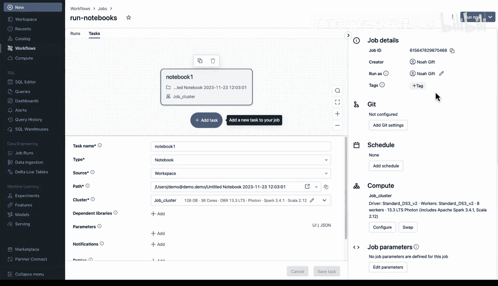
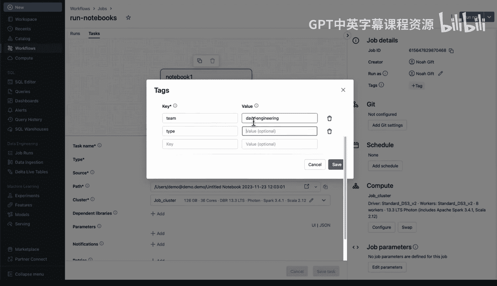
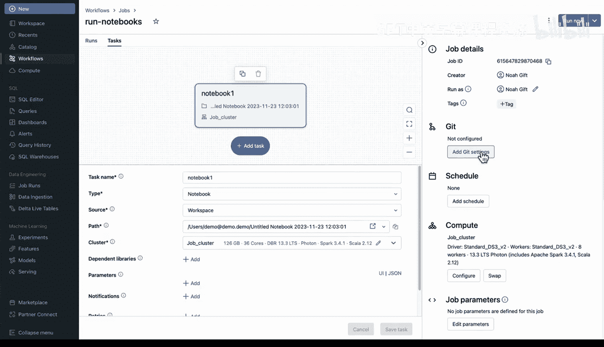
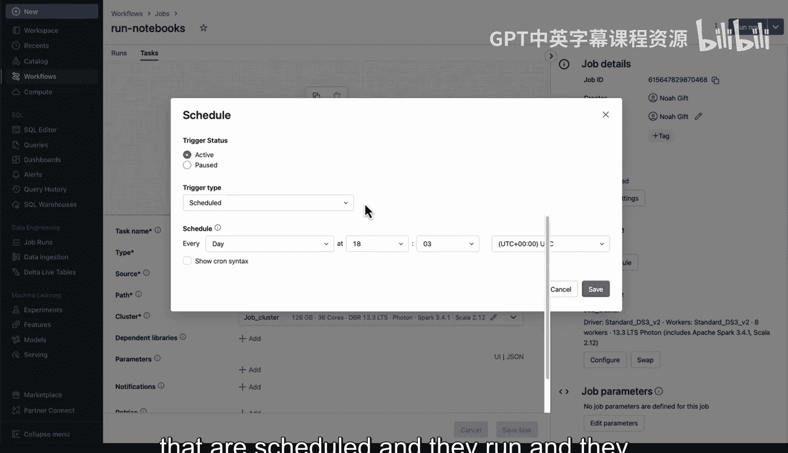
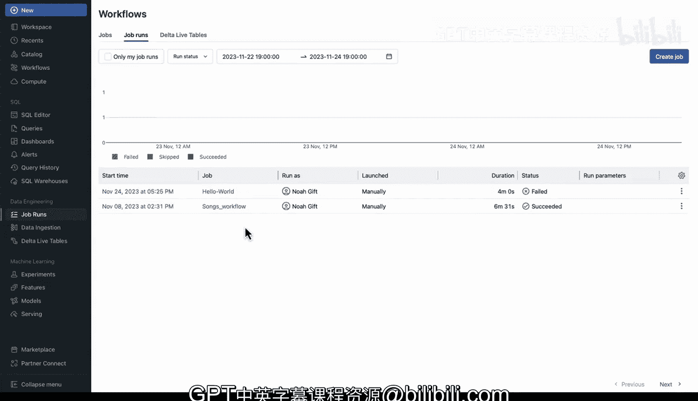

# 杜克大学《大型语言模型实践（高级数据工程、AWS、Databricks和本地LLM）｜Large Language Model Operations 》 - P136：35_02_04_Databricks作业演示.zh_en - GPT中英字幕课程资源 - BV1oi421Q7GT

Here we have the main interface， and we're going to take a look at how to create a new Databricks job。

 I'm going to go to workflows。And inside the workflows。

 we have several jobs that are already available。 So if I wanted to filter through。

 let's say thousands or tens of thousands of jobs。You know， if I typed in hello， right。

 I'm only going to see that interface。 So this could be a very helpful way to。

Look through lots of jobs。 if you're in a bigger organization。

 it's very likely that you could have tens of thousands of jobs。 Now， in order to create a new job。

 though。All that would need to do is select this create job window。 Let's go ahead and click this。

 And now we have this new interface and we can name the job。 So we'll call this one run notebook。

And what's nice about this is that we can then go through here and create a task by task setup so you can create an initial task and then link a second task or a third task or a fourth task。

And potentially we could even say this run notebooks， right。

 so it would signify that we would run multiple notebooks。 So first one， we could call this。

 you know， notebook one。And then。From here we could look at the type。 So notice here under type。

 we have notebooks， Python scripts， Python wheel， SQL， Delta live tables pipeline， DBT， jar。

 Sp submit， run job if else conditions and these if else could be really handy if you're going to do something that needed to wait for certain resources or there was a condition that you needed to match here。

 So there's lots of options。 We're going to go ahead and and stay with notebook。

 Now notice here under source this is where you would also。

Take a look at you know what is actually the source for your notebook is it going to be in a Git provider。

 so Gitlab， for example， or GitHub Bi bucket， AWS code commit。

 or is it going to be inside of the Databricks Workspace itself。

I think most mature organizations probably are going to be pointing to a Gi provider here。Now。

 once you've done that， you would just go ahead and pull up the path to a notebook in this case。

 I could select， for example。Maybe a data science notebook or a demo notebook。

 whatever it is that I'm going to build， we'll go ahead and pick this demo notebook。

And then notice here as well， that。There's a default job cluster。 we could use this。

 We also could use an existing all- purposepose cluster。

 The difference here is that in the case of the all purposeurpose cluster。

 this could be running for maybe data analysis already。

 And so we potentially would want to already use it what's nice about the job cluster though is it's ephemeral and that it'll spin up。

 do the job and then spin back down so we could go ahead and leave that and then you could add other things like notifications。

 for example， you could also ask you know retriize duration threshold。 So lots of options here。

 when you're actually working with the jobs interface So once this task is created。

Then you could again add another task right and so you could just link them again over and over and over again Now also if we take a look at some of these things here。

 you can see the job details you could add tags to it， for example。

 maybe this is going to be the team and this will be data engineering。

And maybe you could add another tag which would be you know type， etc， anyway。

 as you go through here and you add your tags， these could be useful in sorting through things。

 you could also hook this into get to make sure you have this checked in because it could be a complex schedule and then also in terms of the trigger type you could do scheduled or continuous if you do schedule here。

 notice how you could actually build it in Ch syntax so this is really common for dataan engineerings to have pipelines that are scheduled and they run and they do some operation at a certain time per day。

That's definitely one of the ways to do it。 And then finally once once you've done it。

 you also if you wanted to could just go ahead and select run now Now let's look at the interface here for previous job runs。

 So let's go ahead and take a look here and we can see here that this is a nice overview of some of the things are happening if you're working at a large organization you'll be able to see lots and lots of runs and you may even want to you know。

 look at the different statuses here， a sort by failed and so we see one here it's failed what's happening So if I take a look at this failed job here。

And we take a look at what happened you can see here that look it was terminated while it was waiting to be ready。

 so the cluster there was maybe not enough quota for this particular job and so I could debug that and figure it out so it's a great interface not only to create the job。

 but also to look at previous jobs make sure that you understand which ones are failing。

 which ones are skipped， which ones have been successful and in a large organization。

 you need a jobs management framework like this so you can orchestrate in a reliable way many different parts of your pipeline if you don't have automation for the jobs workflow。

 it's going to be incredibly difficult to get anything done and in a more sophisticated organization you're going to need to both automate and schedule these jobs as well as be able to monitor and observe exactly what's happening。

