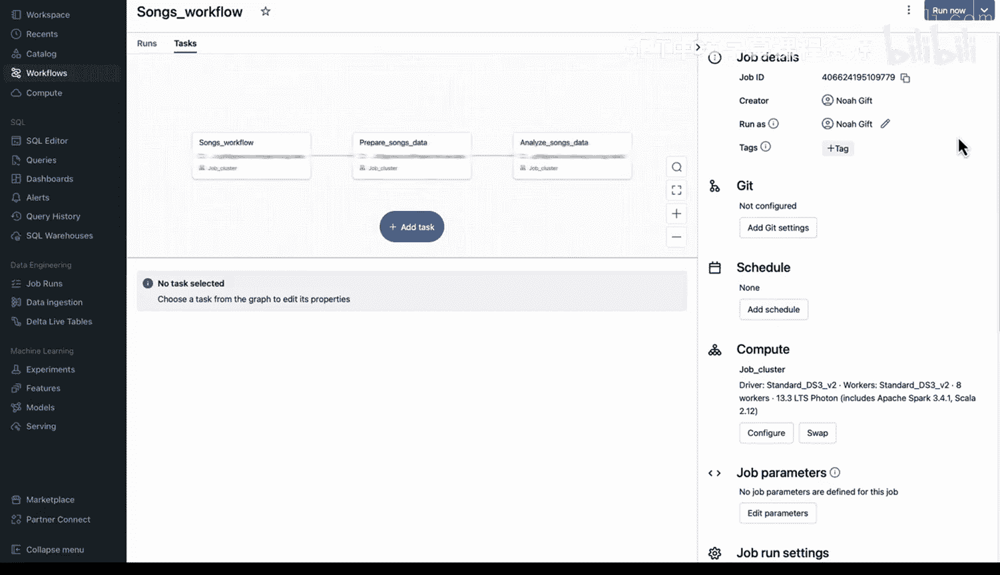
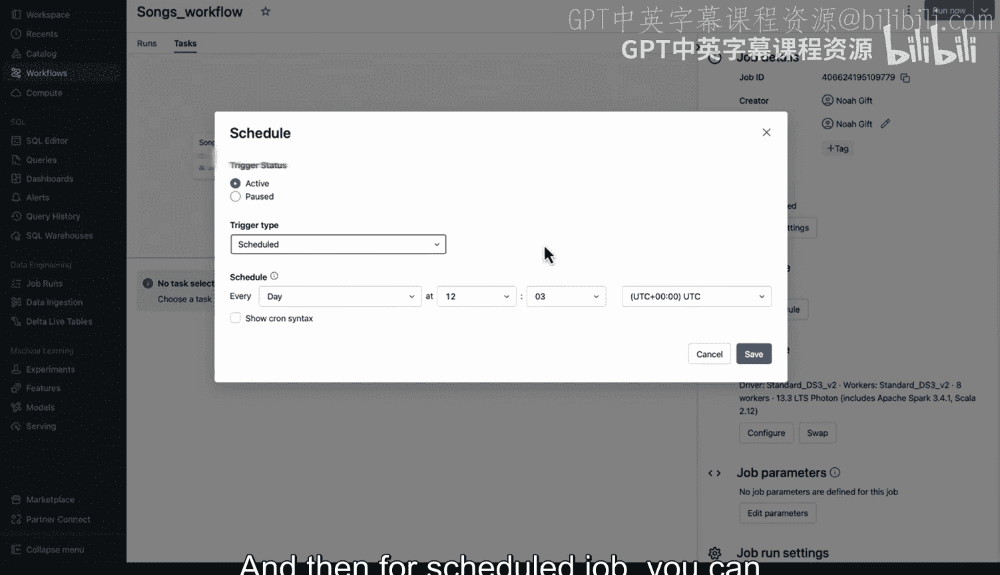
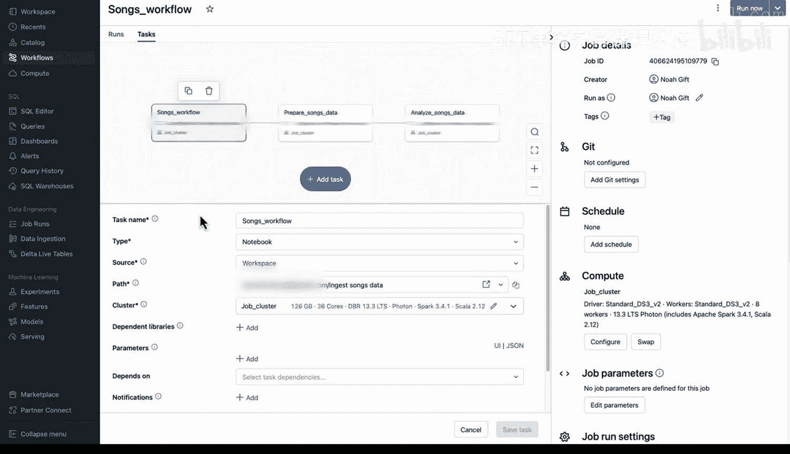
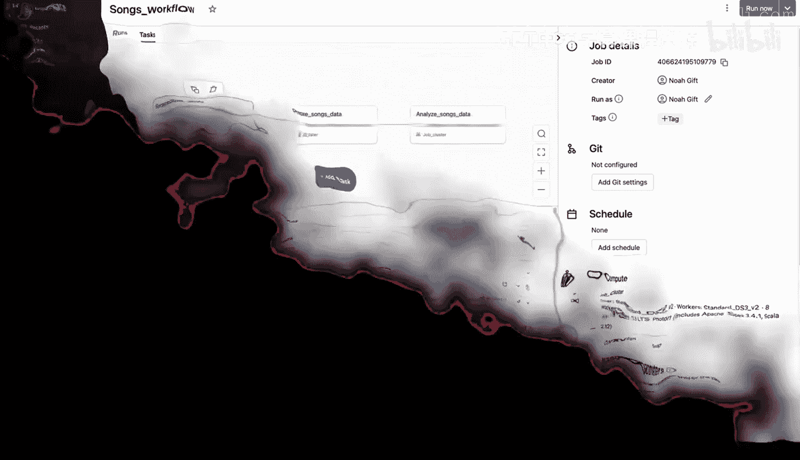

# 杜克大学《大型语言模型实践（高级数据工程、AWS、Databricks和本地LLM）｜Large Language Model Operations 》 - P137：36_02_05_多任务工作流.zh_en - GPT中英字幕课程资源 - BV1oi421Q7GT

Let's take a look at a multi task workflow for jobs。

 so I'm in the workflow interface right here and we can see that there are multiple tasks that are set up。

 we have a ingestion。Then a preparation step and then an analysis step。 right。

 So there's three different tasks。 If I wanted to add another task， I could do that as well。

 Once you're in this multitask interface， the other thing you can do is add a schedule。

 So this schedule could be something where you would trigger continuously and you can see a continuous job is always running。

 And so in that case it could be maybe something for a dashboard or streaming data。

 And then for scheduled job， you can also do this at a periodic interval and even toggle between Chon syntax。

 really the advantages with a multitask setup is that you can break each of these notebooks up into an individual piece。

 We can take a look at this for example， in one of these tasks that I point it to the path where my notebook lives。

 I then point it to the job cluster and I also have the ability to toggle between the different types here。

 So in this case， we're doing a。

BookBut it could be a Python script， a jar file， it could be a Delta Live tables pipeline。

By allowing yourself to break the problem into multiple pieces it's going to be a lot easier to debug。

 both when it's running and also when you're coding up the solution。

