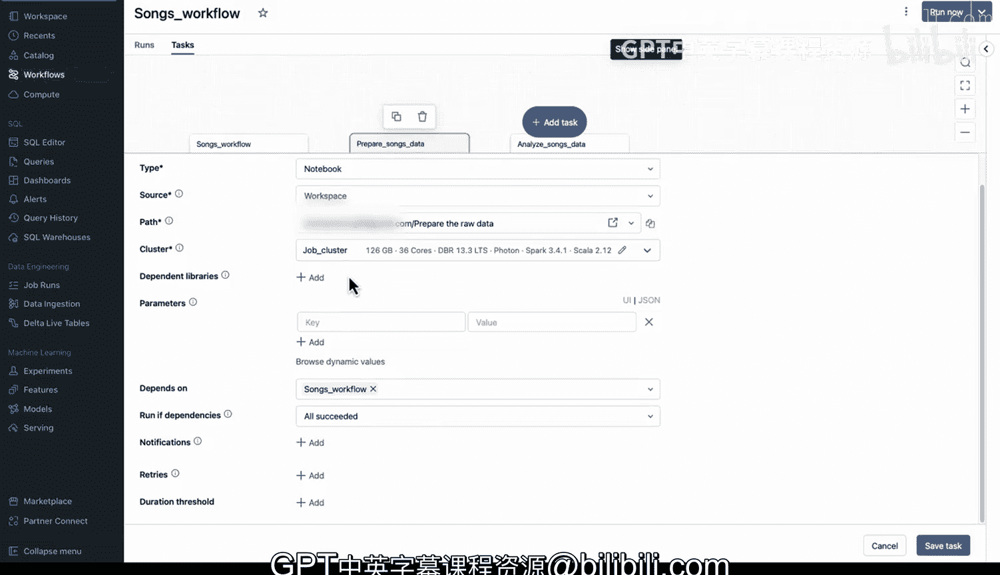

# 杜克大学《大型语言模型实践（高级数据工程、AWS、Databricks和本地LLM）｜Large Language Model Operations 》 - P138：37_02_06_任务依赖关系.zh_en - GPT中英字幕课程资源 - BV1oi421Q7GT

Here we have a workflow that involves multiple tasks。

 that's one of the things you can do with the jobs framework。 We have a songs workflow。

 a prepare songs data and analyze songs data task。 each of these tasks if I toggle through has different types of dependencies notice at the very end here。

 that this one actually depends on the previous task Likewise， if I go to this。

 it depends on the task before it。 So this is part of building a task pipeline that involves multiple steps is that you have to wait until the previous step is complete。

 and when it's successfully completed then it will proceed to the next step。

 This is where also you have to be careful of other tasks dependencies other than just the tasks themselves。

 Some of the things that they could involve and involve dependent library。 So for example。

 you may want a library loaded in。Must be automatically attached to the cluster so this is very important or your job would fail。

 Likewise there may be certain parameters that need to be passed if we go through here and we add it could be a parameter that needs to be in finally if you look at some of the other things as well that are dependencies you may want to also look at the cluster itself and so the cluster may involve things like a GPU or a certain version of Spar so it's important to be able to really dive into all of the different task dependencies。

 the task themselves， the libraries also when you look at the cluster doesn't have the appropriate runtime and these are some of the key things to watch out for when you're looking at task dependencies。

