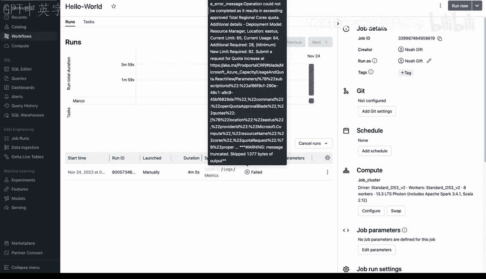

# 杜克大学《大型语言模型实践（高级数据工程、AWS、Databricks和本地LLM）｜Large Language Model Operations 》 - P139：38_02_07_查看作业历史.zh_en - GPT中英字幕课程资源 - BV1oi421Q7GT

Let's take a look at how to monitor job history。 We'll go over to workflows here and notice we have all these jobs which have some history in the fact that they show the last run whether they failed or succeeded。

 so that's pretty useful right， we could go through here and just look at the jobs themselves and find ones that have problems and here we see there's an issue where there was a cluster was terminated in a state that was unexpected because of a quota So this could be something that would debug but if we take a look here and we go back。

 this is definitely an easy interface， but a more comprehensive is job runs So if we go to job runs here notice that it shows us the status right so we could actually look at failed we could look at active we could look at completed So this is actually a much more robust way to take a look at things because we can sort by the status So if you have hundreds and hundreds of jobs each day which。

In bigger organizations， you would。You would go down here and toggle through maybe look at the failed jobs and say okay let's go ahead and take a look at how we can resolve this again I could see the date that it was resolved as well as the status so some of the easy ways to dive into this are to go again to the workflows interface take a look at the last run that gives you a nice overview when you're getting into more of a statusbased approach then look at the status here go ahead and potentially look at all the failed statuses dive into them click on the job。

 see what happened。Dive into the status message itself。

Debug it and then move on to your next solution。

