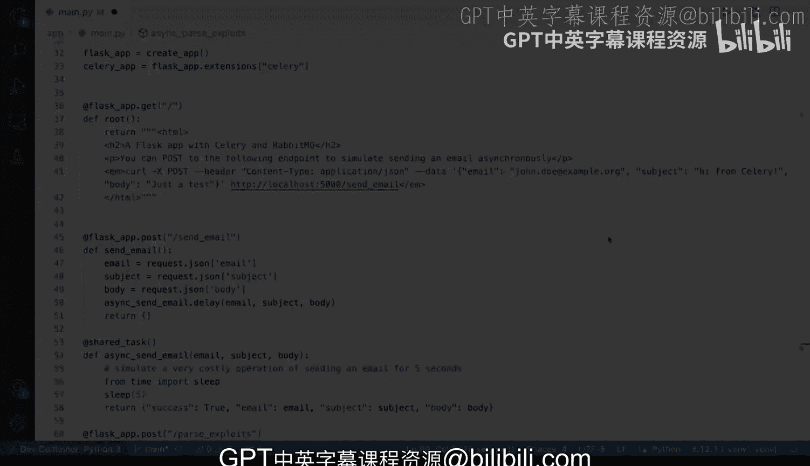
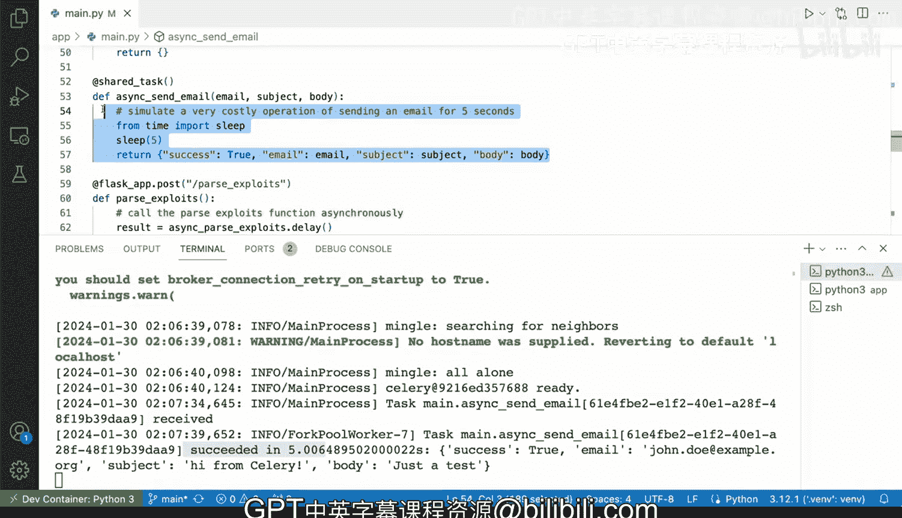

# 杜克大学《大型语言模型实践（高级数据工程、AWS、Databricks和本地LLM）｜Large Language Model Operations 》 - P13：13_01_08_Flask中的即发即弃任务.zh_en - GPT中英字幕课程资源 - BV1oi421Q7GT

What we're going to do here， we're going to well， essentially take a look at our information here that I put in the HTML and we're going to do a curl request So before we do that I'm going to toggle the terminal and in the terminal I'm going to first Well I'm going to start the salary application and now that the salary application is running。

 I'm going to start a flask application and that is running on4 5000 I'm not going to open it right now so that is running and I'm going to make a post request。

 So if you see here where we were before we're going to do we're going to run this exact same this exact same example I'm going to copy that put it here let's quickly go exactly what's happening here。

 we're going to do a post request we're going to do Jason we're going send a couple。

Things here is the email is going to be Johndo an example org subject high from salary and the body a test。

 I'm going to use the local host or 5000 and email endpoint so perfect I'm going to run that and I'm going get nothing in return and you can see that if I go here。

 this is what is getting returned。 So no nothing， nothing got delayed。

 nothing was blocking even though I am explicitly sleeping here for five seconds。

 So how is that possible Well let's take a look at what salary salary was doing。

 So you can see here success true and that is actually what。Where we started processing。

And that succeeded and you can see the can you tell how many seconds it took well it took five seconds that that's how many seconds that's how many seconds I slept for So the process left and this is a typical fire and forget type of task a nonblocking task and you're finally seeing how we're getting an asynchronous request sending some information。

Simulating some deep processing here that would take five seconds and salaries submitting that to RaM Q。

 no problem and processing that as a response and then succeeding。

